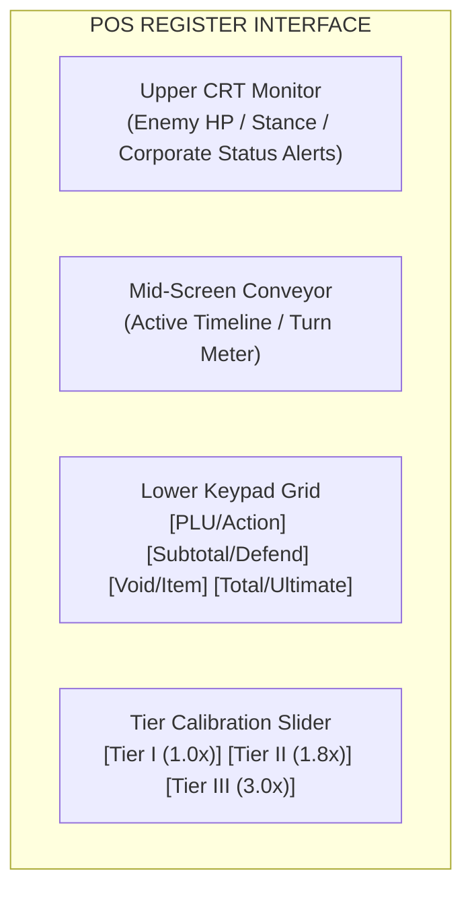

# Retail Inferno — Combat Design & Ability Systems

> **Topic:** POS Terminal Battle System, Department Ability Kits, and Boss Combat Mechanics  
> **Philosophy:** Touch-first on-screen terminal buttons (retaining Tier I–III Calibration timing from engine), satirical retail abilities, and multi-phase end-of-act boss encounters.

---

## 1. Combat Economy & The POS Interface

Combat in *Retail Inferno* represents high-stakes retail confrontations (disastrous customer breakdowns, toxic coworker showdowns, and corrupt managerial audits). The UI is framed as an interactive **Point-of-Sale (POS) Register Terminal**.

### Core Combat Attributes
* **Stamina (HP):** Physical stamina (0–1,000). Reaching 0 causes an exhaustion collapse (Mandatory 15-minute unpaid sit-down in HR).
* **Focus / Patience (MP):** Mental resilience (0–100). Required to execute complex procedural tasks (Overrides, Audits, Hydraulic Pumps).
* **Velocity (Speed / Turn Priority):** Determines turn frequency on the belt timeline.
* **Morale Multiplier (0.5x – 1.5x):** High morale boosts damage and defense; critical low morale (<20%) causes hesitation or missed inputs.
* **Ass-Kissing Meter (Boss Buff):** Filling this bar allows summoning Managerial Intervention or shifting blame to a bystander.

---

## 2. Department Starter Ability Kits

Each of the four department tracks starts with a unique role-based ability kit mapped to the POS Keypad buttons:

### Track 1: Front End (Cashier)
*Archetype: High-Velocity Rapid Striker / Crowd Control*

| Ability Name | Keypad Button | Tier I (Basic) | Tier II (Intermediate) | Tier III (Max Calibration) | Effect / Cost |
|---|---|---|---|---|---|
| **Barcode Whip** | `[ITEM SCAN]` | Rapid scan swipe (80 Dmg) | Double-item scan (160 Dmg) | Lightning multi-scan combo (320 Dmg + Bleed) | Cost: 0 Focus. Builds 15 Velocity. |
| **Price Check Page** | `[OVERRIDE]` | Intercom chime stuns foe for 1 turn | Stun + decreases enemy defense by 20% | 2-turn Storewide Freeze (Manager walks by) | Cost: 25 Focus. 3-turn cooldown. |
| **Coupon Rejection** | `[VOID]` | Parries enemy attack; reflects 30% dmg | Parries attack + restores 15 Focus | Perfect parry; reflects 100% damage + inflicts *Customer Rage* | Cost: 15 Focus. Reaction counter. |
| **Drawer Slam Finisher** | `[TOTAL/SUBTOTAL]` | Heavy metal cash drawer slam (200 Dmg) | Drawer slam + coin shrapnel (400 Dmg) | Hydraulic 100-bill register crush (800 Dmg + Knockback) | Cost: 50 Focus. Requires full Momentum. |

---

### Track 2: Sales Floor (Stocker / Merchandiser)
*Archetype: Heavy Vanguard / Zone Shaper*

| Ability Name | Keypad Button | Tier I (Basic) | Tier II (Intermediate) | Tier III (Max Calibration) | Effect / Cost |
|---|---|---|---|---|---|
| **Box Cutter Slash** | `[PLU ENTRY]` | Quick slice through tape (90 Dmg) | Clean slice; removes enemy buffs | Critical puncture (280 Dmg + Defense Down) | Cost: 0 Focus. |
| **Cardboard Barricade** | `[DEPT LOOKUP]` | Sets up empty flat cart; shields 150 HP | Reinforced double-wall display (Shields 350 HP) | Impenetrable 300-case Pallet Fort (Shields 700 HP + Taunt) | Cost: 20 Focus. Lasts 3 turns. |
| **Shelf Plug Shove** | `[QUANTITY]` | Shoves mismatched stock into foe (120 Dmg) | Hits all adjacent targets with canned goods (220 Dmg) | Massive 50-can avalanche (450 Dmg + Stun) | Cost: 30 Focus. |
| **Flatbed Ramming Speed** | `[TENDER/CASH]` | Heavy iron cart charge (250 Dmg) | High-speed cart drift (500 Dmg + Stun) | Supersonic U-Boat Express (950 Dmg + Wall Slam) | Cost: 60 Focus. Full Momentum. |

---

### Track 3: Backroom (Unloader / Freight)
*Archetype: High-Power Juggernaut / Environmental Hazard*

| Ability Name | Keypad Button | Tier I (Basic) | Tier II (Intermediate) | Tier III (Max Calibration) | Effect / Cost |
|---|---|---|---|---|---|
| **Pallet Jack Crush** | `[WEIGHT]` | Drops hydraulic fork on foe's toes (110 Dmg) | Rapid hydraulic pump strike (220 Dmg) | Full-ton freight drop (450 Dmg + Cripple) | Cost: 0 Focus. Reduces enemy speed. |
| **Shrink-Wrap Cocoon** | `[REPEAT]` | Wraps target with sticky plastic film (Slow) | Immobilizes target for 1 full turn | Complete vacuum seal (Stun for 2 turns + DoT) | Cost: 25 Focus. |
| **Baler Wire Whip** | `[SAFETY STOP]` | High-tensile steel wire lash (140 Dmg) | Sweeping wire arc across all targets (260 Dmg) | Steel garrote snap (520 Dmg + Armor Break) | Cost: 35 Focus. |
| **Compactor Compression** | `[EMERGENCY RUN]` | Hydraulic ram slam (300 Dmg) | Crushing cycle (650 Dmg) | 10-Ton Industrial Baling Press (1,200 Mega-Dmg) | Cost: 70 Focus. Requires full Momentum. |

---

### Track 4: Specialty (Counter Sales — Tech / Deli / Jewelry)
*Archetype: Tactical Saboteur / Status Inflictor*

| Ability Name | Keypad Button | Tier I (Basic) | Tier II (Intermediate) | Tier III (Max Calibration) | Effect / Cost |
|---|---|---|---|---|---|
| **Extended Warranty Pitch** | `[UPSELL]` | Bores foe with terms & conditions (70 Dmg + Confusion) | Traps foe in 3-year protection jargon (180 Dmg + Silence) | Unbreakable 5-Year Accidental Damage Contract (Foe skips turn) | Cost: 15 Focus. |
| **Display Glass Glare** | `[LOCK/KEY]` | Reflects spotlight beam into foe's eyes (Blind) | Multi-angle LED showcase dazzle (Blind 2 turns) | High-Wattage Halogen Flare (Blind + 250 Dmg) | Cost: 20 Focus. Reduces hit chance. |
| **Meat Slicer Sweep** | `[CUSTOM CUT]` | High-RPM stainless steel blade spin (130 Dmg) | Precision deli slice (260 Dmg + Bleed) | Prosciutto Shaving Tempest (550 Dmg + Triple Hit) | Cost: 35 Focus. |
| **Credit Card Application Trap**| `[FINANCING]` | Hands foe a 29.99% APR application (200 Dmg) | Traps foe with hidden monthly fees (450 Dmg + Drain) | Instant Debt Default Catastrophe (900 Dmg + Stun) | Cost: 55 Focus. Steals enemy focus. |

---

## 3. Boss Encounter Mechanics: Acts I & II

### Act I Boss: The Extreme Coupon Glitcher
* **Location:** Front End Register 4  
* **HP:** 1,800  
* **Theme:** Chaotic entitlement, weaponized paperwork, endless transaction voids.
* **Combat Phases:**
  - **Phase 1 (100% – 60% HP):** *The Binder of Doom.* Spams `Expired Coupon Stack` (dealing papercut damage) and `Demand Supervisor` (reduces player's defense).
  - **Phase 2 (59% – 20% HP):** *The Fine Print Filibuster.* Summons a wall of expired mobile app screenshots. Player must hit Tier II or III calibrations on `[PRICE CHECK]` or `[VOID]` to pierce the coupon shield.
  - **Phase 3 (19% – 0% HP):** *The Meltdown.* Screams: *"I HAVE SHOPPED HERE FOR TWENTY YEARS!"* Unleashes multi-target shopping basket projectile attacks.
* **Environmental Hazard:** *Customer Line Sighs.* Every 3 turns, the growing line behind the glitcher sighs loudly, dealing 25 Morale damage to the player.

---

### Act II Boss: Brenda, Senior Cashier (Front End Peer Showdown)
* **Location:** Breakroom / Front Registers Boundary  
* **HP:** 4,200  
* **Theme:** Passive-aggressive seniority, weaponized register lights, returning carts.
* **Unique Boss Stance:**
  - **LANE CLOSED:** Brenda flips her plastic lane beacon off. While in this stance, Brenda takes 80% reduced direct damage and redirects incoming customer attacks onto the player.
* **Signature Moves:**
  - `The Cough Drop Disappearance:` Brenda vanishes from the battlefield for 1 turn; an unruly family of 8 rushes the player's register.
  - `Go-Back Cart Dump:` Hurls an overflowing cart of melted ice cream and motor oil (350 Dmg + Morale -20).
  - `Sweetheart Smirk:` Casts self-heal by snacking on open bulk trail mix from lane 3.
* **Counter-Strategy:** Use `[CARD BARRICADE]` or `[SHRINK-WRAP]` to prevent Brenda from fleeing to the breakroom; break her Lane Closed light with a Tier III Finisher.

---

### Act II Boss: Kyle, Sales Floor Stocker (Sales Floor Peer Showdown)
* **Location:** Aisle 14 (Pet Supplies & Cereal)  
* **HP:** 4,500  
* **Theme:** Vape smoke evasiveness, shelf plugging, shift dumping.
* **Unique Boss Stance:**
  - **VAPE CLOUD SHIELD:** Kyle exhales a thick cloud of strawberry-custard vape smoke, gaining 50% evasion for 2 turns.
* **Signature Moves:**
  - `45-Minute Restroom Retreat:` Kyle attempts to flee the arena. Player has 2 turns to stagger him with `[BOX CUTTER]` or `[PALLET JACK CRUSH]`.
  - `Plugging Avalanche:` Kyle pushes a hollow facade of dog food bags, collapsing 40 boxes on the player (420 Dmg + Slowness).
  - `Half-Eaten Energy Bar Toss:` Sticky trash projectile (180 Dmg + Focus Drain).
* **Counter-Strategy:** Blow away vape smoke with high-velocity attacks; pin him against the heavy endcap before his bathroom timer expires.

---

### Act II Boss: Derrick, Forklift Operator (Backroom Peer Showdown)
* **Location:** Bay 4 Loading Dock & Racking Steel  
* **HP:** 5,000  
* **Theme:** Industrial heavy machinery, hiding equipment, blocking fire exits.
* **Unique Boss Vehicle:**
  - **THE PHANTOM REACH-TRUCK:** Derrick operates a yellow Crown high-reach forklift. Direct attacks hit the steel chassis for half damage until the hydraulic cylinder is targeted.
* **Signature Moves:**
  - `10:55 PM Charcoal Pallet Drop:` Slams a 2,000-lb pallet of Kingsford charcoal onto the concrete, causing a shockwave (450 Dmg to all boots on the ground).
  - `Honk & Speed Away:` Disorients the player with a deafening industrial horn (200 Dmg + Stun).
  - `Hiding the Jacks:` Steals player's equipment, locking their Tier II and III buttons for 2 turns.
* **Counter-Strategy:** Use `[BALER WIRE WHIP]` or `[SHRINK-WRAP COCOON]` on the forklift drive-wheels to stall the motor, forcing Derrick into hand-to-hand combat on the concrete.

---

### Act II Boss: Chad, Specialty Sales Associate (Specialty Showdown)
* **Location:** Electronics Showroom Counter  
* **HP:** 4,600  
* **Theme:** Credit theft, slimy charisma, slicked-back excuses, uncleaned slicers.
* **Unique Boss Trait:**
  - **CREDIT POACHING AURA:** Every time the player executes a high-damage ability, Chad gains a shield equal to 30% of the damage by falsely logging his operator ID into the register terminal.
* **Signature Moves:**
  - `Steal the Close:` Chad steps in front of the player and claims the customer sale, healing himself for 400 HP and draining the player's Focus.
  - `Cologne Bomb:** Sprays a cloud of high-intensity designer knockoff fragrance (320 Dmg + Confusion).
  - `Encrusted Deli Slicer Slash:` Hits with a bacterial biohazard blade (380 Dmg + Poison DoT).
* **Counter-Strategy:** Use `[WARRANTY PITCH]` to lock Chad into a corporate script check; trigger `[PRICE CHECK]` or `[OVERRIDE]` to lock his operator ID and strip his credit shield.
