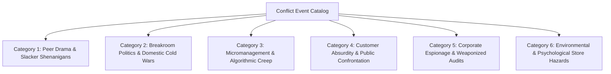

# Retail Inferno — Catalog of Conflict Events & Incidents

> **Repository:** `retail-inferno`  
> **Topic:** Master Catalog of Workplace Drama, Peer Conflicts, Micromanagement, Corporate Espionage, and Dystopian Incidents  
> **Inspirations:** Real retail experiences (r/walmart, retail horror stories, corporate bureaucracy satire)

---

## 1. Overview & Categorization

Conflict events are modular narrative encounters that occur during pre-shift huddles, mid-shift interruptions, breakroom interludes, and closing announcements. They challenge the player's **Morale**, **Engagement**, **Attendance Points**, and **Ass-Kissing Score**, often offering branching choices that define their survival strategy.

---

## Category 1: Peer Drama & Slacker Shenanigans (Primary in Act II)

These events stem from ground-level coworkers dodging labor, shifting blame, and taking advantage of conscientious associates.

### 1.1 The "Phantom Bathroom" Disappearance
* **Trigger:** Mid-shift rush. A two-person task is assigned (unloading a grocery truck or running side-by-side registers).
* **The Incident:** Coworker Kyle or Derrick announces, *"Hey, stomach feels funny, be right back in two minutes."* They vanish into the family restroom for 47 minutes with phone screen glare visible beneath the door.
* **The Conflict:** Line backs up out the door / freight conveyor stalls.
* **Player Choices:**
  - `[A]` **Cover their work entirely:** (Morale -15%, Engagement -10%, Productivity +15). Protects them, but sets a precedent that you will do their job.
  - `[B]` **Page them loudly over the store intercom:** (Morale +10, Peer Standing -20, Kyle becomes hostile).
  - `[C]` **Rattle the bathroom door handle every 5 minutes:** (Morale +5, Slacker Bias +10).

### 1.2 The "Plugging" Discovery
* **Trigger:** Sales floor zoning task.
* **The Incident:** The player finds three full cases of canned dog food shoved completely behind cereal boxes in Aisle 4. Kyle shoved them there at 10:58 PM yesterday to clock out on time instead of taking them to top-stock.
* **The Conflict:** If you leave it, Sales Floor Manager Todd will blame you during his 8:00 AM walk; if you fix it, you lose 30 minutes of your own assigned freight time.
* **Player Choices:**
  - `[A]` **Pull the dog food and work it to the pet aisle:** (Engagement +10, Morale -10, Time Lost: 20 mins).
  - `[B]` **Take a photo on your phone and show Manager Todd:** (Ass-Kissing +15, Kyle marks you as a snitch).
  - `[C]` **Shove two more boxes of cat litter in front of it and walk away:** (Slacker Bias +20, Morale +5).

### 1.3 The Pallet Jack Cold War
* **Trigger:** Backroom freight start.
* **The Incident:** The store owns 14 pallet jacks. Exactly two of them don't leak hydraulic fluid or have bent steering forks ("The Blue Demon" and "Old Reliable"). Derrick has chained "Old Reliable" to a water heater pipe in the compressor room using a personal bike lock.
* **The Conflict:** You have a 2,200 lb pallet of bottled water to move across the store, and the only available jack squeals at 110 decibels and drops 2 inches every 10 paces.
* **Player Choices:**
  - `[A]` **Pick the bike lock with a bent paperclip:** (Acquire item: *Old Reliable*, Backroom Street Smarts +10, Derrick hostility +15).
  - `[B]` **Muscle through using the broken jack:** (HP/Stamina -20, Morale -15, risk of tipping pallet hazard).
  - `[C]` **Wait by the loading dock doing nothing until a manager notices:** (Engagement -20, Slacker Bias +15).

### 1.4 The Commission / Credit Poach
* **Trigger:** Specialty electronics or jewelry counter.
* **The Incident:** You spend 35 minutes answering questions for an elderly couple buying a top-tier \$1,800 OLED TV and soundbar. The moment they reach for their credit card, Chad steps in front of the register: *"I can take over from here, rookie, go take your break!"* and types in his own operator ID.
* **The Conflict:** Chad steals the store credit bounty and monthly quota credit.
* **Player Choices:**
  - `[A]` **Physically body-block the register keypad:** (Initiates mini-scuffle, Chad Morale -15, Manager Julian intervenes).
  - `[B]` **Sweetly ask the customer in front of Chad:** *"Did you want to finish with the associate who spent 40 minutes finding the right cables for you?"* (Morale +15, Chad humiliated).
  - `[C]` **Slump your shoulders and walk away:** (Morale -20, Engagement -15).

### 1.5 The Shift-Swap Amnesia
* **Trigger:** Pre-shift huddle or text message dialogue.
* **The Incident:** Coworker begged you to cover their grueling 6:00 AM Sunday opening shift last week with a promise to cover your Friday closing shift. Friday arrives; coworker calls out or claims, *"Wait, bro, I never said which Friday!"*
* **The Conflict:** You are scheduled to close alone during weekend rush.
* **Player Choices:**
  - `[A]` **Show HR Manager Cheryl the written text messages:** (Cheryl sighs: *"We don't get involved in associate personal trades, sweetie"*).
  - `[B]` **Work the shift fueled by pure unadulterated hatred:** (Morale -25, Energy/Spite +30).
  - `[C]` **Burn an attendance point and walk out at 5:00 PM:** (Attendance +1.0 pt, Morale +20).

---

## 2. Breakroom Politics & Domestic Cold Wars

The breakroom is supposedly a sanctuary, but operates as a passive-aggressive battleground.

### 2.1 The Refrigerator Purge
* **Trigger:** Scheduled 30-minute lunch break.
* **The Incident:** You open the community breakroom fridge to retrieve your meal-prepped pasta, only to find the entire shelf wiped clean. A neon green sticky note reads: *"ANY UNLABELED CONTAINER DISPOSED OF BY 11:00 AM — MANAGEMENT."* It is 11:04 AM.
* **The Conflict:** You have \$3.50 in your bank account and 26 minutes left on your break.
* **Player Choices:**
  - `[A]` **Dig your lunch container out of the top of the trash bag:** (Morale -15, Dignity -20, Hunger cleared).
  - `[B]` **Raid the 'free bread' shelf in the bakery backroom:** (Food Acquired: *Stale Italian Loaf*, Stealth Check).
  - `[C]` **Stare into the empty vending machine and drink cold tap water:** (Morale -10, Nihilism +10).

### 2.2 The Microwave Biohazard Incident
* **Trigger:** 15-minute afternoon rest break.
* **The Incident:** An associate microwaved a foil-wrapped leftover fish fillet for 8 minutes. The breakroom smells like burning harbor docks and the microwave walls are coated in vaporized trout grease.
* **The Conflict:** Associates are actively arguing about who has to clean it; Human Resources Manager Cheryl walks in.
* **Player Choices:**
  - `[A]` **Volunteer to clean it with disinfectant wipes:** (Ass-Kissing +20, Morale -15, Cheryl writes a gold star note).
  - `[B]` **Aggressively pin a handwritten shaming note to the door:** (Breakroom Reputation +10, Morale +5).
  - `[C]` **Take your 15-minute break sitting on a milk crate in the dark outdoor smoking pen:** (Morale +10, fresh air acquired).

### 2.3 The "Pizza Party" Insult
* **Trigger:** End of a record-breaking \$1.2 million holiday weekend shift.
* **The Incident:** Store Manager Henderson announces over the intercom: *"To celebrate 120% metric achievement, management has catered lunch in the breakroom!"* You arrive to find four lukewarm boxes of generic \$5 cheese pizzas from three hours ago, picked clean except for crusts and one cold slice.
* **The Conflict:** Corporate made millions; you received cold breadcrumbs.
* **Player Choices:**
  - `[A]` **Eat the cold crust while smiling at Henderson:** (Ass-Kissing +15, Morale -20).
  - `[B]` **Loudly calculate the hourly profit margin on a napkin for fellow associates:** (Engagement -25, Peer Solidarity +20, Clint notes your name).
  - `[C]` **Pocket three sodas from the manager fridge while nobody is looking:** (Acquire Item: *Looted Energy Drink*, Morale +10).

---

## 3. Micromanagement & Algorithmic Creep (Acts III–IV)

The transition into corporate mechanical oppression.

### 3.1 The IPM (Items-Per-Minute) Speed-Clock
* **Trigger:** Front End cashiering shift.
* **The Incident:** A glowing red LED display is mounted directly above your register monitor. If your scanning speed drops below 22 items per minute (e.g., waiting for an elderly customer to dig for exact pennies), the counter turns amber, then blinks red with a sharp, piercing *BEEP*.
* **The Conflict:** Front End Manager Marsha sprints across the front lanes shouting, *"Scan the barcode! Keep the cadence!"*
* **Player Choices:**
  - `[A]` **Rapidly chuck canned goods down the metal bagging slide like bowling balls:** (IPM rises to 28, Customer satisfaction -20, Morale -10).
  - `[B]` **Spam the 'Quantity' key on 12 identical ramen packs:** (Algorithmic Glitch exploited, IPM skyrockets, Audit Risk +15).
  - `[C]` **Ignore the beeping and deliberately maintain eye contact with Marsha:** (Morale +15, Marsha Stress +25, Write-up Threat).

### 3.2 The 10-Foot Rule / Forced Greeter Stance
* **Trigger:** Sales floor stocking.
* **The Incident:** Corporate policy mandates that every associate must make enthusiastic eye contact and verbally greet any shopper who steps within 10 feet. Sales Floor Manager Todd follows 15 feet behind you with a digital stopwatch to audit your compliance.
* **The Conflict:** You are trying to lift 40-lb boxes of bleach onto top-stock while reciting corporate scripts.
* **Player Choices:**
  - `[A]` **Recite the cheerful script like an automaton to every passing customer:** (Todd nods approval, Ass-Kissing +15, Throat strain -5).
  - `[B]` **Pretend to intensely read the barcode label on a box until the customer walks past:** (Evasion Success, Engagement -10).
  - `[C]` **Ask the customer if they know where to find something because you're lost too:** (Customer laughs, Morale +10, Todd furious).

### 3.3 The Bathroom Break Audit
* **Trigger:** Mid-shift emergency.
* **The Incident:** You return from a 4-minute biological bathroom break to find Sales Floor Manager Todd tapping his digital tablet screen outside the restroom door: *"You clocked out of your work zone at 14:02 and returned at 14:06:45. That is 285 unauthorized seconds."*
* **The Conflict:** Management treating bodily functions as time theft.
* **Player Choices:**
  - `[A]` **Apologize and promise to optimize hydration schedule:** (Ass-Kissing +20, Dignity -30, Morale -15).
  - `[B]` **Offer a medical description of your digestion in graphic anatomical detail:** (Todd turns pale, Morale +25, Todd retreats).
  - `[C]` **Ask if time spent having this conversation is also being deducted from your freight quota:** (Todd vein pops, Defiance +20).

### 3.4 The "Code Spark" Register Hostage Crisis
* **Trigger:** Sales floor or backroom mid-shift.
* **The Incident:** Front End lines back up past apparel. The dreaded two-tone chime sounds: *"ALL AVAILABLE ASSOCIATES TO THE FRONT FOR CODE SPARK REGISTER RELIEF."*
* **The Conflict:** If you go, your freight won't get done and Backroom/Floor Manager will chew you out. If you don't go, Front End Manager Marsha will write you up for insubordination.
* **Player Choices:**
  - `[A]` **Run to the registers and scan frantically:** (Marsha pleased, Freight incomplete, Todd furious).
  - `[B]` **Duck into the compactor room and turn off your walkie-talkie:** (Avoid register chaos, Slacker Bias +15).
  - `[C]` **Walk slowly toward the front, taking 15 minutes to reach the register:** (Arrive right as lines clear, Tactical Genius +10).

---

## 4. Customer Absurdity & Public Confrontation

The frontline horrors that test an associate's sanity and de-escalation limits.

### 4.1 The Expired Coupon Standoff
* **Trigger:** Front End or Specialty counter.
* **The Incident:** A customer produces a crumpled coupon clipped from a newspaper dated November 2014. When informed it expired twelve years ago, they demand: *"It doesn't say which November! The law says you have to honor it or it's false advertising!"*
* **The Conflict:** Line behind them is growing by three people per minute.
* **Player Choices:**
  - `[A]` **Call Front End Manager Marsha for an override:** (Marsha caves instantly and gives it to them for free, Player Morale -20).
  - `[B]` **Break down the grammatical structure of the expiration date with a ballpoint pen:** (Customer rage intensifies, Morale +15).
  - `[C]` **Press the 'Lane Closed' switch and walk away:** (Immediate Chaos, Brenda laughs in the next lane).

### 4.2 The Return With No Receipt / Mystery Fluid
* **Trigger:** Customer service or register return desk.
* **The Incident:** A customer slams a heavily soiled, leaking blender onto the counter: *"It didn't work right out of the box."* The box is covered in garden soil and smells like warm gasoline. They have no receipt, no box barcode, and paid in cash "eight months ago."
* **The Conflict:** Corporate policy forbids accepting hazardous waste; customer threatens to call the Home Office and get you personally fired.
* **Player Choices:**
  - `[A]` **Stand firm on the receipt policy:** (Customer screeches, Morale tested, Policy Shield +10).
  - `[B]` **Issue store credit on a gift card just to make the toxic blender leave your counter:** (Customer leaves, Store Shrink +$49.99).
  - `[C]` **Page Security Manager Clint to the desk:** (Clint emerges from behind a seasonal display like a wraith).

### 4.3 The "I Know the Store Manager" Bluff
* **Trigger:** Any sales floor interaction.
* **The Incident:** A shopper demands that you unlock a high-value display case or discount an item: *"Listen, Henderson and I golf together on Thursdays. If you don't unlock this right now, I'll have your badge by 5:00 PM."*
* **The Conflict:** Store Manager Henderson famously hates sports and spends Thursdays hiding in his office doing payroll fraud.
* **Player Choices:**
  - `[A]` **Offer to call Henderson right now on the storewide loudspeaker:** (Shopper's bluff collapses, Morale +20).
  - `[B]` **Apologize and unlock the case:** (Risk of unattended high-ticket theft, Clint observes).
  - `[C]` **Tell them Henderson was transferred to the Alaska regional office this morning:** (Shopper nods knowingly: *"Yeah, he told me about that"*).

---

## 5. Corporate Espionage & Weaponized Audits (Acts IV–V)

The psychological thriller phase where leadership actively tries to frame the player to cover up executive-level inventory shrink.

### 5.1 The "Sweethearting" Interrogation
* **Trigger:** Summoned to the windowless Asset Protection office in Act IV.
* **The Incident:** Security Manager Clint slides a grainy black-and-white CCTV printout across the desk. It shows an associate scanning a 75-inch TV at Register 4, then bagging it without ringing the payment. The login numbers on the receipt belong to **your employee ID**—from a time you were clocked out on lunch.
* **The Conflict:** Senior Cashier Brenda borrowed your badge barcode to "clear a register jam." Clint threatens to involve local law enforcement unless you sign an admission of liability.
* **Player Choices:**
  - `[A]` **Refuse to sign and demand your electronic time-clock punch records:** (Clint frowns; Paranoia escalates; Defiance +25).
  - `[B]` **Panic and sign under duress:** (Immediate termination trap averted, but you are saddled with a \$1,200 payroll deduction).
  - `[C]` **Point out Brenda's unique leopard-print fingernails visible in the corner of the camera frame:** (Clint's eyes widen; Counter-Investigation initiated).

### 5.2 The Vanishing Pallet Bill of Lading
* **Trigger:** Backroom loading dock, Bay 4.
* **The Incident:** An unmanifested freight truck arrives at 3:15 AM. Backroom Manager Mack hands you a clipboard: *"Just sign this delivery receipt, kid. Don't worry about counting the pallets—Home Office approved the drop."* The shrink-wrapped pallets contain high-value gaming consoles that don't appear in the store's inventory system.
* **The Conflict:** You are being set up as the paper trail for an off-the-books fencing operation.
* **Player Choices:**
  - `[A]` **Sign your own name:** (Trapped in the conspiracy; Mack smiles and slips you a \$50 bill; Corruption +20).
  - `[B]` **Sign the name 'B. Henderson' in sloppy cursive:** (Identity shifted; Mack doesn't check the signature).
  - `[C]` **Refuse to sign without a physical piece-by-piece piece count:** (Mack's friendly demeanor vanishes; Act IV hostility begins).

### 5.3 The Locker Search Raid
* **Trigger:** Shift change in the employee locker hallway.
* **The Incident:** Security Manager Clint and HR Manager Cheryl are standing in front of your personal locker with heavy bolt cutters. They claim an "anonymous tip" reported stolen company property inside. When they open it, an unpurchased high-end wireless headset is sitting on top of your lunchbox—planted by Chad or Kyle.
* **The Conflict:** Blatant frame-job to fabricate a termination paper trail before corporate audit day.
* **Player Choices:**
  - `[A]` **Check the serial number barcode:** (Realize the headset has a clearance sticker from Specialty Counter #3; Chad's department).
  - `[B]` **Demand to review the hallway CCTV camera:** (Clint flatly states: *"That camera has had a lens malfunction since Tuesday"*).
  - `[C]` **Look Cheryl dead in the eye and say:** *"Whoever planted that forgot to remove the employee discount tag from Julian's office."* (Cheryl nervously clears her throat).

---

## 6. Environmental & Psychological Store Hazards (Act V)

The descent into surreal retail horror as the building itself seems to enforce corporate compliance.

### 6.1 The Shifting Aisle Geometry
* **The Incident:** You run an emergency return cart down Aisle 9 (Seasonal). You turn left into Aisle 10, but find yourself staring at an endless row of mirrors and lawn chairs. The overhead exit signs don't point toward the doors; they point in a continuous loop toward Customer Service.
* **The Atmospheric Effect:** Fluorescent tubes hum at varying harmonic pitches; your shadow seems to move half a second after you do.
* **Gameplay Challenge:** Spatial navigation maze. Reading department endcap numbers backwards to find the loading dock firewall.

### 6.2 The Midnight Intercom Broadcast
* **The Incident:** At 3:33 AM during the overnight inventory lockdown, the storewide music stops. The intercom chimes with a low, warped synthesizer tone. A calm, automated corporate voice begins reciting real-time psychological metrics:
  - *"Associate #1042-882: Your heart rate has exceeded optimal efficiency limits. Please regulate your breathing to preserve company oxygen reserves."*
  - *"Reminder: The parking lot is no longer accessible. The perimeter fence has been sealed for product protection."*
* **The Effect:** Morale drains by 5% every 30 seconds unless the player interacts with coffee stations or Donna's breakroom refuge.

### 6.3 The Living Floor Scrubber
* **The Incident:** An automated industrial ride-on floor scrubber was abandoned by the night crew. It begins driving itself down the center action-alleys under the dim emergency night-lights, spraying corrosive wax stripper and violently ramming shopping cart corrals.
* **The Conflict:** It patrols the main corridor connecting the sales floor to the managerial offices, acting as a roaming environmental hazard / mini-boss obstacle.

---

## 7. Integration Matrix (Event Triggering)

| Event Name | Applicable Departments | Target Act | Primary Stat Tested | Primary Antagonist |
|---|---|---|---|---|
| **Phantom Bathroom** | Front End, Backroom | Act II | Morale vs. Peer Standing | Kyle / Derrick |
| **Plugging Discovery** | Sales Floor | Act II | Time vs. Ass-Kissing | Kyle |
| **Pallet Jack War** | Backroom, Sales Floor | Act II | Physical Stamina vs. Slacker Bias | Derrick |
| **Commission Poach** | Specialty | Act II | Morale vs. Assertiveness | Chad |
| **Shift-Swap Flake** | All Departments | Act II | Attendance vs. Morale | Peer Coworkers |
| **Microwave Biohazard** | All Departments | Act II | Ass-Kissing vs. Disgust | Cheryl / Peers |
| **Pizza Party Crusts** | All Departments | Act III | Morale vs. Cynicism | Henderson |
| **IPM Speed-Clock** | Front End | Act III | Speed vs. Customer Care | Marsha / Algorithm |
| **10-Foot Greeter Rule** | Sales Floor | Act III | Stamina vs. Multitasking | Todd |
| **Bathroom Audit** | All Departments | Act III | Dignity vs. Compliance | Todd |
| **Code Spark Crisis** | Sales Floor, Backroom | Act III | Loyalty vs. Self-Preservation | Marsha |
| **Expired Coupon War** | Front End, Specialty | Act I–III | Patience vs. Policy | Extreme Customers |
| **Hazardous Return** | Front End, Specialty | Act II–III | Policy vs. Cowardice | Extreme Customers |
| **Sweethearting Frame** | Front End | Act IV | Paranoia vs. Evidence Gathering | Clint & Brenda |
| **Bay 4 Phantom Drop** | Backroom | Act IV | Morale vs. Complicity | Mack & Henderson |
| **Planted Locker Raid** | Specialty, Sales Floor | Act IV | Defiance vs. False Confession | Clint & Chad |
| **Shifting Aisles** | All Departments | Act V | Navigation vs. Dread | The Store Geometry |
| **Intercom Broadcast** | All Departments | Act V | Sanity vs. Isolation | The Corporate System |
| **Rogue Floor Scrubber** | All Departments | Act V | Reflexes vs. Environmental Hazard | Industrial Machinery |
