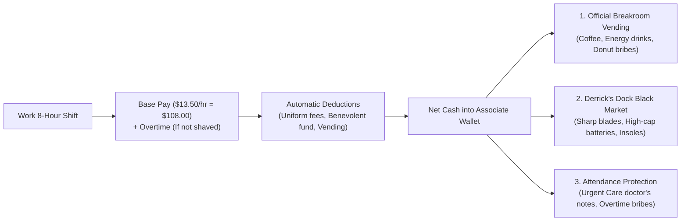

# Retail Inferno — Economy, Store Vending & Inventory System

> **Topic:** Hourly Wages, Paychecks, Deductions, Breakroom Vending, Black-Market Dock Trading, and Locker Storage  
> **Philosophy:** Satirical corporate financial pressure where every dollar earned is squeezed by unapproved overtime shaving, broken vending machines, and mandatory supply rationing.

---

## 1. The Financial Core Loop

The economy of *Retail Inferno* mirrors the tight-rope survival of low-wage retail work. Earnings from 8-hour shifts are balanced against the cost of shift survival tools, vending machine stimulants, and tactical managerial bribes.



---

## 2. The Paycheck & Corporate Deductions System

At the conclusion of each shift (Screen 6: Shift Debrief), a **Thermal Paycheck Summary** is printed:

### A. Hourly Wage Scaling Across Acts
* **Act I (Fresh Blood):** `$13.50 / hour` (Starting base pay; 8 hrs = `$108.00` gross).
* **Act II (Breakroom Politics):** `$13.50 / hour` (*"Annual cost-of-living adjustments frozen due to corporate restructuring"*).
* **Act III (The Corporate Gaze):** `$13.75 / hour` (A 25-cent merit raise granted after the auditor inspection, immediately offset by new corporate fees).
* **Act IV (The Frame Job):** `$14.25 / hour` (Hazard pay / night-shift differential, but scheduled hours are cut to 30 hrs/wk).
* **Act V (The Inferno):** `$15.00 / hour` (Apocalyptic Black Friday surge pay, but leaving the premises is prohibited).

---

### B. The Overtime & "Timecard Shaving" Mechanic
* **Authorized Overtime:** `$20.25 / hour` (1.5x base rate for minutes worked past 8.00 hours).
* **Unapproved Overtime (The Corporate Shave):**
  - If you stay late to finish unloading a truck or clean up Brenda's go-back carts without written authorization from Store Manager Henderson:
  - *The Paycheck Warning:* `SYSTEM ADJUSTMENT: -0.75 HRS OVERTIME SHAVED TO 8.00 HRS MAXIMUM BUDGET POLICY.`
  - **Player Dilemma:**
    - `[Option A]` **Accept the Shave in Silence:** (`Morale -15`, `Ass-Kissing +10`, Money Lost: `$15.18`).
    - `[Option B]` **Confront Cheryl in HR:** (`Morale +10`, `Ass-Kissing -20`, Cheryl prints a mandatory coaching: *"Failure to manage time effectively"*).
    - `[Option C]` **Take an extra 45 minutes on your next lunch break to 'reclaim' stolen wages:** (`Tactical Defiance +15`, risk of Todd's attendance audit).

---

### C. Automatic Corporate Payroll Deductions
Every paycheck itemizes mandatory micro-deductions:
* **Associate Benevolent Community Fund:** `-$1.50 / shift` (*"Supports executive regional retreat catering"*).
* **Uniform Smock Cleaning & Asset Depreciation:** `-$2.00 / shift`.
* **Breakroom Direct-Badge Purchases:** Automatically deducted from net pay if you purchased snacks using your employee ID barcode.

---

## 3. Official Shop: The Breakroom Vending Machine & Coffee Station

Accessible in the Breakroom (Scene 4) and during the mid-shift break:

```
╔══════════════════════════════════════════════════════════════════════╗
║  VEND-O-MATIC 3000 (CREDIT & BADGE TAP)            BREAKROOM #1042   ║
╠══════════════════════════════════════════════════════════════════════╣
║                                                                      ║
║  [A1] LUKWARM INSTANT COFFEE ── $0.75   [A2] TURBO-VOLT ENERGY ── $3.50 ║
║       Restores 25 Focus (MP)                 Restores 60 Stamina (HP)║
║                                              +20% Speed (Crashes)    ║
║                                                                      ║
║  [B1] STALE NACHO CHIPS ─────── $1.50   [B2] BOX OF GLAZED DONUTS $6.50 ║
║       Restores 15 Stamina                    Tactical Bribe Item     ║
║       (25% Coil Jam Risk!)                   (+20 Ass-Kissing / Donna║
║                                                                      ║
║  [C1] ACETAMINOPHEN PACK ────── $2.25   [C2] GRAPHITE LUBRICANT ─ $4.00 ║
║       Cures 'Clopening Hangover'             Fixes sticky lockers    ║
║       and 'Fluorescent Migraine'             (Required for Locker 41)║
║                                                                      ║
╠══════════════════════════════════════════════════════════════════════╣
║  YOUR WALLET: $42.50                  [ 💳 TAP ASSOCIATE BADGE ]     ║
╚══════════════════════════════════════════════════════════════════════╝
```

### Item Catalog: Official Vending
| Item ID | Item Name | Cost | Mechanical Effect | Narrative / Tactical Purpose |
|---|---|---|---|---|
| `item_coffee` | Lukewarm Instant Coffee | `$0.75` | Restores `25 Focus (MP)` | Sustains focus during manager cross-examinations. |
| `item_energy_drink` | Turbo-Volt 300mg Energy | `$3.50` | `+60 Stamina`, `+20% Speed` | Buffs mini-game performance; triggers crash next shift. |
| `item_chips` | Stale Nacho Chips | `$1.50` | Restores `15 Stamina (HP)` | Basic calorie fix; 25% chance to jam in the coil! |
| `item_donuts` | Box of Glazed Donuts | `$6.50` | Consumable Bribe | Hand to Henderson (`+20 Ass-Kissing`) or Donna (`+15 Affinity`). |
| `item_headache_pills` | Acetaminophen Pocket Pack | `$2.25` | Status Cleanse | Cures `Clopening Fatigue` and `60Hz Fluorescent Migraine`. |
| `item_locker_lube` | Graphite Lock Lubricant | `$4.00` | Locker Repair | Opens Locker 41 to discover secret veteran equipment. |

---

## 4. Underground Shop: Derrick’s Loading Dock Black Market

Located behind the outdoor pallet stacks at Bay 4. Derrick accepts cash or barter trades for heavy-duty industrial supplies that corporate refuses to provide.

```
╔══════════════════════════════════════════════════════════════════════╗
║  BAY 4 PALLET CORRAL (DERRICK'S STASH)              LOADING DOCK     ║
╠══════════════════════════════════════════════════════════════════════╣
║                                                                      ║
║  "Keep your voice down. Clint has a dome camera on Bay 3, but the    ║
║   lens is covered in spiderwebs. What do you need, rookie?"          ║
║                                                                      ║
║  [1] ULTRA-SHARP CARBON UTILITY BLADES (PACK OF 3) ───────── $9.00   ║
║      Permanently boosts Box-Per-Minute stocking speed by +25%.       ║
║                                                                      ║
║  [2] HIGH-CAPACITY LITHIUM SCANNER BATTERY ───────────────── $16.00  ║
║      Prevents mid-shift scanner dead warnings; keeps laser at 100%.  ║
║                                                                      ║
║  [3] ERGONOMIC GEL SHOE INSOLES ──────────────────────────── $22.00  ║
║      Passive gear: Reduces physical Stamina drain by 30% all shifts. ║
║                                                                      ║
║  [4] REPLACEMENT POLYURETHANE PALLET JACK WHEEL ──────────── $28.00  ║
║      Eliminates steering wobble and drift in the Pallet Haul arcade.  ║
║                                                                      ║
║  [5] MASTER DISPLAY CASE SKELETON SHIMS ──────────────────── $45.00  ║
║      Specialty gear: Unlocks any glass showcase without manager keys. ║
║                                                                      ║
╠══════════════════════════════════════════════════════════════════════╣
║  [ 💵 PAY WITH CASH ]                  [ 📦 TRADE SMUGGLED CLAIMS ]  ║
╚══════════════════════════════════════════════════════════════════════╝
```

### Black Market Equipment Catalog
| Item ID | Equipment Name | Cost | Type | Permanent Gameplay Benefit |
|---|---|---|---|---|
| `gear_sharp_blades` | Ultra-Sharp Carbon Blades | `$9.00` | Tool Upgrade | `+25% Speed` in box-opening mini-games & `+15 Dmg` to Box Cutter Slash. |
| `gear_lithium_battery` | High-Capacity Battery | `$16.00` | Tool Upgrade | Eliminates random scanner shutoffs; unlocks Tier III Barcode beams. |
| `gear_gel_insoles` | Ergonomic Gel Insoles | `$22.00` | Passive Gear | Reduces walking Stamina drain by `30%` across all shifts. |
| `gear_poly_wheel` | Smooth Poly Pallet Wheel | `$28.00` | Equipment Mod | Removes drifting in Pallet Haul; increases freight stability by `+20%`. |
| `gear_master_shims` | Display Case Key Shims | `$45.00` | Specialty Tool | Bypasses display key search; immune to Julian's key confiscations. |

---

## 5. Attendance Defense Economy: Bribes & Medical Notes

Money directly impacts your survival against the 5-point attendance system:

```
╔══════════════════════════════════════════════════════════════════════╗
║                   ATTENDANCE DEFENSE EXPENDITURES                    ║
╠══════════════════════════════════════════════════════════════════════╣
║                                                                      ║
║  1. URGENT CARE DOCTOR'S NOTE ($55.00 Out-of-Pocket):                ║
║     - If you called out sick and took a +1.0 absence occurrence:     ║
║     - Presenting this note to HR Cheryl legally eliminates the point ║
║       under the corporate medical leave policy.                      ║
║                                                                      ║
║  2. MORNING HUDDLE DONUT BRIBE ($6.50 at Vending Machine):           ║
║     - If you arrive 15 minutes late (+0.5 Tardy Occurrence):         ║
║     - Walking in with a fresh box of glazed donuts for Henderson     ║
║       triggers his "Executive Discretion Override", wiping the 0.5.  ║
║                                                                      ║
║  3. COWORKER SHIFT-COVER BOUNTY ($25.00 Cash + Free Lunch):          ║
║     - Pay a peer (Kyle or Brenda) cash under the table to cover      ║
║       your weekend shift, preventing a dreaded +2.0 No-Call/No-Show. ║
║                                                                      ║
╚══════════════════════════════════════════════════════════════════════╝
```

---

## 6. Associate Locker Inventory Architecture

Managed via Screen 7 (Breakroom Portal). Provides persistent storage across the entire 5-act campaign:

```
╔══════════════════════════════════════════════════════════════════════╗
║  ASSOCIATE LOCKER #42 (CAPACITY: 8 / 8 SLOTS)      STORAGE TERMINAL  ║
╠══════════════════════════════════════════════════════════════════════╣
║                                                                      ║
║  [SLOT 1] 🗡️ Sharp Carbon Blades (Qty: 2)   [SLOT 2] 🔋 Lithium Batt (1)║
║  [SLOT 3] ☕ Thermos Lukewarm Coffee (1)    [SLOT 4] 💊 Acetaminophen (1)║
║  [SLOT 5] 🍩 Box of Glazed Donuts (1)       [SLOT 6] 🗝️ Locker Lube (1)  ║
║  [SLOT 7] 📜 Connex Surveillance Card       [SLOT 8] 🪪 Stolen Master Key║
║                                                                      ║
║  EQUIPPED PASSIVES:                                                  ║
║  - Feet: Ergonomic Gel Insoles (-30% Stamina Drain)                  ║
║  - Vest: 15-Year Anniversary Enamel Pin (+5% Peer Respect)           ║
║                                                                      ║
║  [ 🔒 UPGRADE LOCKER TO 12 SLOTS ($15.00 HARDWARE PADLOCK) ]         ║
╚══════════════════════════════════════════════════════════════════════╝
```

### Save Game Data Contract (`InventoryState`)
Stored inside each employee save slot in `SaveSlotData`:

```kotlin
data class InventoryItem(
    val id: String,
    val name: String,
    val quantity: Int = 1,
    val isEquipped: Boolean = false
)

data class InventoryState(
    val walletCash: Float = 35.00f,
    val maxLockerSlots: Int = 8,
    val items: List<InventoryItem> = emptyList(),
    val unlockedBlackMarket: Boolean = false,
    val lifetimeWagesEarned: Float = 0.00f,
    val lifetimeOvertimeShaved: Float = 0.00f
)
```
