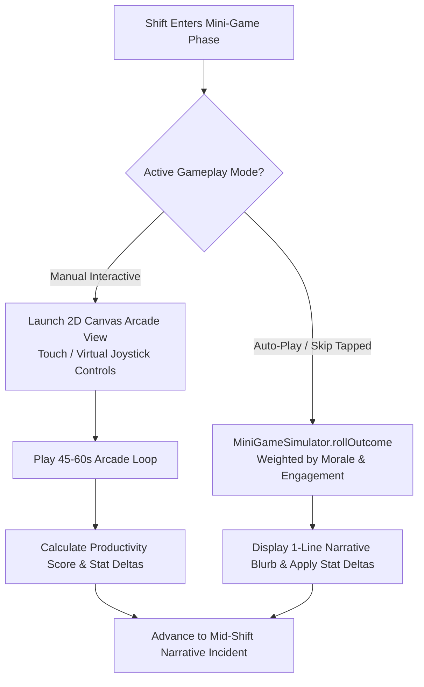

# Retail Inferno — The 4 Mini-Games Technical Specification

> **Topic:** Arcade Gameplay Mechanics, Controls, Physics, Scoring Formulas, and Auto-Play Simulation  
> **Philosophy:** High-production 2D arcade gameplay reflecting genuine retail labor, supporting both interactive touch-controls and instant narrative simulation in Auto-Play mode.

---

## 1. Overview & Arcade Architecture

During each standard shift (Phases 2 and 4), players engage in department-specific arcade challenges. The mini-games serve as the primary source of the player's hidden **Productivity Score (Output/Velocity)** and grant tangible shift rewards while introducing environmental wear on **Stamina** and **Morale**.



---

## 2. Mini-Game 1: Twin-Stick Barcode Blaster (Action Defense)

* **Department Track:** **Front End** (and storewide Black Friday / rush hour sequences)
* **Genre:** Top-down twin-stick action shooter / crowd defense (inspired by *Dead Nation* & *Smash TV*)
* **In-Universe Context:** Swarms of impatient suburban shoppers charge down the checkout concourse. You stand behind the register belts armed with an industrial laser price-scanner and handheld scanner gun, tagging items in shoppers' carts before they crash through the checkout line.

```
╔══════════════════════════════════════════════════════════════════════╗
║ [TIME: 00:45]   ITEMS SCANNED: 42 / 60   REGISTER HEALTH: [▓▓▓▓▓▓▓░░] ║
╠══════════════════════════════════════════════════════════════════════╣
║                                                                      ║
║   (ENTRANCE) ──►  [SHOPPER: COUPON BINDER] ──►                       ║
║                         \                                            ║
║     [SHOPPER: TODDLER CHARGE] ──►             [POWER-WALKER] ──►     ║
║                                                     /                ║
║                   * * * LASER SCAN BEAM * * *                        ║
║                           ▲                                          ║
║                     [PLAYER CASHIER]                                 ║
║               ═══════════════════════════════                        ║
║                 [REGISTER BELT BARRICADE]                            ║
║                                                                      ║
╠══════════════════════════════════════════════════════════════════════╣
║  (VIRTUAL JOYSTICK: MOVE)               (VIRTUAL JOYSTICK: AIM/SCAN) ║
║         [ ◄   ▲   ► ]                            ( 360° LASER )      ║
║               ▼                         [ ⚡ PRICE CHECK EMP ]        ║
╚══════════════════════════════════════════════════════════════════════╝
```

### Mechanics & Shopper Archetypes
| Shopper Archetype | Movement Speed | Durability (Hits to Clear) | Special Behavior / Hazard |
|---|---|---|---|
| **Casual Browser** | Slow (1.0x) | 1 Laser Hit | Wanders erratically; easily tagged. |
| **Power-Walking Dad** | Fast (2.5x) | 2 Laser Hits | Sprints in straight lines directly at Register 3. |
| **Coupon Binder Extremist** | Medium (1.5x) | 5 Laser Hits | Wields paper binder shield; must be flanked or hit with Price Check EMP. |
| **Motorized Scooter Menace**| Slow/Heavy (0.8x)| 8 Laser Hits | Heavy tank; knocks aside other shoppers; deals double register damage. |
| **Screaming Toddler Swarm** | Very Fast (3.0x)| 1 Laser Hit | Tiny hitboxes; scatters random items across the floor. |

### Controls & Power-Up System
* **Left Thumbstick:** Lateral movement behind the register counter.
* **Right Thumbstick:** 360-degree aiming and rapid-fire barcode beam emission.
* **Special Button `[PRICE CHECK EMP]` (Cost: 1 Charge):** Emits a storewide audio chime shockwave that freezes all shoppers on screen for 3 seconds.
* **Scoring Formula:**
  $$\text{Productivity} = \left(\frac{\text{Items Scanned}}{\text{Quota}}\right) \times 70 + (\text{Register Health \%}) \times 30$$

---

## 3. Mini-Game 2: The Pallet Haul / Aisle Dodger (Physics Navigation)

* **Department Track:** **Sales Floor** (and Backroom freight distribution)
* **Genre:** Top-down corridor physics navigation (inspired by *Frogger* & *Overcooked*)
* **In-Universe Context:** Hauling a towering, 2,000-lb hydraulic pallet jack stacked with fragile merchandise through crowded, 6-foot-wide sales aisles without tipping freight or running over customers.

```
╔══════════════════════════════════════════════════════════════════════╗
║ [TIME: 00:52]   FREIGHT INTEGRITY: [▓▓▓▓▓▓▓▓▓░ 92%]   QUOTA: 3 / 4   ║
╠══════════════════════════════════════════════════════════════════════╣
║                                                                      ║
║                     AISLE 6 (SAUCE & PICKLES)                        ║
║                                                                      ║
║         [CAUTION CONE]               [UNATTENDED CART]               ║
║                \                            /                        ║
║                 ═════ [ LEANING PALLET JACK ] ═════                  ║
║                            (PLAYER)                                  ║
║                               |                                      ║
║                       [WET DETERGENT PUDDLE]                         ║
║                                                                      ║
║         [SLOW SHOPPER]               [DISPLAY WATERMELON BIN]        ║
║                                                                      ║
╠══════════════════════════════════════════════════════════════════════╣
║  (VIRTUAL JOYSTICK: STEER)              [ 🛑 EMERGENCY HANDBRAKE ]   ║
║         [ ◄   ▲   ► ]                   [ 📢 'EXCUSE ME' HORN ]      ║
║               ▼                         [ ⏩ SPRINT / HEAVY HAUL ]   ║
╚══════════════════════════════════════════════════════════════════════╝
```

### Mechanics & Environmental Hazards
* **Inertia & Weight Physics:** Heavy pallet jacks carry massive forward momentum. Sudden 90-degree turns cause top-heavy boxes (e.g. glass pasta sauce, bulk olive oil) to wobble. A visible **Stability Needle** swings: if it enters the Red Zone, boxes tumble onto the floor (`-25% Freight Integrity`).
* **Environmental Hazards:**
  - *Detergent Spills:* Causes the jack's poly wheels to hydroplane, locking steering for 1.5 seconds.
  - *Yellow Caution Cones:* Narrow the navigable corridor.
  - *Unattended Grocery Carts:* Obstacles that must be nudged aside slowly or navigated around.
  - *Oblivious Shoppers:* Stand horizontally across aisles looking at cereal.
* **Action Buttons:**
  - `[EXCUSE ME]` **Horn:** Causes shoppers to step aside into shelf nooks. Using it more than 3 times per shift drains `Morale -5` due to customer scowls.
  - `[EMERGENCY HANDBRAKE]:` Halts forward momentum instantly, saving freight from crashing into toddlers at the cost of `Stamina -10`.
* **Scoring Formula:**
  $$\text{Productivity} = (\text{Freight Integrity \%}) \times 0.6 + \left(\frac{\text{Time Remaining}}{\text{Total Time}}\right) \times 40$$

---

## 4. Mini-Game 3: The Baler Compactor (Timing & Pressure Puzzle)

* **Department Track:** **Backroom** (and closing cardboard runs across all tracks)
* **Genre:** Rhythm, sorting, and pressure-management puzzle (inspired by *Tetris* & *WarioWare*)
* **In-Universe Context:** Feeding hundreds of broken-down corrugated cardboard boxes into the towering green industrial hydraulic baler, monitoring ram pressure gauges, swiping away illegal trash, and threading steel tie-wires before safety switches blow.

```
╔══════════════════════════════════════════════════════════════════════╗
║ [PRESSURE: ▓▓▓▓▓▓▓▓░░ 2,100 PSI]   BALES TIED: 1 / 2   [OSHA: SAFE]  ║
╠══════════════════════════════════════════════════════════════════════╣
║                                                                      ║
║  ┌────────────────────────────────────────────────────────────────┐  ║
║  │              INDUSTRIAL HYDRAULIC BALING CHAMBER               │  ║
║  │                                                                │  ║
║  │   [=== HYDRAULIC CRUSH RAM ===]  ▼ ▼ ▼ (CRUSHING DOWN)         │  ║
║  │                                                                │  ║
║  │   [ DENSE CRATE ]   [ SLICED BOX ]   [ APPLIANCE CARTON ]      │  ║
║  │   [ CARDBOARD ]     [ CARDBOARD ]    [ ⚠️ METAL BANDING ] ◄──  │  ║
║  │   ──────────────────────────────────────────────────────       │  ║
║  └────────────────────────────────────────────────────────────────┘  ║
║                                                                      ║
║  CONVEYOR INBOX: [ BOX ] [ BOX ] [ ⚠️ PLASTIC WRAP ] [ HEAVY BOX ]   ║
╠══════════════════════════════════════════════════════════════════════╣
║  [ 🗑️ REJECT FOREIGN OBJECT ]          [ ⬇️ ENGAGE HYDRAULIC RAM ]   ║
║  [ 🧵 THREAD WIRE 1 2 3 4 ]            [ 🛑 EMERGENCY STOP ]         ║
╚══════════════════════════════════════════════════════════════════════╝
```

### Mechanics & Hazardous Materials
* **Cardboard Loading Phase:** Boxes stream across a bottom staging line. Drag cardboard into the compression chamber to fill the volume bar to 100%.
* **Foreign Object Rejection (Anti-Jam Rule):**
  - Rogue items regularly appear on the line: shrink-wrap plastic film, wooden pallet chunks, and metal strapping bands.
  - Players must swipe non-cardboard items into the `[REJECT / CLAIMS]` chute within 1.5 seconds.
  - *Jam Consequence:* If metal or plastic enters the chamber during a crush cycle, the baler violently jams: hydraulic fluid overheats, and Backroom Manager Mack screams (`-20 Morale`, `-30s Timer Penalty`).
* **The 4-Wire Threading QTE:**
  - Once pressure hits `2,800 PSI`, the chamber locks.
  - The player must complete a rapid-fire timing slider QTE: tap when moving needles align with the 4 vertical wire guide slots to loop and tie off the bale.
* **Scoring Formula:**
  $$\text{Productivity} = (\text{Bales Completed}) \times 50 + (\text{Zero Jam Bonus: 30 pts}) + (\text{Wire Precision \%}) \times 20$$

---

## 5. Mini-Game 4: Counter Commotion (Precision Time-Attack)

* **Department Track:** **Specialty** (Electronics, Gourmet Deli, Custom Paint, Fine Jewelry)
* **Genre:** High-stress multi-tasking pattern matching (inspired by *Cook, Serve, Delicious!* & *Papers, Please*)
* **In-Universe Context:** Serving demanding customers across high-margin specialty service counters under impatient gaze.

```
╔══════════════════════════════════════════════════════════════════════╗
║ [TIME: 00:38]   SERVED: 5 / 7       CUSTOMER PATIENCE: [▓▓▓▓▓▓░░░░]  ║
╠══════════════════════════════════════════════════════════════════════╣
║                                                                      ║
║  CURRENT CUSTOMER: "I need exactly 0.65 lbs of smoked gouda, thin,  ║
║                     and don't touch the meat blade with it!"         ║
║                                                                      ║
║  ┌──────────────────────────────┐  ┌──────────────────────────────┐  ║
║  │ ROTARY SLICER GAUGE          │  │ DIGITAL SCALE                │  ║
║  │ THICKNESS: [ 0.5mm ──●── 2mm]│  │ WEIGHT:  0.64 LBS [PERFECT!] │  ║
║  │ BLADE RPM: [ ▓▓▓▓▓▓▓▓▓ 80% ] │  │ TARGET:  0.65 LBS (± 0.02)   │  ║
║  └──────────────────────────────┘  └──────────────────────────────┘  ║
║                                                                      ║
║  SPECIALTY TASKS: [ 🧀 CHEESE SLICE ]  [ 📱 UNLOCK DISPLAY CASE ]    ║
║                   [ 🎨 MIX PAINT ]     [ 💳 PITCH 29% APR CARD ]     ║
╠══════════════════════════════════════════════════════════════════════╣
║  [ 🔪 SLICE / PORTION (HOLD) ]         [ 🏷️ PRINT BARCODE LABEL ]    ║
║  [ 🤝 PITCH EXTENDED WARRANTY ]        [ 🔔 DING SERVICE BELL ]      ║
╚══════════════════════════════════════════════════════════════════════╝
```

### Specialty Sub-Modules by Department Routine
1. **The Gourmet Deli Slicer:**
   - Hold the slice trigger to shave cold cuts onto the digital scale.
   - Release within the target weight window (e.g. `0.75 lbs ± 0.02 lbs`). Under-portioning triggers customer complaints; over-portioning wastes store profit.
2. **The High-Ticket Display Case Key Quest:**
   - Customer wants a \$1,200 smartphone or diamond pendant.
   - Screen displays an array of 6 similar-looking brass keys. The player must inspect the lock cylinder silhouette and tap the matching key within 3 seconds.
3. **The Paint Mixing Color Code:**
   - Rapidly tap primary tint valves (Cyan, Magenta, Yellow, Umber) matching a formula recipe card (e.g., `C-2, M-4, Y-1`), then hold the acoustic shaker button for 3 seconds.
4. **The Mandatory Warranty Upsell QTE:**
   - Before printing the barcode, tap `[PITCH EXTENDED WARRANTY]`. A moving slider targets a sweet-spot: hitting it successfully adds a `+15% Commission Bounty` to your shift paycheck!
* **Scoring Formula:**
  $$\text{Productivity} = (\text{Order Accuracy \%}) \times 60 + (\text{Patience Preserved \%}) \times 25 + (\text{Warranty Upsells}) \times 15$$

---

## 6. Auto-Play Simulation Engine (`MiniGameSimulator`)

When playing in **Pure Story / Auto-Play Mode** (or when the player taps `[SKIP TO STORY]` during arcade gameplay), the engine delegates outcome resolution to the `MiniGameSimulator` component.

### A. Simulated Outcome Table & Probability Weights
The outcome roll is calculated using a 100-point lottery modified by current **Morale** and **Engagement**:

```kotlin
fun calculateOutcomeTier(morale: Int, engagement: Int): SimulatedTier {
    val roll = Random.nextInt(100)
    
    // Morale & Engagement shift the tier thresholds
    val flawlessThreshold = (15 + (morale - 50) / 5 + (engagement - 50) / 5).coerceIn(5, 35)
    val disasterThreshold = (5 + (50 - morale) / 5).coerceIn(2, 20)
    
    return when {
        roll < flawlessThreshold -> SimulatedTier.FLAWLESS_SPRINT
        roll > (100 - disasterThreshold) -> SimulatedTier.MINOR_DISASTER
        roll % 3 == 0 -> SimulatedTier.CLUMSY_SCRAMBLE
        else -> SimulatedTier.SOLID_ROUTINE
    }
}
```

### B. Outcome Tiers, Stat Deltas & Dialogue Blurbs
| Outcome Tier | Stat Adjustments | Narrative Blurb Displayed on Screen |
|---|---|---|
| **1. Flawless Sprint** | Productivity `+20`<br>Morale `+5`<br>Stamina `-5` | *"You powered through your stocking quota with surgical precision. Not a single misplaced box or wrinkled label in sight."* |
| **2. Solid Routine Shift** | Productivity `+10`<br>Morale `+0`<br>Stamina `-10` | *"Standard, unglamorous floor labor. You met your freight volume right as the department timer chimed."* |
| **3. Clumsy Scramble** | Productivity `+5`<br>Morale `-10`<br>Stamina `-15` | *"A leaning stack of paper towels tumbled into Action Alley. You spent 20 minutes rebuilding the tower while shoppers stared."* |
| **4. Minor Disaster** | Productivity `+0`<br>Morale `-20`<br>Stamina `-20` | *"A gallon jug of industrial corn syrup shattered across three floor tiles. Scraping the sticky sludge consumed your entire shift."* |

---

## 7. Difficulty Ramp Across Acts I–V

| Act | Timer Duration | Quota / Complexity | Environmental Hazard Density | Failure Consequence |
|---|---|---|---|---|
| **Act I: Fresh Blood** | Generous (60s) | Low (15 items / 2 bales) | None (Clean aisles, polite shoppers) | Minor supervisor verbal warning. |
| **Act II: Breakroom Politics** | Standard (50s) | Medium (25 items / 3 bales) | Low (Kyle's abandoned trash, spills) | Todd scowls and notes velocity. |
| **Act III: The Corporate Gaze** | Tight (40s) | High (40 items / 4 bales) | High (Beeping scanner timers, audits) | Metric alarm sounds storewide. |
| **Act IV: The Frame Job** | Punishing (35s) | Intense (50 items / 5 bales) | Extreme (Sabotaged equipment, cuts) | Clint loss prevention investigation. |
| **Act V: The Inferno** | Frenetic (30s) | Maximum (Survive swarm) | Apocalyptic (Rogue scrubbers, sirens) | Composure breakdown / Lockdown. |
