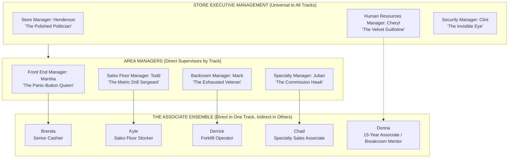
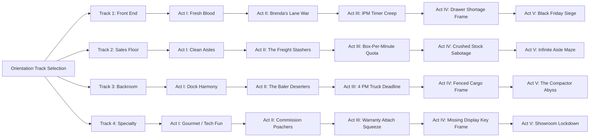
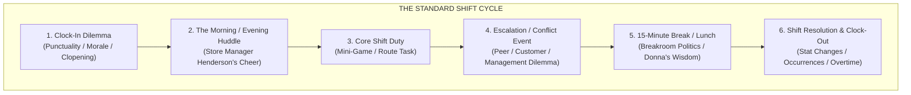

# Retail Inferno — Narrative & Story Design Document

> **Repository:** `retail-inferno`  
> **Topic:** 5-Act Structural Progression, Department Tracks, and Thematic Evolution  
> **Inspirations:** Real retail experiences (r/walmart, retail forums, *Wallys World* universe)

---

## 1. The 5-Act Structural Arc: From Cheerful to Dread

The narrative arc deliberately avoids introducing corporate malevolence early on. The experience mirrors genuine retail tenure: initial optimism, friction with lazy or toxic peers, algorithmic corporate pressure, internal betrayal/espionage, and finally inescapable institutional horror.

### Act I: Fresh Blood (Tone: Cheerful, Upbeat, Quirky)
* **The Environment:** Brightly lit sales floors, upbeat corporate orientation videos, smiling trainer, breakroom filled with welcome donuts and pizza.
* **The Atmosphere:** The player is enthusiastic. Tasks are straightforward, and customer interactions are humorous rather than hostile.
* **The Friction:** Minor learning hurdles (memorizing PLU codes, finding aisle locations, learning to work the tape gun).
* **Act I Climax / Boss:** Overcoming an eccentric early challenge (e.g., an extreme coupon glitcher or an unstable tower of boxed goods).

### Act II: Breakroom Politics (Tone: Petty, Passive-Aggressive, Toxic Peers)
* **The Environment:** Dirty microwave notes, the smoking patio whisper-circle, messy carts left abandoned right before shift-change.
* **The Atmosphere:** Corporate hasn't intervened yet; the real enemy is coworkers. Coworkers disappear for 45-minute bathroom breaks, dump unfinished pallets on the player, steal working equipment (scanners, pallet jacks), and spread rumors that the player is an "eager brown-noser" for actually doing their job.
* **The Conflict:** Dealing with slacker peers, shifting blame, and navigating social cliques.
* **Act II Climax / Boss:** A direct confrontation with the department's most toxic peer veteran (e.g., Brenda the lane-closing senior cashier, or Kyle the disappearing cart wrangler).

### Act III: The Corporate Gaze (Tone: Cold, Stressful, Algorithmic)
* **The Environment:** Handheld devices begin beeping timer alerts, floor cameras are visibly repositioned to stare at workstations, corporate regional flyers are plastered on bulletin boards.
* **The Atmosphere:** Corporate management steps in with new efficiency metrics (Items-Per-Minute quotas, 45-second pallet drops, warranty attach percentages). 
* **The Irony:** The slackers who dumped their work in Act II are rewarded because they know how to game the metrics, while the player (who actually cleans up the store) gets flagged for low velocity.
* **Act III Climax / Boss:** Facing the first corporate enforcer (e.g., The Secret Mystery Shopper or The Metric Auditor).

### Act IV: The Frame Job (Tone: Paranoia, Gaslighting, Espionage)
* **The Environment:** Windowless interrogation offices, missing paperwork, forged logbooks, flickering lights in secluded backroom corridors.
* **The Atmosphere:** Toxic coworkers and corrupt assistant managers join forces to protect their own jobs by sabotaging the player. Equipment goes missing under the player's name; manager overrides are executed using the player's credentials; pre-written disciplinary coachings appear before incidents even happen.
* **The Mystery:** The player realizes the store is suffering from massive internal shrink/theft, and leadership is framing the player to satisfy corporate headquarters.
* **Act IV Climax / Boss:** The Internal Espionage Ring (e.g., Corrupt Asset Protection Lead and the Rogue Shift Supervisor).

### Act V: The Inferno (Tone: Psychological Horror, Inescapable Dread)
* **The Environment:** Continuous 60Hz buzzing from aging fluorescent tubes, shifting aisles that seem to stretch into infinity, exterior windows replaced by cinderblocks, broken clocks displaying shifting hours.
* **The Atmosphere:** The ultimate retail nightmare. The store is locked down for an apocalyptic event (e.g., Black Friday Swarm / Overnight Inventory Audit). The player cannot clock out; the exit sensors trigger lockdown gates; the PA system whispers personalized psychological taunts.
* **The Climax:** The player must battle through the store hierarchy to reach the Executive Penthouse, expose the systemic corruption, and finally swipe their badge to clock out once and for all.
* **Act V Climax / Boss:** The Store General Manager & The Unstoppable Corporate Machine.

---

## 2. Morale, Engagement & The 5-Point Attendance Dilemma

Throughout all 5 acts, narrative branches and dialogue options are dynamically gated by the character's internal psychological state and their attendance record:

### A. The Morale & Engagement Descent Curve:
* **Act I:** Morale: **90-100%** | Engagement: **90-100%**  
  *Options:* Upbeat, eager, going the extra mile, pride in uniform.
* **Act II:** Morale: **60-75%** | Engagement: **60-70%**  
  *Options:* Sarcastic internal monologue, annoyance with slacker coworkers, reluctant compromise.
* **Act III:** Morale: **40-55%** | Engagement: **35-45%**  
  *Options:* "Quiet quitting" unlocked; high-effort options grayed out; choosing survival over perfection.
* **Act IV:** Morale: **20-35%** | Engagement: **15-25%**  
  *Options:* Hyper-vigilant paranoia, defensive snarls, cold refusal to comply with unwritten rules.
* **Act V:** Morale: **5-15%** | Engagement: **0% (Pure Survival)**  
  *Options:* Unfiltered defiance, scorched-earth truth-telling, desperate gambits to escape.

### B. Attendance Occurrences (The 5-Point "Selective Enforcement" Clock):
* **Points Policy:**
  - Tardy / Late Arrival: `+0.5 pts`
  - Unexcused Call-Out / Absence: `+1.0 pt`
  - Leaving Shift Early: `+0.5 pts`
  - No Call, No Show: `+2.0 pts`
* **The 5.0+ Point Paradox (Hypocritical Corporate Enforcement):**
  - Officially, company policy states that hitting `5.0 points` is ground for immediate termination.
  - In practice, **corporate reality kicks in**: whether you are fired at 5.0+ points depends entirely on your hidden **Productivity Score** (mini-game performance & task speed) and your **Ass-Kissing Score** (sycophancy in dialogue choices, reporting peers, participating in morning cheers).
  - **Scenarios at 5.0+ Points:**
    - **The Star Worker (High Productivity, Low Ass-Kissing):** Management ignores the points when they need labor, but constantly threatens termination to force you to cover bad shifts: *"You're at 6.5 points, rookie. You're working Friday night or HR gets this folder."*
    - **The Manager's Pet (Low Productivity, High Ass-Kissing):** Points miraculously "disappear" or get coded as excused manager discretion, watching slackers rack up 11.0 points without consequence.
    - **The Indifferent Grunt (High Productivity, High Ass-Kissing):** Accumulates 8.0+ points freely while corporate looks the other way.
    - **The Outcast (Low Productivity, Low Ass-Kissing):** The moment points tick to 5.0, Asset Protection is waiting at the time clock with a cardboard box for your locker contents (Game Over).
* **The Core Moral / Survival Dilemmas:**
  - *"Your alarm blares at 5:45 AM after a brutal clopening shift. Your Morale is critical (12%). You already sit at 4.5 points."*
    - `[Option A]` **Drag Yourself In:** (Morale -15%, Engagement -10%, Points +0). Unlocks shift, but character enters in a sleep-deprived daze.
    - `[Option B]` **Call Out & Test Your Luck:** (Morale +25% recovered, Points +1.0 $\rightarrow$ 5.5/5.0). Skips shift, but now you must gamble your Productivity and Ass-Kissing scores against the Store Manager's mood.
    - `[Option C]` **Roll in Late & Bring Donuts for Management:** (Morale +0%, Points +0.5 $\rightarrow$ 5.0/5.0, Ass-Kissing +15). A tactical bribe to soften the attendance hit.

---

### C. The Ripple Matrix: How Early Decisions Reshape Later Acts

Choices in *Retail Inferno* are not isolated vignettes; they build an invisible criminal and social record that determines whether you survive the corporate witch-hunt in Acts IV and V:

| Early Decision / Incident | Choice Path Taken | Act IV / V Narrative Consequence | Act IV / V Mechanical Gameplay Consequence |
|---|---|---|---|
| **Act I Pre-Hire Assessment (Question 1–10)** | **Sycophant Loyalty vs. Pragmatic Cynicism** | HR Manager Cheryl prints your exact application answers during the Act IV Interrogation to prove hypocrisy or moral failure. | Quoted answers dynamically unlock unique defense retorts or suffer severe Morale penalties during Cheryl's audit. |
| **Act II Derrick's Forklift Incident (M-1)** | **Whistleblower / Snitched (`#COMPANY_RAT`)** | The dock crew treats you like radioactive waste. Brenda, Kyle, and Derrick actively help Clint frame you. | Loading dock doors locked; cannot escape during the Act IV lockdown; receiving crew refuses to aid. |
| **Act II Derrick's Forklift Incident (M-1)** | **Kept Quiet / Solidarity (`#ONE_OF_US`)** | The peer crew forms an underground resistance. Derrick and Kyle risk their own jobs to help you clear your name. | Derrick blocks Clint's security buggy with a forklift; Kyle pulls a fire alarm distraction in Lawn & Garden. |
| **Act II Connex Trailer Scandal (M-4)** | **Extorted Todd for Attendance Overrides** | Todd is terrified of you exposing his affair, but holds a secret bitter grudge. | Todd secretly slips you the surveillance memory card proving your innocence before Clint's raid. |
| **Act II Connex Trailer Scandal (M-4)** | **Reported Todd to Corporate HR** | Todd is fired immediately; replaced by an emotionless regional corporate metric enforcer. | Lose your secret managerial backchannel; new manager enforces maximum 65-box/hr speed quotas with zero mercy. |
| **Act II Brenda's Lane War Showdown** | **Publicly Humiliated Brenda** | Brenda aligns with Clint, volunteering to count down your register and planting a \$50 shortage in your till. | Register shortage triggers immediate loss prevention audit and Clint's interrogation. |
| **Act II Brenda's Lane War Showdown** | **Showed Empathy / Covered Shift in Breakup** | Brenda storms into the interrogation room and defends you against Clint: *"The kid didn't take the cash, check Chad's login!"* | Brenda's testimony instantly strips Clint's initial shield during the Act IV Boss Battle. |
| **Acts II–III Attendance Occurrences** | **Accumulated 5.0+ Points via Manager Passes** | Henderson summons you into his office, using your forgiven attendance occurrences as blackmail to take the blame for Bay 4 shrink. | Henderson starts Act IV with a +50% Leverage attack buff; player must gather physical logs to neutralize his blackmail. |
| **Acts I–V Donna Breakroom Mentorship** | **Max Donna Affinity ($\ge 80$)** | Donna stops being a bystander; hands you the master brass skeleton key to the Executive Mezzanine and acts as surprise whistleblower witness. | Bypasses locked mezzanine security gates in Act V; unlocks Department of Labor Golden Ending. |

---

## 3. Core Supporting Cast & Recurring Ensemble

The store's characters are structured to create a cohesive, interconnected workplace ecosystem across all four storylines:

### A. Store Executive Management (Universal to All Tracks)

1. **Cheryl — Human Resources Manager**
   - **Archetype:** *"The Velvet Guillotine"*
   - **Visual Aesthetic:** Pastel floral cardigans over an ironed company lanyard, perky smile, brightly lit office filled with pastel motivational posters (*"Smile! You're On the Clock"*, *"Teamwork Makes the Dream Work"*). A glass bowl of rock-hard peppermint candies sits on her desk.
   - **Personality & Voice:** Speaks in a gentle, maternal, sing-song voice while handing out disciplinary strikes and termination notices. Everything is framed as *"we just want to support your personal growth."*
   - **Narrative Role:** Screens your application, administers the 10-question pre-employment assessment in Phase 1, mediates petty coworker squabbles in Act II, weaponizes the 5-point attendance system in Act III–IV, and holds the master termination lockouts in Act V.

2. **Henderson — Store Manager**
   - **Archetype:** *"The Polished Politician"*
   - **Visual Aesthetic:** Crisp corporate polo, razor-creased khakis, gleaming white orthopedic running shoes, and a Bluetooth earpiece blinking blue in his left ear. Always grips a metal clipboard.
   - **Personality & Voice:** Booming, performative optimism. Walks the sales floor at brisk speed, doling out firm handshakes while mentally calculating how many payroll hours he can cut to maximize his quarterly bonus.
   - **Narrative Role:** Steps onto a plastic milk crate to lead the mandatory morning cheer in Act I; serves as a distant god-like authority figure whose sudden floor walks cause area managers to panic in Act II; unveils algorithmic quotas in Act III; acts as the primary mastermind behind the store's inventory shrink cover-up in Acts IV–V.

3. **Clint — Security Manager (Loss Prevention)**
   - **Archetype:** *"The Invisible Eye"*
   - **Visual Aesthetic:** Plain dark polo, battered baseball cap pulled low, mirrored sunglasses on his collar, heavy black radio holster under a light jacket. Often pretends to inspect cereal box labels at the end of an aisle.
   - **Personality & Voice:** Low, gravelly monotone. Operates under the assumption that every associate is an undercover criminal plotting to steal inventory.
   - **Narrative Role:** Silently observes new hires from the shadows near the entrance sensors in Act I; lurks in ceiling walkways in Act II–III; summons the player into security to present manufactured "evidence" of register shortages or missing pallets in Act IV; locks the physical steel fire exit gates during storewide lockdown in Act V.

---

### B. Area Managers (Direct Department Supervisors)

Each department track has a dedicated **[Area] Manager** who serves as the player's direct boss, taskmaster, and initial managerial obstacle:

* **Front End Manager: Marsha**
  - *Archetype:* **The Panic-Button Queen.** High-strung, lives on diet energy sodas, permanently on the verge of a breakdown. The second a checkout line exceeds two shoppers, she slams the emergency page. Micromanages register lights, drawer balancing, and scan speed.
* **Sales Floor Manager: Todd**
  - *Archetype:* **The Metric Drill Sergeant.** Ex-varsity football coach who treats shelf-stocking like boot camp. Demands "65 cases per hour or you're benched." Stares at his digital tablet timer, timing employee bathroom trips down to the second.
* **Backroom Manager: Mack**
  - *Archetype:* **The Exhausted Veteran.** 55 years old, permanent 5 o'clock shadow, worn back brace over work jeans. Completely disillusioned with corporate cheers. Will happily bypass safety lockouts and ignore bent pallet racks just to get the freight truck cleared before the 4:00 PM deadline.
* **Specialty Manager: Julian**
  - *Archetype:* **The Commission Hawk.** Slicked hair, heavy designer cologne, tailored slim-fit vest. Believes he's a Wall Street broker stranded in a suburban retail store. Obsessed with extended warranty percentages and store credit applications. Pits his own associates against each other.

---

### C. The Associate Peer Ensemble (Inter-Department Connections)

The toxic coworkers who act as **Act II Bosses** in their home track appear as **recurring background peers** across the other three tracks:

1. **Brenda — Senior Cashier (Front End Peer)**
   - *Front End Story:* **Direct Act II Boss.** 20-year veteran cashier who flips her lane light to "Closed" when large carts approach, hoards Register 4 (closest to the snacks), and dumps return baskets at the player's register.
   - *Sales Floor Story:* Wheels overflowing, disorganized "go-back" return carts into the player's freshly zoned aisles right at shift change.
   - *Backroom Story:* Barks over the storewide walkie-talkie every 10 minutes whining that the unloaders haven't hand-delivered more register paper rolls.
   - *Specialty Story:* Sends confused customers with complex technical questions over to the specialty counter without warning just to get them out of her checkout line.

2. **Kyle — Sales Floor Stocker (Sales Floor Peer)**
   - *Sales Floor Story:* **Direct Act II Boss.** The vape-cloud slacker who "plugs" shelves (shoving pet food behind cereal boxes to pretend he stocked it) and vanishes behind the outdoor dumpster for 45-minute breaks.
   - *Front End Story:* The cart wrangler who refuses to bring shopping carts in from the parking lot, leaving cashiers to absorb screams from cartless customers.
   - *Backroom Story:* Drags damaged wooden pallets to the loading dock, drops them crookedly in front of the emergency fire exit, and runs away.
   - *Specialty Story:* Constantly asks the electronics associate to unlock high-end gaming consoles for his "cousin who might drop by later."

3. **Derrick — Forklift Operator (Backroom Peer)**
   - *Backroom Story:* **Direct Act II Boss.** The phantom forklift driver who hides the only functioning hydraulic jacks in high seasonal racks and plays phone games behind the frozen meat freezer.
   - *Sales Floor Story:* Drops a massive, leaning 7-foot pallet of bulk charcoal in the exact center of the player's freshly zoned aisle at 10:55 PM, honks the forklift horn, and drives away laughing.
   - *Front End Story:* Delivers bags and receipt paper two hours late after the cashiers have already run completely dry.
   - *Specialty Story:* Refuses to lower heavy 75-inch smart TVs from the top-stock steel racks, claiming *"the forklift battery needs an overnight trickle charge."*

4. **Chad — Specialty Sales Associate (Specialty Peer)**
   - *Specialty Story:* **Direct Act II Boss.** The slick credit poacher who leans on the counter gossiping, then swoops in at the register to enter his own operator ID whenever the player finishes a 30-minute TV consultation. Leaves the food preparation slicers encrusted in dried residue.
   - *Front End Story:* Loiters near the checkout lanes in his clean specialist shirt, trying to hijack the cashier's customers into opening store charge accounts so he pockets the enrollment bounty.
   - *Sales Floor Story:* Treats stockers like his personal luggage handlers; demands they haul heavy display furniture for him because he *"can't get dust on the specialty uniform."*
   - *Backroom Story:* Sneaks onto the loading dock to steal the unloader crew's premium packing tape guns and industrial utility knives for his counter.

5. **Donna — 15-Year Associate (The Breakroom Anchor)**
   - *Universal Role:* 15-year associate with a vest covered in 30+ flair pins. Present in **every single storyline**.
   - *Presence:* Sitting in the breakroom folding chair with a lukewarm thermos of black coffee and a dog-eared crossword puzzle.
   - *Narrative Function:* The sarcastic, street-smart mentor. She warns the player about upcoming managerial traps, explains the unwritten rules of attendance survival, and shares dark folklore about previous associates who tried to fight the system.

---

## 4. Department Track Storylines

### Track 1: Front End (Cashier)
* **Act I:** High-energy orientation; pride in fast scanning; memorizing produce codes (4011 bananas); ringing up eccentric, cheerful townspeople.
* **Act II (Peer Conflict):** Senior Cashier Brenda dominates the front end. She flips her lane light to "Closed" every time a customer with two full carts approaches, forcing the line onto the player. Brenda leaves messy return bins at the player's register and gossips to Front End Manager Marsha that the player "doesn't have customer empathy."
  - **Act II Boss:** **Brenda, Senior Cashier** (Throws return carts, weaponizes lane lights).
* **Act III (Corporate Arrives):** Corporate installs scan-speed monitors overhead. If scan speed dips below 22 IPM, an alarm chimes across the front end. Front End Manager Marsha forces cashiers to pitch high-interest store credit cards to every customer.
* **Act IV (The Frame Job):** Brenda borrows the player's login barcode to "help clear a transaction." Later, Security Manager Clint claims the player's drawer is consistently \$50 short and threatens legal prosecution.
* **Act V (The Inferno):** A thunderous Black Friday mob swarms the front registers under red emergency strobe lights. The player must battle through the chaos, expose the drawer skim fraud, and confront Store Manager Henderson and Security Manager Clint to clear their record.

### Track 2: Sales Floor (Stocker / Merchandiser)
* **Act I:** The satisfaction of building pristine endcaps, perfectly facing cereal boxes, riding empty flatbeds through wide aisles after closing.
* **Act II (Peer Conflict):** Kyle and the mid-day stockers never finish their pallets. Instead of working overstock, they "plug" shelves (shoving pet food behind cereal boxes) and hide full overstock carts in the apparel fitting rooms. Kyle leaves his half-eaten lunch on the player's cart and vanishes behind the outdoor dumpster.
  - **Act II Boss:** **Kyle, Sales Floor Stocker** (Spams smoke breaks, hurls overloaded cardboard bins).
* **Act III (Corporate Arrives):** Sales Floor Manager Todd enforces a new 65 cases-per-hour quota while timing associate bathroom breaks. The store faces a surprise regional inspection visit.
* **Act IV (The Frame Job):** A stack of high-value merchandise is found deliberately hidden and damaged in the player's designated zone. Kyle tells management that the player hid it there to avoid stocking it.
* **Act V (The Inferno):** The store's aisles begin shifting and looping infinitely. Shelving units collapse into maze-like walls. The player must navigate the labyrinth to defeat Sales Floor Manager Todd and confront Store Manager Henderson.

### Track 3: Backroom (Unloader / Freight)
* **Act I:** Loud radio music on the loading dock, lifting weights with freight, camaraderie of sweating through a 2,000-piece truck unload.
* **Act II (Peer Conflict):** Derrick the forklift operator spends his shifts playing mobile games behind the frozen meat racks. The floor associates refuse to take their freight, leaving the unloading dock completely gridlocked. When the hydraulic cardboard baler fills up, coworkers walk away, leaving the heavy wire-tying to the player.
  - **Act II Boss:** **Derrick, Forklift Operator** (Hides equipment, blocks emergency exits with pallets).
* **Act III (Corporate Arrives):** The corporate regional office mandates a strict "Truck Unloaded by 4:00 PM" rule. Backroom Manager Mack pushes the crew to dangerous speeds, disabling safety interlocks on the conveyors.
* **Act IV (The Frame Job):** Expensive electronics pallets go missing from Bay 4. A forged bill of lading is discovered bearing the player's signature, and stolen goods are planted in the player's personal locker by Security Manager Clint.
* **Act V (The Inferno):** The backroom warehouse expands into a dark, industrial abyss of towering steel racks. The mechanical baler transforms into an industrial crushing monster as the player battles Backroom Manager Mack and exposes Store Manager Henderson's freight fraud.

### Track 4: Specialty (Counter Sales — Tech / Deli / Jewelry)
* **Act I:** Demonstrating high-end headphones, giving out gourmet cheese and meat samples, wearing the polished specialty uniform.
* **Act II (Peer Conflict):** Chad, the slick specialty associate, spends all morning leaning against the counter flirting with customers. Whenever the player spends 30 minutes helping a customer choose a \$1,500 4K TV, Chad swoops in at the register to input his own employee code and poach the credit. At night, Chad leaves the meat slicer encrusted in dried residue for the player to clean.
  - **Act II Boss:** **Chad, Specialty Sales Associate** (Steals customer sales, leaves hazardous sanitation messes).
* **Act III (Corporate Arrives):** Specialty Manager Julian enforces a mandatory 60% extended warranty attach rate. Secret mystery shoppers test whether associates recite the exact corporate warranty script.
* **Act IV (The Frame Job):** High-ticket display cases are unlocked and emptied after hours. The master key log shows the player's badge was used, because Chad secretly swapped key rings during lunch. Security Manager Clint initiates an interrogation.
* **Act V (The Inferno):** The showroom becomes a nightmare of screaming security alarms, shattered display glass, and flashing warranty popups. The player must take down Specialty Manager Julian and Store Manager Henderson.

---

## 5. Boss Encounter Progression by Track

| Act | Front End Boss | Sales Floor Boss | Backroom Boss | Specialty Boss |
|---|---|---|---|---|
| **Act I** *(Early Hurdle)* | The Extreme Coupon Glitcher | The Runaway Shopping Cart Train | The Tipping Pallet Hazard | The Indecisive Gourmet Snob |
| **Act II** *(Toxic Coworker)* | **Brenda, Senior Cashier** | **Kyle, Sales Floor Stocker** | **Derrick, Forklift Operator** | **Chad, Specialty Sales Associate** |
| **Act III** *(Corporate Metric)* | The Metric Auditor | The Regional Zone Inspector | The 4 PM Clock Enforcer | The Corporate Mystery Shopper |
| **Act IV** *(The Frame Ring)* | **Security Manager Clint** | **Sales Floor Manager Todd** | **Backroom Manager Mack** | **Specialty Manager Julian** |
| **Act V** *(The Inferno)* | **Store Manager Henderson & The Black Friday Swarm** | **The Floor Scrubber Colossus** | **The Industrial Baler Golem** | **Store Manager Henderson & The Boardroom Hydra** |

---

## 6. Shift-by-Shift Campaign Architecture (50+ Shifts Across 5 Acts)

To deliver an expansive, deep campaign experience, each Act comprises **10 to 12 distinct shifts**. Every shift is a self-contained narrative and gameplay beat with a **Clock-In Dilemma**, a **Core Shift Objective (Mini-Game or Flow Task)**, a **Mid-Shift Conflict Event (from `CONFLICT_EVENTS.md`)**, and a **Clock-Out Debrief**.

---

### Act I: Fresh Blood (Shifts 1–10) — The Honeymoon Phase
*Focus: Eagerness, learning the store geography, mastering equipment, harmless eccentricities, initial team introductions.*

* **Shift 1: First Badge Swipe & Orientation Day**
  - *Clock-In:* First nervous badge scan; HR Manager Cheryl hands over the polyester company vest and laminated name badge.
  - *Duty:* Store Geography Tour. Memorize key store landmarks (Breakroom, Baler, Fire Exits, Manager's Glass Fishbowl).
  - *Conflict:* The 10-Question Pre-Hire Assessment debrief. Cheryl remarks on your personality test score with a sweet, ambiguous smile.
  - *Resolution:* Morale 100%, Engagement 100%, 0.0 Points.

* **Shift 2: The Equipment Scramble**
  - *Clock-In:* The locker combination locks stick; Donna gives you her spare graphite lubricant.
  - *Duty:* Sign out equipment (TC-70 handheld scanner, box cutter, register key).
  - *Conflict:* Realizing only 12 scanners exist for 40 employees. A friendly coworker lets you borrow theirs for 10 minutes.
  - *Resolution:* Equipment successfully returned before the 10-minute timer expires.

* **Shift 3: The First Morning Huddle**
  - *Clock-In:* Store Manager Henderson summons all departments to Action Alley at 7:00 AM sharp.
  - *Duty:* Mandatory Store Cheer. Rhythmic clapping, spelling out the store name, performing the "corporate hip-shake."
  - *Conflict:* Choice to yell at the top of your lungs (`Ass-Kissing +15, Morale -10`) or mumble awkwardly in the back row (`Defiance +10`).
  - *Resolution:* Henderson singles out enthusiastic cheerers for a coupon for a free mini-fountain drink.

* **Shift 4: The PLU Code & Fast Scan Gauntlet**
  - *Duty:* High-volume item entry. Memorizing 4011 (bananas), 4046 (avocados), 4065 (bell peppers).
  - *Conflict:* Customer presents unlabeled organic heirloom squash. Do you halt the line to lookup the code or ring it as standard zucchini?
  - *Resolution:* First high-fives from the Area Manager. Eagerness pays off.

* **Shift 5: The "Go-Back" Odyssey**
  - *Duty:* Re-shelving abandoned merchandise across distant aisles before 3:00 PM.
  - *Conflict:* Finding raw frozen chicken breasts shoved behind the warm automotive motor oil display.
  - *Resolution:* Proper disposal in the claims bin. Donna warns: *"Get used to that smell, kid."*

* **Shift 6: First Interaction with Senior Cashier Brenda**
  - *Duty:* Front-end line busting / cart returns.
  - *Conflict:* Brenda sweetly asks you to *"watch my lane for two minutes while I grab a cough drop."* She doesn't return for 35 minutes.
  - *Resolution:* First realization that senior peers offload their duties onto rookie shoulders.

* **Shift 7: The Saturday Family Rush**
  - *Duty:* Action Alley navigation amidst double-wide strollers, screaming children, and motorized scooters.
  - *Conflict:* Customer insists a \$499 soundbar was marked on the clearance shelf for \$19.99 because a rogue toddler dropped it there.
  - *Resolution:* Calling a manager override. Area Manager sighs and blames the sales floor.

* **Shift 8: The Cardboard Baler Initiation**
  - *Duty:* Crushing cardboard boxes in the backroom warehouse.
  - *Conflict:* Coworkers leave 15 flat carts stacked high in front of the baler. Do you clear the jam alone or leave it for overnight?
  - *Resolution:* Sweating through manual labor. Backroom Manager Mack nods approvingly from a distance.

* **Shift 9: The Clopening Prelude**
  - *Clock-In:* Scheduled until 11:00 PM closing, then scheduled at 6:00 AM the next morning.
  - *Duty:* Closing store sweeps; cleaning floors, locking jewelry cases, securing registers.
  - *Conflict:* Customer refuses to leave at 10:59 PM: *"I only need three more items, corporate policy says you can't kick me out!"*
  - *Resolution:* Leaving the parking lot at 11:30 PM with 6.5 hours before your next alarm.

* **Shift 10: Act I Climax & Boss Encounter**
  - *The Climax:* Exhausted clopening shift brings the Act I Boss confrontation (e.g., *The Extreme Coupon Glitcher* with 74 expired printout coupons / *The Runaway Shopping Cart Train* in a thunderstorm).
  - *Victory:* Overcoming the initial hurdle. Store Manager Henderson gives you a laminated certificate: *"Rookie of the Month."*

---

### Act II: Breakroom Politics & Slacker Shenanigans (Shifts 11–22) — The Grunt Reality
*Focus: Peer friction, disappearing coworkers, dirty breakrooms, hoarding working equipment, shifting blame.*

* **Shift 11: The Clopening Hangover & Coffee War**
  - *Clock-In:* Arriving at 5:58 AM on 4 hours of sleep. Morale takes its first permanent drop to 75%.
  - *Duty:* First opening rush. Power-walking through the quiet, dim morning store.
  - *Conflict:* Breakroom incident 2.1: The communal fridge has been purged, and your labeled lunch is in the trash.
  - *Resolution:* Choosing to confront the breakroom clique or eat stale vending machine chips.

* **Shift 12: The Great Equipment Hoard**
  - *Duty:* Need a functioning hydraulic pallet jack or handheld scanner with a working laser lens.
  - *Conflict:* Scenario 1.4: Derrick hid the only smooth pallet jack in the high seasonal racking; Brenda locked the working barcode scanners in her personal locker.
  - *Resolution:* Operating with broken, squeaking wheels that drift to the left; physical stamina drained.

* **Shift 13: The Disappearing Coworker Mystery**
  - *Duty:* Partnered task requiring two associates (two-person furniture carry / dual register line).
  - *Conflict:* Scenario 1.1: Kyle announces a *"quick five-minute bathroom break"* and vanishes for 48 minutes behind the outdoor pallets.
  - *Resolution:* Taking the full customer brunt alone while the Area Manager walks by scowling.

* **Shift 14: The Microwave Fish Biohazard**
  - *Lunch Break:* Breakroom incident 2.2: The microwave is coated in charred leftover mackerel.
  - *Conflict:* Kyle and Derrick are laughing in the corner. If you report it, you're a snitch; if you clean it, you're the store maid.
  - *Resolution:* Donna gives you half an egg salad sandwich from her cooler: *"Don't ever clean up after grown adults, kid."*

* **Shift 15: The Go-Back Cart Ambush**
  - *Duty:* Finishing your daily tasks at 10:45 PM.
  - *Conflict:* Scenario 1.5: Brenda wheels two towering carts of miscellaneous returns into your department at 10:50 PM, says *"Front end thanks you!"*, and clocks out.
  - *Resolution:* Do you stay 45 minutes late and risk unapproved overtime, or push the carts into the dark furniture aisle?

* **Shift 16: The "Shelf-Plugging" Scandal**
  - *Duty:* Stocking and inventory audit.
  - *Conflict:* Scenario 1.3: Discovering that Kyle has shoved 18 cans of wet cat food behind family-size cereal boxes to avoid walking to aisle 14.
  - *Resolution:* Fixing Kyle's mess slows your own pace. Sales Floor Manager Todd notes your low velocity on his clipboard.

* **Shift 17: The Cold Pizza Scramble**
  - *Shift Mid-Point:* Store Manager Henderson announces over the intercom: *"Appreciation Pizza in the breakroom!"*
  - *Conflict:* Scenario 2.3: Arriving 8 minutes late to find six crushed cardboard boxes with dried crusts and grease stains; morning shifts took entire boxes home.
  - *Resolution:* Morale drops by 15%. Donna dryly observes: *"Every slice represents a canceled cost-of-living raise."*

* **Shift 18: The Pallet Drop Trap**
  - *Duty:* Closing aisle recovery.
  - *Conflict:* Multi-Perspective Event 7.2: Derrick drops a leaning 7-foot pallet of bulk charcoal in the center of your aisle at 10:55 PM, honks, and speeds away.
  - *Resolution:* Calling Derrick out over the radio or breaking down 80 heavy bags with tired arms.

* **Shift 19: The Fitting Room 3 Stash**
  - *Duty:* Store sweep and sanitation patrol.
  - *Conflict:* Multi-Perspective Event 7.3: Discovering an associate nest in Fitting Room 3 complete with a stolen beanbag, energy drinks, and phone chargers.
  - *Resolution:* Do you use the retreat for your own 15-minute break or report the unauthorized breakroom?

* **Shift 20: The Uncertified Equipment Standoff**
  - *Duty:* High-bay freight movement.
  - *Conflict:* Multi-Perspective Event 7.4: Coworker Derrick operates the high-reach forklift without an OSHA certification license and nearly crushes an endcap.
  - *Resolution:* Reporting the violation creates a blood-feud with the loading dock crew; staying silent makes you an accomplice.

* **Shift 21: The Connex Trailer Tryst & The Smoking Patio Gossip Hub**
  - *Clock-In:* Walking past the smoking patio whisper-circle. The entire store is abuzz with the juicy discovery: someone caught an Area Manager and an associate behind the peat moss in the garden Connex trailer.
  - *Duty:* Seasonal inventory pull / register backup.
  - *Conflict:* Scenario 7.1 & Multi-Perspective Incident M-4: Depending on your track, you either hold the blackmail leverage on Todd, burn with resentment over Taylor's unearned supervisor promotion, or navigate Brenda's register broadcast network.
  - *Resolution:* Tactical dilemma: extort management to wipe 2 attendance points, leak evidence to Cheryl, or weaponize peer solidarity.

* **Shift 22: Act II Climax & Boss Encounter**
  - *The Climax:* Direct confrontation with the toxic peer veteran (**Brenda**, **Kyle**, **Derrick**, or **Chad** depending on your track).
  - *Battle:* Turn-based JRPG Boss Battle where the peer summons lazy excuses, throws return carts, and spams weaponized bathroom breaks.
  - *Victory:* Exposing their laziness in front of the entire department huddle. The peer is disciplined, but the store environment grows colder.

---

### Act III: The Corporate Gaze & Algorithmic Quotas (Shifts 23–34) — The System Strikes
*Focus: Overhead camera tracking, timer beeps, automated speed quotas, bathroom tracking, mystery shoppers, speed-clocking.*

* **Shift 23: The Algorithmic Handheld Upgrade**
  - *Clock-In:* New software update rolled out on all handheld scanners. A digital tachometer displays your speed in real time.
  - *Duty:* Meeting the baseline target (22 IPM on registers / 65 cases-per-hour on floor / 4:00 PM truck unload).
  - *Conflict:* Scanner emits high-pitched warning chimes whenever you stop moving for more than 45 seconds.
  - *Resolution:* Engagement drops to 40%. The job ceases to be about people and becomes pure mechanical input.

* **Shift 24: The 10-Foot Rule & Overhead Camera Audit**
  - *Duty:* Customer assistance on the sales floor.
  - *Conflict:* Scenario 3.2: Corporate directive mandates greeting every customer within 10 feet within 4 seconds. Todd reviews surveillance footage with a digital stopwatch.
  - *Resolution:* Parroting robotic corporate greetings until your vocal cords feel dry.

* **Shift 25: The 4-Minute Bathroom Audit**
  - *Duty:* Mid-shift bio break.
  - *Conflict:* Scenario 3.3: Todd stands outside the associate restroom with a clipboard and a smartphone timer. He knocks loudly at the 4-minute mark: *"Movement check!"*
  - *Resolution:* Choice to rush out humiliated (`Morale -20`) or tell him to call HR (`Defiance +20, Attendance Watchlist`).

* **Shift 26: The "Code Spark" All-Hands Front-End Drag**
  - *Duty:* Deep freight stocking or high-end electronics consultations.
  - *Conflict:* Scenario 3.4 & Event 7.1: Marsha hits the emergency front-end page: *"ALL CERTIFIED ASSOCIATES TO REGISTERS IMMEDIATELY."*
  - *Resolution:* Your primary freight/counter work sits abandoned. Todd later berates you for not finishing your stocking pallet.

* **Shift 27: The Store Credit Card Bounty Squeeze**
  - *Duty:* Register / counter checkouts.
  - *Conflict:* Scenario 3.6: Mandatory quota: 3 high-interest store card signups per shift or face mandatory "coaching."
  - *Resolution:* Pitching predatory 29.99% APR store cards to elderly regulars; choice between moral guilt (`Morale -15`) or manager wrath.

* **Shift 28: The Speed-Clocking / Item Spacing Paradox**
  - *Duty:* High-speed checkout / stock stocking.
  - *Conflict:* Scenario 3.1: To keep IPM above 25, cashiers rapidly swipe items without bagging, causing bread and eggs to crush under 12-packs of soda.
  - *Resolution:* Choosing whether to protect the customer's eggs or your corporate scan metric.

* **Shift 29: The Smart-Shelf Sensor Mayhem**
  - *Duty:* Sales floor maintenance and facing.
  - *Conflict:* Scenario 3.9: Weight-sensing brackets trigger 90-second emergency timers across five aisles simultaneously as customers misplace cereal boxes.
  - *Resolution:* Sprinting like a pinball between aisles to prevent metric violations.

* **Shift 30: The Digital Time-Card "Adjustment"**
  - *Duty:* Paystub review on the associate portal.
  - *Conflict:* Scenario 3.7: Discovering that 15 minutes of overtime you earned clearing the baler yesterday was shaved back to 8.0 hours flat by management.
  - *Resolution:* Confronting Cheryl or Henderson. They claim: *"It was an automated system correction, you cannot work unauthorized OT."*

* **Shift 31: The Unreasonable 1-Star Survey Ambush**
  - *Duty:* Customer satisfaction review.
  - *Conflict:* Scenario 3.8: Store receipt survey yields a 1-star review: *"Cashier smiled too aggressively; store was out of discontinued 1994 soda brand."*
  - *Resolution:* Front End Manager Marsha assigns you a mandatory 45-minute re-training module on "Radiating Authentic Warmth."

* **Shift 32: The Corporate Mystery Shopper Infiltration**
  - *Duty:* Floor patrol and greeting.
  - *Conflict:* An undercover corporate inspector dressed in casual clothes deliberately attempts to bait you into skipping safety protocols or offering unauthorized discounts.
  - *Resolution:* Navigating the trick questions without breaking character.

* **Shift 33: The 5-Point Squeeze Warning**
  - *Clock-In:* Cheryl calls you into HR. You sit at 4.5 attendance occurrences due to flu season and clopening exhaustion.
  - *Conflict:* Cheryl places the manila folder on her desk: *"One more late badge swipe, and the system auto-flags you for dismissal. Unless... you cover weekend overnights."*
  - *Resolution:* Pure survival dilemma: take the brutal overnight shift or risk the chopping block.

* **Shift 34: Act III Climax & Boss Encounter**
  - *The Climax:* Surprise regional executive walk-through (**The Metric Auditor**, **The Regional Zone Inspector**, or **The Corporate Mystery Shopper**).
  - *Battle:* Multi-phase corporate audit battle where the boss attacks with Clipboards of Doom, Red-Tape Entanglements, and Velocity Penalties.
  - *Victory:* Flawless compliance or defiant survival forces the auditor to sign off on the store's certification. Store Manager Henderson takes all the credit.

---

### Act IV: The Frame Job & Internal Espionage (Shifts 35–46) — Paranoia & Sabotage
*Focus: Planted evidence, missing high-ticket merchandise, forged signatures, stolen badges, weaponized HR complaints, midnight lock-ins.*

* **Shift 35: The Broken Surveillance Angle**
  - *Clock-In:* Noticing that three ceiling dome cameras over your work area have been pointed down toward blank concrete.
  - *Conflict:* Donna whispers in the breakroom: *"When Clint adjusts the cameras away from high-ticket items, someone's getting set up. Watch your badge."*
  - *Resolution:* Hyper-vigilance unlocks; paranoid internal dialogue replaces standard reactions.

* **Shift 36: The "Sweethearting" Register Skim Setup**
  - *Duty:* Ringing up customers at register 7.
  - *Conflict:* Scenario 5.1: Coworker brings up a flat-screen TV and expensive power tools with fake clearance barcodes taped over real UPCs.
  - *Resolution:* Catching the fake barcode before scanning, or getting flagged by Clint's overhead video replay.

* **Shift 37: The Missing Bay 4 Electronics Pallet**
  - *Duty:* Backroom inventory check.
  - *Conflict:* Scenario 5.2: A \$12,000 pallet of gaming consoles vanishes from Bay 4. A forged receiving document bears your initials in blue ballpoint ink.
  - *Resolution:* Security Manager Clint detains you in the loss prevention office for a 90-minute interrogation.

* **Shift 38: The Locker Inspection Raid**
  - *Shift Mid-Point:* Intercom announces an unscheduled locker audit.
  - *Conflict:* Scenario 5.3: Clint and Cheryl use bolt cutters on your lock. Hidden inside your winter coat is an unopened \$300 digital camera from electronics.
  - *Resolution:* Proving you were on the sales floor when the camera was logged missing; noting the discount sticker originated from Manager Julian's computer.

* **Shift 39: The Weaponized Ethics Hotline Strike**
  - *Clock-In:* Summons to the HR office.
  - *Conflict:* Scenario 5.5: Three anonymous calls to the corporate 1-800 hotline accuse you of harassment and creating a hostile work environment.
  - *Resolution:* Exposing that the wording matches Brenda's signature grammatical mistakes (*"irregardless of store policy"*). Cheryl pauses, rattled.

* **Shift 40: The Stolen Master Keys Lockdown**
  - *Duty:* Closing shift transition.
  - *Conflict:* Scenario 5.4: Master display keys disappear. Clint triggers exterior security gates. You find the key ring slipped into your apron pocket by Chad.
  - *Resolution:* Stealth maneuver to ditch the keys into Julian's open briefcase before the physical body searches begin.

* **Shift 41: The Phantom Walkie Page & Stuck Mic**
  - *Duty:* High-stress floor management.
  - *Conflict:* Scenario 4.5: Radio frequency is jammed for 22 minutes while someone plays 80s sitcom tunes from the cooler. Henderson searches for the radio serial number.
  - *Resolution:* Derrick owes you his life after you unstick his mic before Henderson catches him.

* **Shift 42: The Watermelon / Dump-Bin Avalanche**
  - *Duty:* Center action alley transit.
  - *Conflict:* Scenario 4.4: 8-foot wire dump-bin collapses under a climbing toddler, sending hundreds of watermelons and bouncing balls across three grocery aisles.
  - *Resolution:* Physical reflex check; preventing a catastrophic chain-reaction collapse while managers hide in their offices.

* **Shift 43: The Compactor Shredder Scheme Uncovered**
  - *Duty:* Late night trash disposal at 2:00 AM.
  - *Conflict:* Scenario 5.7: Catching Mack and freight drivers feeding undamaged \$1,500 smart TVs into the hydraulic trash compactor to trigger fraudulent freight insurance payouts.
  - *Resolution:* Securing photographic evidence on your phone; Mack stares you down: *"You better forget what you saw, rookie."*

* **Shift 44: The Midnight Off-the-Clock Lock-In**
  - *Duty:* 11:00 PM closing shift.
  - *Conflict:* Scenario 5.6: Henderson padlocks the glass exit doors with physical chain locks: *"Everyone clock out right now to save payroll. Nobody leaves until the entire sales floor is faced."*
  - *Resolution:* Illegal forced labor standoff: hit the emergency fire bar (`Fire Department summoned`), record Henderson's voice (`Federal Evidence acquired`), or refuse to touch a broom.

* **Shift 45: The Blackout & Broken Badge Reader**
  - *Duty:* Nighttime audit.
  - *Conflict:* Store power flickers. The time clock terminal deletes your punch history. Cheryl hands you an occurrence warning: *"System shows you were absent today."*
  - *Resolution:* Demanding Cheryl print your register transaction log to prove you processed 412 customers while supposedly "absent."

* **Shift 46: Act IV Climax & Boss Encounter**
  - *The Climax:* Direct confrontation with the internal conspiracy ringleader (**Security Manager Clint**, **Sales Floor Manager Todd**, **Backroom Manager Mack**, or **Specialty Manager Julian**).
  - *Battle:* High-stakes corporate confrontation in the Loss Prevention Security Suite. The boss summons False Incident Reports, Video Edits, and Termination Threat debuffs.
  - *Victory:* Countering with gathered evidence (surveillance timestamps, forged signatures, photo logs). The corrupt manager retreats into Henderson's inner executive office.

---

### Act V: The Inferno (Shifts 47–56) — Inescapable Retail Dread
*Focus: Psychological horror, endless aisles, 60Hz fluorescent buzz, Black Friday apocalypse, rogue scrubbers, the final clock-out.*

* **Shift 47: The Endless Fluorescent Hum (60Hz Psychosis)**
  - *Clock-In:* The store entrance doors are welded shut from the outside with yellow structural brackets. The ceiling lights buzz at a deafening 60Hz.
  - *Duty:* Routine morning recovery, but the aisles appear 50% longer than yesterday.
  - *Conflict:* Looking down Aisle 4; the endcap never gets closer no matter how fast you walk.
  - *Resolution:* Donna gives you foam earplugs: *"Don't listen to the hum. Focus on the linoleum tiles."*

* **Shift 48: The Rogue Robotic Floor Scrubber**
  - *Duty:* Nighttime cleaning cycle.
  - *Conflict:* Scenario 6.3: Autonomous commercial floor scrubber machine boots up with glowing crimson status LEDs. It begins patrolling the center aisle at 15 MPH, chasing associates with whirling nylon brushes.
  - *Resolution:* Leaping onto a merchandise display rack to evade the machine; discovering its override panel is locked with Henderson's master key.

* **Shift 49: The Phantom Intercom Whispers**
  - *Duty:* Solo inventory audit at 3:00 AM.
  - *Conflict:* Scenario 6.2: Store PA system chimes and begins whispering personalized corporate psychological taunts: *"Associate #1042, your engagement is below company average. Your productivity has disappointed your parents."*
  - *Resolution:* Locating the PA control box in the manager's office to rip the auxiliary cable out.

* **Shift 50: The Infinite Shifting Aisles**
  - *Duty:* Reaching the claims department in the backroom.
  - *Conflict:* Scenario 6.1: Shelving units slide across concrete like monolithic stone walls. Exiting Aisle 9 leads directly back into Aisle 9.
  - *Resolution:* Navigating by the overhead emergency exit signs; spatial disorientation survival check.

* **Shift 51: The Mannequin Uprising**
  - *Duty:* Apparel department sweep.
  - *Conflict:* Headless plastic apparel mannequins have moved positions during the lighting flicker; their arms point accusingly toward the Executive Suite.
  - *Resolution:* Dismantling plastic limbs to clear a path; uncovering Henderson's secret payroll ledger hidden in a hollow display torso.

* **Shift 52: The Siren of the Black Friday Swarm**
  - *Pre-Shift:* Red emergency rotating beacons activate on the roof beams. External crowd banging vibrates the glass storefront.
  - *Conflict:* Store Manager Henderson steps onto his plastic milk crate: *"Associates! Today, we don't bleed. We sell! Unlock the floodgates!"*
  - *Resolution:* Preparing barricades; equipping box cutters, handheld scanners, and pallet jacks for total war.

* **Shift 53: Breach of the Front Doors**
  - *Duty:* Holding the checkout front-line against a tsunami of frenzied suburban shoppers fighting over \$99 65-inch 4K TVs.
  - *Conflict:* Shoppers tearing merchandise displays apart; register belts smoking from friction heat.
  - *Resolution:* Executing rapid-fire POS Combos (Tier I–III Calibration) to clear the horde without letting the front-end collapse.

* **Shift 54: Ascent to the Executive Penthouse (Store Mezzanine)**
  - *Duty:* Fighting through the upper administrative walkway above the sales floor.
  - *Conflict:* Corporate administrative staff throwing reams of printer paper, disciplinary write-ups, and shredded termination notices like throwing stars.
  - *Resolution:* Clearing the executive conference room; Cheryl flees into Henderson's inner sanctum.

* **Shift 55: The Gatekeeper Showdown**
  - *The Gatekeeper:* The department-specific ultimate nightmare construct (**The Floor Scrubber Colossus**, **The Industrial Baler Golem**, or **The Loss Prevention Panopticon**).
  - *Battle:* Multi-phase mechanic fight involving emergency cut-off switches, hydraulic fluid leaks, and heavy pallet counterweights.
  - *Victory:* The machine explodes into shredded cardboard and hydraulic steam. The double oak doors to Henderson's office swing open.

* **Shift 56: Act V Grand Finale & The Final Clock-Out**
  - *The Climax:* **Store Manager Henderson & The Unstoppable Corporate Machine**.
  - *The Final Boss:* Henderson stands atop a throne of stacked regional trophies, wielding a golden barcode scanner and an infinite clipboard. He summons the phantom board of directors, fires disciplinary coachings with auto-tracking accuracy, and unleashes the storewide overhead sprinkler system.
  - *The Resolution:* Exposing Henderson's federal insurance fraud, payroll theft recordings, and safety violations over the live storewide PA system and sending the archive directly to corporate headquarters and the Department of Labor.
  - *The Final Swipe:* Walking out through the shattered glass entrance into the cool morning sunrise. Sliding your plastic badge through the time-clock terminal one last time:
    - *SCREEN READS:* **PUNCH CONFIRMED: 07:00 AM. STATUS: RETIRED / FREE.**

