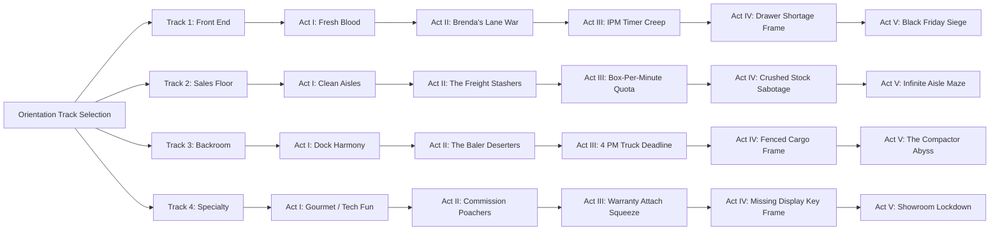

# Retail Inferno — Narrative & Story Design Document

> **Repository:** `retail-inferno`  
> **Topic:** 5-Act Structural Progression, Department Tracks, and Thematic Evolution  
> **Inspirations:** Real retail experiences (r/walmart, retail forums, *Wallys World* universe)

---

## 1. The 5-Act Structural Arc: From Cheerful to Dread

The narrative arc deliberately avoids introducing corporate malevolence early on. The experience mirrors genuine retail tenure: initial optimism, friction with lazy or toxic peers, algorithmic corporate pressure, internal betrayal/espionage, and finally inescapable institutional horror.

### Act I: Fresh Blood (Tone: Cheerful, Upbeat, Quirky)
* **The Environment:** Brightly lit sales floors, upbeat corporate orientation videos, smiling trainer, breakroom filled with welcome donuts and pizza.
* **The Atmosphere:** The player is enthusiastic. Tasks are straightforward, and customer interactions are humorous rather than hostile.
* **The Friction:** Minor learning hurdles (memorizing PLU codes, finding aisle locations, learning to work the tape gun).
* **Act I Climax / Boss:** Overcoming an eccentric early challenge (e.g., an extreme coupon glitcher or an unstable tower of boxed goods).

### Act II: Breakroom Politics (Tone: Petty, Passive-Aggressive, Toxic Peers)
* **The Environment:** Dirty microwave notes, the smoking patio whisper-circle, messy carts left abandoned right before shift-change.
* **The Atmosphere:** Corporate hasn't intervened yet; the real enemy is coworkers. Coworkers disappear for 45-minute bathroom breaks, dump unfinished pallets on the player, steal working equipment (scanners, pallet jacks), and spread rumors that the player is an "eager brown-noser" for actually doing their job.
* **The Conflict:** Dealing with slacker peers, shifting blame, and navigating social cliques.
* **Act II Climax / Boss:** A direct confrontation with the department's most toxic peer veteran (e.g., Brenda the lane-closing senior cashier, or Kyle the disappearing cart wrangler).

### Act III: The Corporate Gaze (Tone: Cold, Stressful, Algorithmic)
* **The Environment:** Handheld devices begin beeping timer alerts, floor cameras are visibly repositioned to stare at workstations, corporate regional flyers are plastered on bulletin boards.
* **The Atmosphere:** Corporate management steps in with new efficiency metrics (Items-Per-Minute quotas, 45-second pallet drops, warranty attach percentages). 
* **The Irony:** The slackers who dumped their work in Act II are rewarded because they know how to game the metrics, while the player (who actually cleans up the store) gets flagged for low velocity.
* **Act III Climax / Boss:** Facing the first corporate enforcer (e.g., The Secret Mystery Shopper or The Metric Auditor).

### Act IV: The Frame Job (Tone: Paranoia, Gaslighting, Espionage)
* **The Environment:** Windowless interrogation offices, missing paperwork, forged logbooks, flickering lights in secluded backroom corridors.
* **The Atmosphere:** Toxic coworkers and corrupt assistant managers join forces to protect their own jobs by sabotaging the player. Equipment goes missing under the player's name; manager overrides are executed using the player's credentials; pre-written disciplinary coachings appear before incidents even happen.
* **The Mystery:** The player realizes the store is suffering from massive internal shrink/theft, and leadership is framing the player to satisfy corporate headquarters.
* **Act IV Climax / Boss:** The Internal Espionage Ring (e.g., Corrupt Asset Protection Lead and the Rogue Shift Supervisor).

### Act V: The Inferno (Tone: Psychological Horror, Inescapable Dread)
* **The Environment:** Continuous 60Hz buzzing from aging fluorescent tubes, shifting aisles that seem to stretch into infinity, exterior windows replaced by cinderblocks, broken clocks displaying shifting hours.
* **The Atmosphere:** The ultimate retail nightmare. The store is locked down for an apocalyptic event (e.g., Black Friday Swarm / Overnight Inventory Audit). The player cannot clock out; the exit sensors trigger lockdown gates; the PA system whispers personalized psychological taunts.
* **The Climax:** The player must battle through the store hierarchy to reach the Executive Penthouse, expose the systemic corruption, and finally swipe their badge to clock out once and for all.
* **Act V Climax / Boss:** The Store General Manager & The Unstoppable Corporate Machine.

---

## 2. Morale, Engagement & The 5-Point Attendance Dilemma

Throughout all 5 acts, narrative branches and dialogue options are dynamically gated by the character's internal psychological state and their attendance record:

### A. The Morale & Engagement Descent Curve:
* **Act I:** Morale: **90-100%** | Engagement: **90-100%**  
  *Options:* Upbeat, eager, going the extra mile, pride in uniform.
* **Act II:** Morale: **60-75%** | Engagement: **60-70%**  
  *Options:* Sarcastic internal monologue, annoyance with slacker coworkers, reluctant compromise.
* **Act III:** Morale: **40-55%** | Engagement: **35-45%**  
  *Options:* "Quiet quitting" unlocked; high-effort options grayed out; choosing survival over perfection.
* **Act IV:** Morale: **20-35%** | Engagement: **15-25%**  
  *Options:* Hyper-vigilant paranoia, defensive snarls, cold refusal to comply with unwritten rules.
* **Act V:** Morale: **5-15%** | Engagement: **0% (Pure Survival)**  
  *Options:* Unfiltered defiance, scorched-earth truth-telling, desperate gambits to escape.

### B. Attendance Occurrences (The 5-Point "Selective Enforcement" Clock):
* **Points Policy:**
  - Tardy / Late Arrival: `+0.5 pts`
  - Unexcused Call-Out / Absence: `+1.0 pt`
  - Leaving Shift Early: `+0.5 pts`
  - No Call, No Show: `+2.0 pts`
* **The 5.0+ Point Paradox (Hypocritical Corporate Enforcement):**
  - Officially, company policy states that hitting `5.0 points` is ground for immediate termination.
  - In practice, **corporate reality kicks in**: whether you are fired at 5.0+ points depends entirely on your hidden **Productivity Score** (mini-game performance & task speed) and your **Ass-Kissing Score** (sycophancy in dialogue choices, reporting peers, participating in morning cheers).
  - **Scenarios at 5.0+ Points:**
    - **The Star Worker (High Productivity, Low Ass-Kissing):** Management ignores the points when they need labor, but constantly threatens termination to force you to cover bad shifts: *"You're at 6.5 points, rookie. You're working Friday night or HR gets this folder."*
    - **The Manager's Pet (Low Productivity, High Ass-Kissing):** Points miraculously "disappear" or get coded as excused manager discretion, watching slackers rack up 11.0 points without consequence.
    - **The Indifferent Grunt (High Productivity, High Ass-Kissing):** Accumulates 8.0+ points freely while corporate looks the other way.
    - **The Outcast (Low Productivity, Low Ass-Kissing):** The moment points tick to 5.0, Asset Protection is waiting at the time clock with a cardboard box for your locker contents (Game Over).
* **The Core Moral / Survival Dilemmas:**
  - *"Your alarm blares at 5:45 AM after a brutal clopening shift. Your Morale is critical (12%). You already sit at 4.5 points."*
    - `[Option A]` **Drag Yourself In:** (Morale -15%, Engagement -10%, Points +0). Unlocks shift, but character enters in a sleep-deprived daze.
    - `[Option B]` **Call Out & Test Your Luck:** (Morale +25% recovered, Points +1.0 $\rightarrow$ 5.5/5.0). Skips shift, but now you must gamble your Productivity and Ass-Kissing scores against the Store Manager's mood.
    - `[Option C]` **Roll in Late & Bring Donuts for Management:** (Morale +0%, Points +0.5 $\rightarrow$ 5.0/5.0, Ass-Kissing +15). A tactical bribe to soften the attendance hit.

---

## 3. Department Track Storylines

### Track 1: Front End (Cashier)
* **Act I:** High-energy orientation; pride in fast scanning; memorizing produce codes (4011 bananas); ringing up eccentric, cheerful townspeople.
* **Act II (Peer Conflict):** Senior Cashier Brenda dominates the front end. She flips her lane light to "Closed" every time a customer with two full carts approaches, forcing the line onto the player. Brenda leaves messy return bins at the player's register and gossips to the Front End Lead that the player "doesn't have customer empathy."
  - **Act II Boss:** **Brenda, The 20-Year Veteran Cashier** (Throws return carts, weaponizes lane lights).
* **Act III (Corporate Arrives):** Corporate installs scan-speed monitors overhead. If scan speed dips below 22 IPM, an alarm chimes across the front end. Management forces cashiers to pitch high-interest store credit cards to every customer.
* **Act IV (The Frame Job):** Brenda borrows the player's login barcode to "help clear a transaction." Later, Asset Protection claims the player's drawer is consistently \$50 short and threatens police involvement.
* **Act V (The Inferno):** A thunderous Black Friday mob swarms the front registers under red emergency strobe lights. The player must battle through the chaos, confront the corrupt Asset Protection Lead, and clear their employee record.

### Track 2: Sales Floor (Stocker / Merchandiser)
* **Act I:** The satisfaction of building pristine endcaps, perfectly facing cereal boxes, riding empty flatbeds through wide aisles after closing.
* **Act II (Peer Conflict):** Kyle and the mid-day stockers never finish their pallets. Instead of working overstock, they "plug" shelves (shoving pet food behind cereal boxes) and hide full overstock carts in the apparel fitting rooms. Kyle leaves his half-eaten lunch on the player's cart and vanishes behind the garden center dumpster.
  - **Act II Boss:** **Kyle, The Disappearing Associate** (Spams smoke breaks, hurls overloaded cardboard bins).
* **Act III (Corporate Arrives):** New corporate algorithm dictates that each associate must stock 65 cases per hour while simultaneously answering customer inquiries with a mandatory 10-foot customer service smile.
* **Act IV (The Frame Job):** A stack of high-value merchandise is found deliberately hidden and damaged in the player's designated zone. Kyle tells management that the player hid it there to avoid stocking it.
* **Act V (The Inferno):** The store's aisles begin shifting and looping infinitely. Shelving units collapse into maze-like walls. The player must navigate the labyrinth to defeat the Overnight Shift Supervisor.

### Track 3: Backroom (Unloader / Freight)
* **Act I:** Loud radio music on the loading dock, lifting weights with freight, camaraderie of sweating through a 2,000-piece truck unload.
* **Act II (Peer Conflict):** Derrick the forklift driver spends his shifts playing mobile games behind the frozen meat racks. The floor associates refuse to take their freight, leaving the unloading dock completely gridlocked. When the hydraulic cardboard baler fills up, coworkers walk away, leaving the heavy wire-tying to the player.
  - **Act II Boss:** **Derrick, The Phantom Forklift Guy** (Hides equipment, blocks emergency exits with pallets).
* **Act III (Corporate Arrives):** The corporate regional office mandates a strict "Truck Unloaded by 4:00 PM" rule. Missed deadlines result in automatic disciplinary write-ups for the entire dock crew.
* **Act IV (The Frame Job):** Expensive electronics pallets go missing from Bay 4. A forged bill of lading is discovered bearing the player's signature, and stolen goods are planted in the player's personal locker.
* **Act V (The Inferno):** The backroom warehouse expands into a dark, industrial abyss of towering steel racks. The mechanical baler transforms into an industrial crushing monster as the player battles the Logistics Director.

### Track 4: Specialty (Counter Sales — Tech / Deli / Jewelry)
* **Act I:** Demonstrating high-end headphones, giving out gourmet cheese and meat samples, wearing the polished specialty uniform.
* **Act II (Peer Conflict):** Chad, the slick specialty associate, spends all morning leaning against the counter flirting with customers. Whenever the player spends 30 minutes helping a customer choose a \$1,500 4K TV, Chad swoops in at the register to input his own employee code and poach the credit. At night, Chad leaves the meat slicer encrusted in dried residue for the player to clean.
  - **Act II Boss:** **Chad, The Commission Poacher** (Steals customer sales, leaves hazardous sanitation messes).
* **Act III (Corporate Arrives):** Mandatory 60% extended warranty attach rate is enforced. Mystery shoppers test whether associates recite the exact corporate warranty script.
* **Act IV (The Frame Job):** High-ticket display cases are unlocked and emptied after hours. The master key log shows the player's badge was used, because Chad secretly swapped key rings during lunch.
* **Act V (The Inferno):** The showroom becomes a nightmare of screaming security alarms, shattered display glass, and flashing warranty popups. The player must take down the Regional Sales VP.

---

## 4. Boss Encounter Progression by Track

| Act | Front End Boss | Sales Floor Boss | Backroom Boss | Specialty Boss |
|---|---|---|---|---|
| **Act I** *(Early Hurdle)* | The Extreme Coupon Glitcher | The Runaway Shopping Cart Train | The Tipping Pallet Hazard | The Indecisive Gourmet Snob |
| **Act II** *(Toxic Coworker)* | **Brenda, Senior Cashier** | **Kyle, The Disappearing Associate** | **Derrick, The Phantom Forklift Guy** | **Chad, The Commission Poacher** |
| **Act III** *(Corporate Metric)* | The Metric Auditor | The Regional Zone Inspector | The 4 PM Clock Enforcer | The Corporate Mystery Shopper |
| **Act IV** *(The Frame Ring)* | Corrupt Asset Protection Lead | Night Shift Supervisor Gary | The Rogue Freight Broker | Corporate Loss Prevention Chief |
| **Act V** *(The Inferno)* | **The Store Manager & Black Friday Swarm** | **The Floor Scrubber Colossus** | **The Industrial Baler Golem** | **The Executive Boardroom Hydra** |
