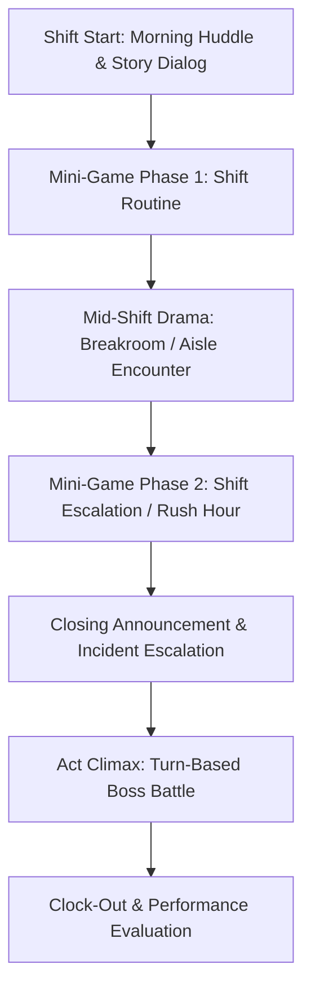

# Retail Inferno — Overall Game Design Document

> **Repository:** `retail-inferno`  
> **Package ID (`applicationId`):** `com.voicerpg.retailinferno`  
> **Engine Foundation:** `voice-rpg-engine` (Customized for touch-first & hybrid gameplay)  
> **Status:** Planning & Architectural Design Phase

---

## 1. Executive Summary & Core Pillars

*Retail Inferno* is a satirical, psychological survival JRPG set within the sprawling, windowless expanse of a mega-retail department store ("The Store"). Rather than classic high-fantasy tropes, the game translates workplace mechanics, retail culture, peer friction, and corporate dread into an RPG framework.

### Core Pillars:
1. **Touch / Button-First Control Scheme:**
   - Designed around fast, responsive on-screen virtual controls.
   - Battle UI uses tactical buttons with calibrated random tier outcomes (inherited from the `echoes-of-logos` button engine).
   - Voice controls are non-mandatory and reserved for optional flavor or accessibility.
2. **Shift Loop Architecture:**
   - Chapters represent work shifts and promotion tiers.
   - Core gameplay alternates between story dialogue, arcade-style high-production mini-games, and dramatic turn-based boss battles at the end of each act.
3. **Branching Department Origins:**
   - Character creation replaces conventional fantasy classes with **Assigned Store Departments** (Front End, Sales Floor, Backroom, Specialty), each featuring an independent narrative track.
4. **Gradual Psychological Descent:**
   - Starts cheerful, bright, and comedic in Act I.
   - Degenerates through ground-level associate toxicity in Act II.
   - Escalates into cold corporate metrics, espionage, and psychological thriller/dread in Acts III through V.

---

## 2. Store Tracks & Player Roles

Instead of selecting Warrior, Mage, or Scout, the player selects their starting department at orientation:

| Department Track | Starting Role | In-Game Playstyle | Core Equipment & Aesthetic |
|---|---|---|---|
| **Front End** | Register Cashier | High speed, multi-target barcode blasts, customer de-escalation, drawer balancing. | Register scanner, blue smock, roll of register tape, nametag lanyard. |
| **Sales Floor** | Merchandiser & Zone Associate | Zone defense, item facing, crowd navigation, physical heavy cart management. | Box cutter, yellow safety vest, shelf label gun, flatbed cart. |
| **Backroom** | Freight Unloader & Bin Runner | High physical endurance, forklift maneuvering, industrial machinery, pallet control. | Steel-toe boots, back brace, work gloves, hydraulic pallet jack. |
| **Specialty** | Counter Sales Specialist (Electronics / Deli) | Precision time-attack, high-ticket upsells, technical jargon, locked display cases. | Master key ring, black specialist polo, two-way radio, clipboard. |

---

## 3. Gameplay Loop & Chapter Flow

Each Chapter represents a pivotal **Shift** or **Work Week** in the store:



### Shift Phases:
1. **Morning Huddle / Clock-In:** Narrative dialogue, player decisions, gossip updates, and shift objectives.
2. **Mini-Game Phase 1:** High-production 2D arcade sequence reflecting daily tasks (e.g., freight hauling, crowd dodging, or counter service).
3. **Mid-Shift Drama:** Narrative inflection point occurring in the breakroom, smoking area, or managerial back office.
4. **Mini-Game Phase 2:** Escalated arcade challenge with higher stakes (e.g., top-down twin-stick shooter defense during rush hour or Black Friday sales).
5. **Act Climax Boss Battle:** Turn-based tactical battle utilizing the engine's full status, affinity, and tier-multiplier combat mechanics.
6. **Clock-Out:** Performance scoring, XP gain, store vouchers, and story flag updates.

---

## 4. Combat Mechanics & On-Screen Resonance Tiers

Boss battles repurpose the underlying engine's resonance combat system using **tactical on-screen buttons** with randomized tier calibrations (matching the `echoes-of-logos` model):

```mermaid
flowchart TD
    Btn[Player Taps Action Button on POS Terminal HUD] --> RNG{Random Tier Calibration}
    RNG -->|Standard Roll (Common)| T1["Tier I: Standard Duty (1.0x)<br/>'Clean up on Aisle 3'"]
    RNG -->|Elevated Roll (Uncommon)| T2["Tier II: Escalated Protocol (1.5x - 2.0x)<br/>'Customer Service to Register 2'"]
    RNG -->|Jackpot Roll (Rare)| T3["Tier III: Code Red Override (2.5x - 3.0x)<br/>'MANAGEMENT OVERRIDE SANCTIONED'"]
```

### Action Categories & Visual Indicator Badges:
* `[⚔️ ATK]` **Offensive:** *Barcode Laser Flash*, *Cart Slam*, *Policy Citation*, *Heavy Lift*.
* `[💥 AOE]` **Area of Effect:** *Intercom Page All*, *Spill on Floor*, *Flash Clearance Sale*, *Fire Alarm Pull*.
* `[💚 HEAL]` **Recovery:** *Union Break*, *Smuggled Energy Drink*, *Lukewarm Breakroom Coffee*, *Deep Breath*.
* `[🛡️ DEF]` **Defensive:** *Clock Out Shield*, *Show Nametag*, *"I Just Work Here" Stance*, *Wet Floor Sign*.
* `[✨ MANA / SANITY]` **Morale Boost:** *Employee Discount*, *Spite*, *Overtime Paycheck*.

### Battle Stats & Status Mechanics:
* **Combat Health (HP):** Immediate combat patience during a boss encounter (reaching 0 causes the character to break down or walk away from the argument).
* **Combat Energy (MP):** Fuel for tactical responses, policy citations, and break actions.
* **Affinity / Element:** Workplace Persona (Customer-Facing, Policy-Stickler, Slacker-Immune, Industrial).

---

## 5. Persistent Meta-Meters (The Narrative HUD)

Spanning across **Story Dialog, Mini-Games, and Boss Battles**, three persistent status gauges sit at the top of the screen:

```
[ ❤️ MORALE: ▓▓▓▓▓▓░░░░ 60% ]   [ ⚡ ENGAGEMENT: ▓▓▓░░░░░░░ 30% ]   [ ⚠️ OCCURRENCES: 3.5 / 5.0 ]
```

### 1. Morale Meter (Emotional Battery: 0% - 100%)
- **What it represents:** The character's emotional resilience, mental health, and willingness to endure retail absurdity.
- **Narrative Trajectory:** Starts at 100% in Act I; steadily eroded by peer toxicity in Act II and corporate gaslighting in Acts III–V.
- **Gameplay Effect:** When Morale is high, the player has access to witty, patient, or de-escalating dialogue choices. When Morale is depleted (<20%), dialogue choices shift to nihilistic, cynical, or explosive outbursts.

### 2. Engagement Meter (Effort & Caring: 0% - 100%)
- **What it represents:** How much the character still buys into corporate propaganda, cares about doing a good job, and believes hard work will pay off.
- **Narrative Trajectory:** High in Act I ("Employee of the Month hopeful"); drops as the player realizes slackers get promoted and good work is rewarded with more work ("Quiet Quitting").
- **Gameplay Effect:** Gates high-effort actions. A player with 15% Engagement physically cannot choose *"Stay late to fix the seasonal aisle"* or *"Help the frantic customer find baking soda"*. Instead, low engagement unlocks "slacker shortcuts" (e.g., *"Hide in the fixture room"*, *"Tell customer it's out of stock without checking"*).

### 3. Attendance Occurrence Tracker (The 5-Point "Selective Enforcement" System)
- **The Retail Dread Mechanic:** Inspired by strict real-world retail attendance policies (e.g., Walmart's 5-point system).
  - Tardy (10 mins late): `+0.5 points`
  - Unexcused Absence / Call-In: `+1.0 point`
  - Leaving Early: `+0.5 points`
  - "No Call, No Show": `+2.0 points`
- **The 5.0+ Point Paradox (Hypocritical Enforcement):**
  - Reaching **5.0 points does NOT automatically trigger immediate termination**.
  - Instead, the corporation reviews the employee through a corrupt, two-factor evaluation:
    1. **Productivity Score (Output/Velocity):** How much freight do they stock? How fast is their scan IPM? Can the store survive losing them?
    2. **Ass-Kissing Score (Brown-Nosing / Compliance):** Do they attend the morning cheer? Do they laugh at the assistant manager's jokes? Do they report coworkers?
  - **The Evaluation Outcomes at 5.0+ Points:**
    - **High Productivity + High Ass-Kissing:** Points are quietly "cleared from the system" or perpetually ignored ("points can build to 8.5 or 12.0 without a word").
    - **High Productivity + Low Ass-Kissing:** Management holds the points over the player's head as a weapon ("You're at 6.0 points, so you *will* work this weekend or we process your paperwork today").
    - **Low Productivity + High Ass-Kissing:** Management protects their favorite lackey, making excuses to corporate HR.
    - **Low Productivity + Low Ass-Kissing:** Immediate ruthless termination / Game Over.
- **The Dilemma (Desire to Not Be There vs. Survival):**
  - Story prompts regularly test the player's boiling point: *"You wake up at 5:30 AM with a pounding migraine. You have 4.5 points. Do you drag yourself into the store, or burn another point to sleep in?"*
  - Calling out pushes the player into the dangerous 5.0+ danger zone, where survival hinges on whether their output or sycophancy is high enough to dodge the corporate chopping block.

---

## 5. Mini-Game Portfolio (High-Level Concepts)

1. **Top-Down Shooter (Dead Nation Style):**
   - Twin-stick controls. Wielding handheld barcode scanners or price guns to stun, tag, and clear swarming crowds during peak holiday madness.
2. **The Pallet Haul / Aisle Dodger (Frogger / Overcooked Style):**
   - Navigating overloaded pallet jacks and carts through packed aisles while dodging runaway toddlers, spills, and blocked carts without damaging freight.
3. **The Baler Compactor (Physics / Puzzle):**
   - High-speed cardboard crushing and wire-tying before the hydraulic compactor overflows.
4. **Counter Commotion (Precision Time-Attack):**
   - Slicing deli meats to exact fractions, keying paint formulas, or finding the right key from a 50-key ring under customer pressure.

---

## 6. Architecture & File Structure

```
retail-inferno/
├── app/
│   ├── build.gradle.kts           # Configured with applicationId: com.voicerpg.retailinferno
│   └── src/main/
│       ├── assets/game/           # Content-neutral JSON data templates
│       │   ├── manifest.json      # Game title, initial scene, victory lines
│       │   ├── characters/        # Department starting identities
│       │   ├── classes/           # Associate roles & skill definitions
│       │   ├── encounters/        # Act boss battles
│       │   ├── enemies/           # Coworkers, customers, and corporate managers
│       │   ├── spells/            # Workplace actions, pages, and policies
│       │   └── story/             # Dialogue nodes and scene definitions
│       └── java/com/voicerpg/engine/
├── docs/                          # Design documentation & balance data
├── OVERALL_DESIGN.md              # High-level architecture & mechanics (this file)
├── NARRATIVE_DESIGN.md            # Comprehensive 5-act narrative and dialogue outlines
└── README.md                      # Project introduction & setup
```
