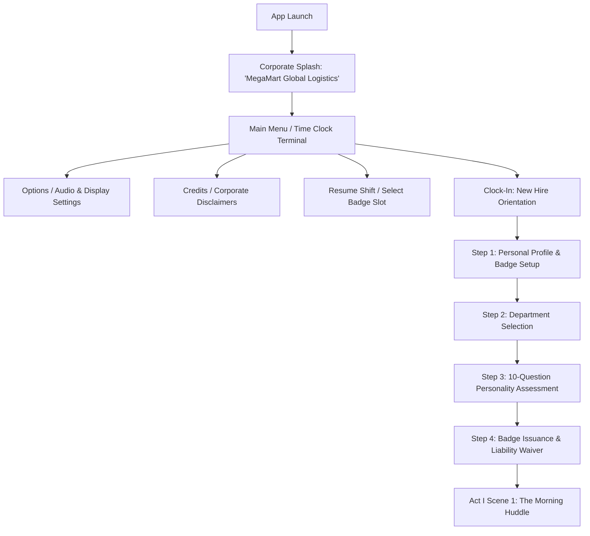
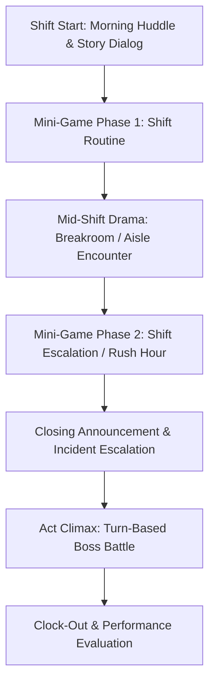

# Retail Inferno — Overall Game Design Document

> **Repository:** `retail-inferno`  
> **Package ID (`applicationId`):** `com.voicerpg.retailinferno`  
> **Engine Foundation:** `voice-rpg-engine` (Customized for touch-first & hybrid gameplay)  
> **Status:** Planning & Architectural Design Phase

---

## 1. Executive Summary & Core Pillars

*Retail Inferno* is a satirical, psychological survival JRPG set within the sprawling, windowless expanse of a mega-retail department store ("The Store"). Rather than classic high-fantasy tropes, the game translates workplace mechanics, retail culture, peer friction, and corporate dread into an RPG framework.

### Core Pillars:
1. **Touch / Button-First Control Scheme:**
   - Designed around fast, responsive on-screen virtual controls.
   - Battle UI uses tactical buttons with calibrated random tier outcomes (inherited from the `echoes-of-logos` button engine).
   - Voice controls are non-mandatory and reserved for optional flavor or accessibility.
2. **Shift Loop Architecture:**
   - Chapters represent work shifts and promotion tiers.
   - Core gameplay alternates between story dialogue, arcade-style high-production mini-games, and dramatic turn-based boss battles at the end of each act.
3. **Branching Department Origins:**
   - Character creation replaces conventional fantasy classes with **Assigned Store Departments** (Front End, Sales Floor, Backroom, Specialty), each featuring an independent narrative track.
4. **Gradual Psychological Descent:**
   - Starts cheerful, bright, and comedic in Act I.
   - Degenerates through ground-level associate toxicity in Act II.
   - Escalates into cold corporate metrics, espionage, and psychological thriller/dread in Acts III through V.

---

## 2. Game Flow: App Launch through Shift Start



### A. Title Screen (The MegaMart Time Clock Terminal)
Stripped of all fantasy artifacts (no tutorial battles, no microphone chant calibrations), the title screen presents an authentic in-universe punch clock:
* **Visual Aesthetic:** A 1990s CRT monitor embedded in breakroom faux-wood paneling, faint green phosphor text, and an electronic badge-swipe slot.
* **Ambient Audio:** 60Hz fluorescent hum, distant overhead chime, and tinny department-store elevator muzak.
* **Menu Actions:**
  1. **`[ 🏷️ CLOCK IN / NEW HIRE ]`** — Launches New Hire Orientation and Character Creation.
  2. **`[ 💳 SWIPE BADGE / RESUME ]`** — Select an active Employee File (3 slots showing Name, Department, Act, Morale, Engagement, and Attendance Points).
  3. **`[ ⚙️ STORE POLICY / OPTIONS ]`** — Sound FX, BGM volume, TTS narrator speed, button touch sensitivity.
  4. **`[ 📋 EMPLOYEE HANDBOOK / CREDITS ]`** — Satirical corporate disclaimers and credits.

---

### B. New Hire Onboarding & Creation Kiosk

#### Step 1: Personal Details & Nametag Customization
* **Employee Name:** Text input (default: *"Taylor"*).
* **Pronouns / Salutation:** Influences NPC dialogue and automated corporate paperwork.
* **Vest Accent & Flair Pins:** Choose vest accent color and starting flair pin (*"In Training"*, *"Smiley Face"*, *"Safety First"*, or *"Ask Me Anything"*).

#### Step 2: Department Assignment
Choose from the 4 primary store tracks (Front End, Sales Floor, Backroom, Specialty).

#### Step 3: The 10-Question Corporate Personality Profile Assessment
Modeled directly after notorious pre-employment personality profiling questionnaires (e.g., Unicru / Kronos retail aptitude tests). Each question has 4 forced-choice answers ranging from **Extreme Sycophant**, **Pragmatic Slacker**, **Honest Human**, to **Passive-Aggressive Rebel**. These answers calculate the player's starting **Morale (70-100%)**, **Engagement (60-100%)**, and hidden **Ass-Kissing Score (0-100)**:

1. **"An associate takes an extra 6 minutes on their scheduled 15-minute break. What is the most appropriate action?"**
   - A) *"Report their badge number immediately to Asset Protection. Time theft is real theft."* `(+Ass-Kissing 15, -Morale 5)`
   - B) *"Quietly ask them if they're okay—everyone needs a breather."* `(+Morale 10, -Engagement 5)`
   - C) *"Ignore it. If management isn't watching, it didn't happen."* `(+Slacker Bias 10)`
   - D) *"Take an extra 6 minutes on my own break to maintain corporate equilibrium."* `(+Morale 15, -Ass-Kissing 15)`

2. **"You spot an abandoned half-eaten rotisserie chicken in the toy aisle. What is your response?"**
   - A) *"Carefully inspect the chicken, log it on the inventory shrink app, sanitize the shelf, and smile!"* `(+Engagement 10, +Ass-Kissing 10)`
   - B) *"Page the maintenance associate over the intercom and walk in the opposite direction."* `(+Morale 5)`
   - C) *"Pretend I didn't see it. I work in a different department."* `(-Engagement 10)`
   - D) *"Check if it's still warm, then throw it into an empty shopping cart."* `(+Morale 10, -Engagement 5)`

3. **"How do you feel about participating in the mandatory daily MegaMart morning cheer?"**
   - A) *"I practice the synchronized clapping and spelling in front of my mirror at home!"* `(+Ass-Kissing 20, -Morale 5)`
   - B) *"I mouth the words so management doesn't pull me into an office."* `(Neutral Baseline)`
   - C) *"I strategically time my morning bathroom break to coincide with the cheer."* `(+Morale 15, -Ass-Kissing 15)`
   - D) *"I clap with dead eyes while questioning my life choices."* `(-Engagement 15, +Morale 5)`

4. **"A customer insists that a brand-new \$800 OLED TV was marked on the shelf for \$8.00. How do you resolve this?"**
   - A) *"Apologize profusely and honor the price—the customer is always our guest!"* `(+Ass-Kissing 10, -Morale 15)`
   - B) *"Explain the policy calmly while silently screaming inside."* `(+Engagement 5, -Morale 5)`
   - C) *"Call the Assistant Manager over so they can get yelled at instead of me."* `(+Morale 10)`
   - D) *"Stare at them in dead silence until they become uncomfortable and leave."* `(+Morale 15, -Ass-Kissing 10)`

5. **"Management asks you to stay past your scheduled clock-out time to unload a surprise freight truck. How do you respond?"**
   - A) *"Cancel my personal evening plans! MegaMart comes first!"* `(+Ass-Kissing 25, +Engagement 10, -Morale 20)`
   - B) *"Agree to stay, but spend half the time checking my phone behind a cardboard stack."* `(+Slacker Bias 15)`
   - C) *"Politely decline citing prior family obligations."* `(+Morale 10, -Ass-Kissing 10)`
   - D) *"Pretend I didn't hear the page, clock out at 4:59 PM, and sprint to my car."* `(+Morale 20, -Ass-Kissing 20)`

6. **"Which of the following statements best describes your philosophy on workplace safety rules?"**
   - A) *"Safety policies were written by corporate angels and must never be questioned."* `(+Ass-Kissing 15)`
   - B) *"Follow the ones that prevent losing a limb; ignore the ones that slow down productivity."* `(+Productivity Bias 10)`
   - C) *"I wear my back brace because it looks cool, not because I lift with my legs."* `(+Morale 5)`
   - D) *"Safety meetings are just a paid opportunity to sit on folding chairs and nap."* `(+Morale 10, -Engagement 10)`

7. **"You find a working handheld scanner hidden on top of the seasonal paper towel steel racks. What do you do?"**
   - A) *"Turn it into the Asset Protection office with an incident report."* `(+Ass-Kissing 15)`
   - B) *"Stash it in my personal department locker so I always have equipment."* `(+Survival Instinct 15)`
   - C) *"Leave it where it is—someone's life depends on that hidden scanner."* `(+Peer Solidarity 10)`
   - D) *"Trade its location to another associate in exchange for a free energy drink."* `(+Street Smarts 15)`

8. **"A customer approaches you with 10 expired coupons printed on illegible desktop paper. How do you proceed?"**
   - A) *"Manually key in all 10 coupons to make the customer feel valued and heard."* `(-Morale 15, +Ass-Kissing 10)`
   - B) *"Examine each expiration date with a magnifying glass while savoring their disappointment."* `(+Morale 15)`
   - C) *"Hit 'Manager Override' and pray the register doesn't flag my operator number."* `(-Engagement 10)`
   - D) *"Suddenly develop severe technical difficulties and restart the register terminal."* `(+Morale 10)`

9. **"What is the primary reason you applied to join the MegaMart family?"**
   - A) *"To build a long-term corporate career and one day manage my own district!"* `(+Ass-Kissing 20, +Engagement 15)`
   - B) *"Because human survival requires currency for rent and instant noodles."* `(Realist: +Morale 10, -Engagement 10)`
   - C) *"I was told there would be free pizza in the breakroom on weekends."* `(+Foodie Bias 10)`
   - D) *"My parole officer said I needed a W-2 job by Thursday."* `(+Chaos Bias 15)`

10. **"An executive from the Home Office is touring your aisle. What do you say when they ask how things are going?"**
    - A) *"Everything is flawless, sir! MegaMart is the greatest workplace in America!"* `(+Ass-Kissing 25, -Morale 10)`
    - B) *"Things are great, but we could really use a working pallet jack."* `(Honest: +Engagement 5, Ass-Kissing -5)`
    - C) *"Smile, nod, say 'Never better!', and retreat behind the milk crates."* `(+Pragmatism 10)`
    - D) *"Tell them the raw truth about the air conditioning being broken since June."* `(+Morale 20, -Ass-Kissing 25)`

#### Step 4: Badge Issuance & Transition to Act I Scene 1
Upon completing question 10, the kiosk displays:
```
╔══════════════════════════════════════════════════════╗
║              PROFILE CALIBRATION COMPLETE            ║
║                                                      ║
║  ASSESSMENT RATING: "POTENTIALLY COMPLIANT"          ║
║  STARTING MORALE: 85%  |  ENGAGEMENT: 90%            ║
║  BADGE #1042-882 PRINTED. PLEASE PROCEED TO ROOM B.  ║
╚══════════════════════════════════════════════════════╝
```
The screen fades from the CRT scanlines into the fluorescent glow of the Breakroom for **Act I: Scene 1 (The Morning Huddle)**.

---

## 3. Store Tracks & Player Roles

Instead of selecting Warrior, Mage, or Scout, the player selects their starting department at orientation:

| Department Track | Starting Role | In-Game Playstyle | Core Equipment & Aesthetic |
|---|---|---|---|
| **Front End** | Register Cashier | High speed, multi-target barcode blasts, customer de-escalation, drawer balancing. | Register scanner, blue smock, roll of register tape, nametag lanyard. |
| **Sales Floor** | Merchandiser & Zone Associate | Zone defense, item facing, crowd navigation, physical heavy cart management. | Box cutter, yellow safety vest, shelf label gun, flatbed cart. |
| **Backroom** | Freight Unloader & Bin Runner | High physical endurance, forklift maneuvering, industrial machinery, pallet control. | Steel-toe boots, back brace, work gloves, hydraulic pallet jack. |
| **Specialty** | Counter Sales Specialist (Electronics / Deli) | Precision time-attack, high-ticket upsells, technical jargon, locked display cases. | Master key ring, black specialist polo, two-way radio, clipboard. |

---

## 4. Gameplay Loop & Chapter Flow

Each Chapter represents a pivotal **Shift** or **Work Week** in the store:



### Shift Phases:
1. **Morning Huddle / Clock-In:** Narrative dialogue, player decisions, gossip updates, and shift objectives.
2. **Mini-Game Phase 1:** High-production 2D arcade sequence reflecting daily tasks (e.g., freight hauling, crowd dodging, or counter service).
3. **Mid-Shift Drama:** Narrative inflection point occurring in the breakroom, smoking area, or managerial back office.
4. **Mini-Game Phase 2:** Escalated arcade challenge with higher stakes (e.g., top-down twin-stick shooter defense during rush hour or Black Friday sales).
5. **Act Climax Boss Battle:** Turn-based tactical battle utilizing the engine's full status, affinity, and tier-multiplier combat mechanics.
6. **Clock-Out:** Performance scoring, XP gain, store vouchers, and story flag updates.

---

## 5. Combat Mechanics & On-Screen Resonance Tiers

Boss battles repurpose the underlying engine's resonance combat system using **tactical on-screen buttons** with randomized tier calibrations (matching the `echoes-of-logos` model):

```mermaid
flowchart TD
    Btn[Player Taps Action Button on POS Terminal HUD] --> RNG{Random Tier Calibration}
    RNG -->|Standard Roll (Common)| T1["Tier I: Standard Duty (1.0x)<br/>'Clean up on Aisle 3'"]
    RNG -->|Elevated Roll (Uncommon)| T2["Tier II: Escalated Protocol (1.5x - 2.0x)<br/>'Customer Service to Register 2'"]
    RNG -->|Jackpot Roll (Rare)| T3["Tier III: Code Red Override (2.5x - 3.0x)<br/>'MANAGEMENT OVERRIDE SANCTIONED'"]
```

### Action Categories & Visual Indicator Badges:
* `[⚔️ ATK]` **Offensive:** *Barcode Laser Flash*, *Cart Slam*, *Policy Citation*, *Heavy Lift*.
* `[💥 AOE]` **Area of Effect:** *Intercom Page All*, *Spill on Floor*, *Flash Clearance Sale*, *Fire Alarm Pull*.
* `[💚 HEAL]` **Recovery:** *Union Break*, *Smuggled Energy Drink*, *Lukewarm Breakroom Coffee*, *Deep Breath*.
* `[🛡️ DEF]` **Defensive:** *Clock Out Shield*, *Show Nametag*, *"I Just Work Here" Stance*, *Wet Floor Sign*.
* `[✨ MANA / SANITY]` **Morale Boost:** *Employee Discount*, *Spite*, *Overtime Paycheck*.

### Battle Stats & Status Mechanics:
* **Combat Health (HP):** Immediate combat patience during a boss encounter (reaching 0 causes the character to break down or walk away from the argument).
* **Combat Energy (MP):** Fuel for tactical responses, policy citations, and break actions.
* **Affinity / Element:** Workplace Persona (Customer-Facing, Policy-Stickler, Slacker-Immune, Industrial).

---

## 6. Persistent Meta-Meters (The Narrative HUD)

Spanning across **Story Dialog, Mini-Games, and Boss Battles**, three persistent status gauges sit at the top of the screen:

```
[ ❤️ MORALE: ▓▓▓▓▓▓░░░░ 60% ]   [ ⚡ ENGAGEMENT: ▓▓▓░░░░░░░ 30% ]   [ ⚠️ OCCURRENCES: 3.5 / 5.0 ]
```

### 1. Morale Meter (Emotional Battery: 0% - 100%)
- **What it represents:** The character's emotional resilience, mental health, and willingness to endure retail absurdity.
- **Narrative Trajectory:** Starts at 100% in Act I; steadily eroded by peer toxicity in Act II and corporate gaslighting in Acts III–V.
- **Gameplay Effect:** When Morale is high, the player has access to witty, patient, or de-escalating dialogue choices. When Morale is depleted (<20%), dialogue choices shift to nihilistic, cynical, or explosive outbursts.

### 2. Engagement Meter (Effort & Caring: 0% - 100%)
- **What it represents:** How much the character still buys into corporate propaganda, cares about doing a good job, and believes hard work will pay off.
- **Narrative Trajectory:** High in Act I ("Employee of the Month hopeful"); drops as the player realizes slackers get promoted and good work is rewarded with more work ("Quiet Quitting").
- **Gameplay Effect:** Gates high-effort actions. A player with 15% Engagement physically cannot choose *"Stay late to fix the seasonal aisle"* or *"Help the frantic customer find baking soda"*. Instead, low engagement unlocks "slacker shortcuts" (e.g., *"Hide in the fixture room"*, *"Tell customer it's out of stock without checking"*).

### 3. Attendance Occurrence Tracker (The 5-Point "Selective Enforcement" System)
- **The Retail Dread Mechanic:** Inspired by strict real-world retail attendance policies (e.g., Walmart's 5-point system).
  - Tardy (10 mins late): `+0.5 points`
  - Unexcused Absence / Call-In: `+1.0 point`
  - Leaving Early: `+0.5 points`
  - "No Call, No Show": `+2.0 points`
- **The 5.0+ Point Paradox (Hypocritical Enforcement):**
  - Reaching **5.0 points does NOT automatically trigger immediate termination**.
  - Instead, the corporation reviews the employee through a corrupt, two-factor evaluation:
    1. **Productivity Score (Output/Velocity):** How much freight do they stock? How fast is their scan IPM? Can the store survive losing them?
    2. **Ass-Kissing Score (Brown-Nosing / Compliance):** Do they attend the morning cheer? Do they laugh at the assistant manager's jokes? Do they report coworkers?
  - **The Evaluation Outcomes at 5.0+ Points:**
    - **High Productivity + High Ass-Kissing:** Points are quietly "cleared from the system" or perpetually ignored ("points can build to 8.5 or 12.0 without a word").
    - **High Productivity + Low Ass-Kissing:** Management holds the points over the player's head as a weapon ("You're at 6.0 points, so you *will* work this weekend or we process your paperwork today").
    - **Low Productivity + High Ass-Kissing:** Management protects their favorite lackey, making excuses to corporate HR.
    - **Low Productivity + Low Ass-Kissing:** Immediate ruthless termination / Game Over.
- **The Dilemma (Desire to Not Be There vs. Survival):**
  - Story prompts regularly test the player's boiling point: *"You wake up at 5:30 AM with a pounding migraine. You have 4.5 points. Do you drag yourself into the store, or burn another point to sleep in?"*
  - Calling out pushes the player into the dangerous 5.0+ danger zone, where survival hinges on whether their output or sycophancy is high enough to dodge the corporate chopping block.

---

## 7. Mini-Game Portfolio (High-Level Concepts)

1. **Top-Down Shooter (Dead Nation Style):**
   - Twin-stick controls. Wielding handheld barcode scanners or price guns to stun, tag, and clear swarming crowds during peak holiday madness.
2. **The Pallet Haul / Aisle Dodger (Frogger / Overcooked Style):**
   - Navigating overloaded pallet jacks and carts through packed aisles while dodging runaway toddlers, spills, and blocked carts without damaging freight.
3. **The Baler Compactor (Physics / Puzzle):**
   - High-speed cardboard crushing and wire-tying before the hydraulic compactor overflows.
4. **Counter Commotion (Precision Time-Attack):**
   - Slicing deli meats to exact fractions, keying paint formulas, or finding the right key from a 50-key ring under customer pressure.

---

## 8. Architecture & File Structure

```
retail-inferno/
├── app/
│   ├── build.gradle.kts           # Configured with applicationId: com.voicerpg.retailinferno
│   └── src/main/
│       ├── assets/game/           # Content-neutral JSON data templates
│       │   ├── manifest.json      # Game title, initial scene, victory lines
│       │   ├── characters/        # Department starting identities
│       │   ├── classes/           # Associate roles & skill definitions
│       │   ├── encounters/        # Act boss battles
│       │   ├── enemies/           # Coworkers, customers, and corporate managers
│       │   ├── spells/            # Workplace actions, pages, and policies
│       │   └── story/             # Dialogue nodes and scene definitions
│       └── java/com/voicerpg/engine/
├── docs/                          # Design documentation & balance data
├── OVERALL_DESIGN.md              # High-level architecture & mechanics (this file)
├── NARRATIVE_DESIGN.md            # Comprehensive 5-act narrative and dialogue outlines
└── README.md                      # Project introduction & setup
```
