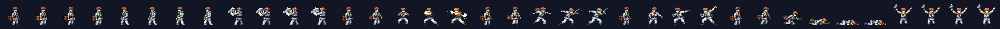
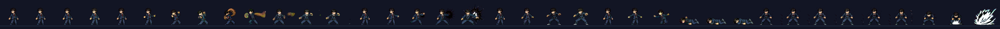
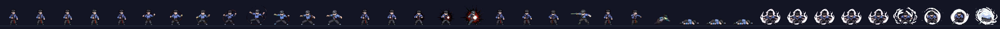

<p align="center">
  <a href="https://ko-fi.com/todd0042">
    
  </a>
</p>

---

# 🛒 Superstore Saga: Escape From MegaMart

[](https://github.com/Todd0042/superstore-saga/releases)
[](LICENSE)
[-3DDC84.svg?logo=android&logoColor=white)](https://developer.android.com)
[](https://developer.android.com/16kb-page-size)
[](https://kotlinlang.org)
[](https://developer.android.com/jetpack/compose)
[](https://github.com/Todd0042/voice-rpg-engine)
[](app/src/main/java/com/voicerpg/engine/audio/SpeechManager.kt)
[](app/src/main/java/com/voicerpg/engine/engine/ResonanceEngine.kt)
[](app/src/test/java/com/voicerpg/engine/)
[](https://ko-fi.com/todd0042)

> **A satirical, hands-free retail-survival voice JRPG for Android: pick your department at the job interview, then fight your way through 56 shifts at MegaMart Store #1042 by speaking your moves aloud, with damage that grows with how well you say them.**

---

## 📖 Table of Contents

* **Part 1 — Overview & Quick Start**
  * [🛒 What Is Superstore Saga?](#-what-is-superstore-saga)
  * [⚡ How a Shift Works in 3 Steps](#-how-a-shift-works-in-3-steps)
  * [🏢 The 4 Department Storylines](#-the-4-department-storylines)
  * [⚔️ The POS Register Terminal Battle System](#️-the-pos-register-terminal-battle-system)
  * [📸 Visual Tour](#-visual-tour)
  * [✨ Highlights at a Glance](#-highlights-at-a-glance)
  * [🚀 Quick Download & Installation](#-quick-download--installation)
* **Part 2 — Technical Documentation & Architecture Reference**
  * [1. Architecture: Engine and Game ([`.engine-sync/OWNED_PATHS`](.engine-sync/OWNED_PATHS))](#1-architecture-engine-and-game)
  * [2. Game Content & Department Routes ([`manifest.json`](app/src/main/assets/game/manifest.json), [`nodes.json`](app/src/main/assets/game/story/nodes.json), [`encounters.json`](app/src/main/assets/game/encounters/encounters.json))](#2-game-content--department-routes)
  * [3. Combat: Kits, Weaknesses, Armour & Stuns ([`classes/`](app/src/main/assets/game/classes), [`affinity_matrix.json`](app/src/main/assets/game/combat/affinity_matrix.json), [`DamageResolver.kt`](app/src/main/java/com/voicerpg/engine/combat/DamageResolver.kt))](#3-combat-kits-weaknesses-armour--stuns)
  * [4. Speech Recognition & the Hands-Free Loop ([`SpeechManager.kt`](app/src/main/java/com/voicerpg/engine/audio/SpeechManager.kt), [`commands_en.json`](app/src/main/assets/game/commands/commands_en.json))](#4-speech-recognition--the-hands-free-loop)
  * [5. Resonance Engine ([`ResonanceEngine.kt`](app/src/main/java/com/voicerpg/engine/engine/ResonanceEngine.kt))](#5-resonance-engine)
  * [6. Music & Speech Ducking ([`MusicManager.kt`](app/src/main/java/com/voicerpg/engine/audio/MusicManager.kt))](#6-music--speech-ducking)
  * [7. Store Incidents & Metrics ([`IncidentManager.kt`](app/src/main/java/com/voicerpg/engine/engine/IncidentManager.kt), [`incidents.json`](app/src/main/assets/game/incidents/incidents.json))](#7-store-incidents--metrics)
  * [8. Battle Sprites & Backdrops ([`art/SPRITE_BRIEFS.md`](art/SPRITE_BRIEFS.md), [`art/sprite_roster.json`](art/sprite_roster.json))](#8-battle-sprites--backdrops)
  * [9. Engine Sync Workflow](#9-engine-sync-workflow)
  * [10. Tests & Combat Balance ([`BalanceHarnessTest.kt`](app/src/test/java/com/voicerpg/engine/combat/BalanceHarnessTest.kt), [`balance.json`](app/src/main/assets/game/combat/balance.json))](#10-tests--combat-balance)
  * [11. Repository Structure](#11-repository-structure)
  * [12. Ethics, Provenance & Licensing ([LICENSE](LICENSE), [LICENSE-MEDIA](LICENSE-MEDIA))](#12-ethics-provenance--licensing)

---

# Part 1 — Overview & Quick Start

## 🛒 What Is Superstore Saga?

**Superstore Saga: Escape From MegaMart** is a satirical, turn-based voice JRPG for Android set in **MegaMart Store #1042**. Instead of crypts and dragons you get entitled customers, coupon hoarders, a regional auditor, a loss-prevention interrogator and a store manager with something to hide.

You play it with your voice: speak a move's name (*"Barcode scan strike!"*, *"Escalate to my supervisor!"*, *"Union break, coffee with the crew!"*) and the **Resonance Engine** scores how you said it, multiplying its effect from **1.0x up to 3.0x**. Every line of dialogue can be read aloud, so the whole game can be played eyes-free with headphones.

The game has three main parts:

1. **The hiring flow**: an online application, then an interview with HR Manager Cheryl where you choose your department.
2. **The shift story**: a 56-shift storyline for your department, with dialogue hubs, random store incidents and store metrics.
3. **Battles**: solo, real-time-gauge (ATB) fights against customers, store fixtures, loss prevention, management and corporate.

---

## ⚡ How a Shift Works in 3 Steps

1. **Apply and pick your department**: at the interview, Cheryl offers four openings: **Cashier**, **Stocker**, **Unloader** or **Specialist**. Your answer sets your route for the rest of the game; each department plays its own **56-shift story with 14 fights**.
2. **Work the shift**: talk your way through the story's choices by voice or touch, handle incidents that pop up when you return to a hub, and keep an eye on the store metrics (**Store Morale**, **Karen Index**, **Labor Squeeze**, **Engagement**).
3. **Win the fights**: speak your moves, learn each enemy's weaknesses, and beat each act's boss. Your department kit grows as the story goes on: each act's boss you beat teaches you a new move.

---

## 🏢 The 4 Department Storylines

You fight **alone**, with your department's kit. Every kit starts with an attack, **Union Break** (a coffee with the crew: a heal you aim at an ally, which in a solo run is you, restoring a fifth of max Stamina, scaled by how well you say it) and one more move, and learns four more as the story goes on (see [Part 2, section 3](#3-combat-kits-weaknesses-armour--stuns)).

| Department (class) | Stamina | Starting Kit | Learned Along the Story |
| :--- | :--- | :--- | :--- |
| **Front End (Cashier)** | 450 | *Barcode Scan* (Equipment), *Union Break*, *Coupon Shield* (guard) | *Drawer Smash* (Store Policy), *Express Lane* (Hustle, hits everyone), *Escalate* (Chain of Command), *Strength in Numbers* (Solidarity) |
| **Sales Floor (Stocker)** | 580 | *Box Cutter Slash* (Elbow Grease), *Union Break*, *Cart Push* (Hustle) | *Flatbed Charge* (Hustle), *Escalate*, *By the Book* (Store Policy), *Strength in Numbers* |
| **Backroom (Unloader)** | 700 | *Pallet Crush* (Elbow Grease), *Union Break*, *Shrink Wrap Hold* (guard) | *Baler Grind* (Equipment), *Escalate*, *By the Book*, *Strength in Numbers* |
| **Specialty (Specialist)** | 420 | *Warranty Pitch* (Upsell), *Union Break*, *Price Check* (guard) | *Closing Pitch* (Upsell), *Flash Sale* (Hustle, hits everyone), *By the Book*, *Strength in Numbers* |

The bosses every department meets: **District VP Vance** (shift 10) and **District Auditor Vance** (shift 34), both the **Regional Auditor**; the **Slacker Veteran** (shift 22); **Loss Prevention Clint** (shift 46); and **Store Manager Henderson** (the shift 55 finale).

---

## ⚔️ The POS Register Terminal Battle System

Combat in *Superstore Saga* represents high-stakes retail showdowns. The combat interface is styled as a retro Point-of-Sale terminal:
- **Stamina (HP)**: Your physical energy: 420 (Specialist) to 700 (Unloader), by department. Dropping to 0 triggers an unpaid disciplinary review in HR.
- **No mana, no cooldowns**: every move is always available; the right choice comes from what the enemy is weak to (Hustle, Store Policy, Equipment, Solidarity, Chain of Command, Upsell or Elbow Grease) and what it shrugs off. A hit reveals a weakness, and the game remembers it.
- **Turn gauge (ATB)**: everyone's gauge fills at their own speed; whoever fills it first acts next.
- **Guard moves**: Coupon Shield, Price Check and Shrink Wrap Hold put you on guard, halving the next hit. A stun (from an overloading sensor or a freeze) skips one turn, then you shrug off stuns for two turns, and the same rule protects your enemies.
- **Armor**: fixtures and plated foes take less from Elbow Grease blows; Equipment (electrical) attacks conduct through armor and hit harder.

---

## 📸 Visual Tour

### Battle Sprites

Every frame of a battle sheet, from idle through attack, hurt and knockout (previews from [`art/sprite-previews/`](art/sprite-previews)).

| **The Associate (you)** |
| :---: |
|  |
| *The player's new hire in the royal-blue MegaMart vest, 64 px side view.* |

| **Store Manager Henderson** |
| :---: |
|  |
| *The finale boss, drawn on a 128 px sheet.* |

| **Regional Auditor** |
| :---: |
|  |
| *Corporate's boss for the shift 10 inspection and the shift 34 audit.* |

---

## ✨ Highlights at a Glance

* **🏢 Four Department Storylines**: the interview choice sets your route; each department plays its own 56 shifts with 14 fights.
* **🗣️ Speak Your Moves**: every move has a spoken chant and aliases; the Resonance Engine turns delivery into a 1.0x to 3.0x multiplier.
* **📈 A Kit That Grows**: three moves to start, four more learned from the story, one per act boss.
* **🎯 Weaknesses You Learn**: 7 move types against 7 enemy families, plus per-enemy weaknesses and resistances; a weakness you find is remembered.
* **🛡️ Armour and Stuns With Rules**: armour only stops physical blows (electrical ones conduct through it), and a stunned fighter shrugs off the next stun for a while.
* **🧾 No Mana**: every move is always available, so choosing well is about the matchup, not the budget.
* **🎧 Eyes-Free Play**: narration, read-aloud choices, auto-listen and voice meta-commands (*"Status"*, *"Enemies"*, *"Read choices"*, *"Pocket mode"*, *"Options"*), with a true-black Pocket Mode touch guard.
* **🚨 Store Incidents**: 50 department-specific incidents can interrupt your return to a hub.
* **🌍 Six Command Languages**: voice commands in English, German, Spanish, French, Italian and Portuguese.

---

## 🚀 Quick Download & Installation

### Android (release APK)

1. Download **`app-debug.apk`** from the latest release on the [Releases page](https://github.com/Todd0042/superstore-saga/releases).
2. Install it on a device running **Android 8.0 or higher (API 26+)** (allow installs from your browser or file manager).
3. Grant **Microphone** permission on first launch to enable voice commands.

### Run from source

```bash
# The engine repo is expected next to this one (../voice-rpg-engine) for its scripts
git clone https://github.com/Todd0042/superstore-saga.git
cd superstore-saga

# Build the debug APK and install it on a connected phone
./gradlew assembleDebug
adb install -r app/build/outputs/apk/debug/app-debug.apk

# Confirm 16 KB page-size compatibility
bash ../voice-rpg-engine/scripts/check_16kb.sh app/build/outputs/apk/debug/app-debug.apk
```

---

# Part 2 — Technical Documentation & Architecture Reference

> *The sections below are a code-verified engineering reference for this repository: every number, file and rule is taken from the current content and engine code.*

## 1. Architecture: Engine and Game

*Superstore Saga* runs on the shared **[VoiceRPG Engine](https://github.com/Todd0042/voice-rpg-engine)**. The engine code is a read-only copy in this repo; everything retail-specific is JSON content and art.

```
+-----------------------------------------------------------------------+
|                 ENGINE (read-only copy, com.voicerpg.engine.*)        |
|  SpeechManager | ResonanceEngine | CombatViewModel | StoryViewModel   |
|  DamageResolver | StatusSystem | IncidentManager | MusicManager       |
+-----------------------------------------------------------------------+
                                   |
                                   v
+-----------------------------------------------------------------------+
|                 GAME CONTENT (app/src/main/assets/game/)              |
|  manifest | classes | spells | enemies | encounters | story | combat  |
+-----------------------------------------------------------------------+
```

The engine-owned paths are listed in [`.engine-sync/OWNED_PATHS`](.engine-sync/OWNED_PATHS):

| Path | Contents |
| :--- | :--- |
| `app/src/main/java/com/voicerpg/engine/` | All engine code, including `MainActivity.kt` |
| `app/src/main/assets/game/commands/` | Voice meta-commands and actions in 6 languages |
| `app/src/main/assets/game/localization/` | Engine UI phrases |
| `app/src/test/java/com/voicerpg/engine/` | Engine tests, run against this game's content |
| `app/src/test/fixtures/template-pack/` | The template content pack used by engine tests |

A pre-commit hook and CI (`.engine-sync/guard.sh`, [`.github/workflows/engine_guard.yml`](.github/workflows/engine_guard.yml)) reject any change there that doesn't match the synced engine version. Game-specific tests live in `app/src/test/java/com/voicerpg/game/`.

Speech recognition prefers the device: on Android 12+ (API 31+) it uses `SpeechRecognizer.createOnDeviceSpeechRecognizer` when on-device recognition is available, otherwise the system recognizer with `EXTRA_PREFER_OFFLINE`.

---

## 2. Game Content & Department Routes

All gameplay data lives under `app/src/main/assets/game/`:

| File | What it holds |
| :--- | :--- |
| [`manifest.json`](app/src/main/assets/game/manifest.json) | Title, start scene (`scene_online_app`), default encounter (`encounter_register_rush`), `combatResource: "none"` (no mana), `routeFlagPrefix: "role_"` |
| [`classes/*.json`](app/src/main/assets/game/classes) | The 4 classes: Stamina, speed, attack, `starterSpellIds` and `spellGrants` (moves learned at story flags) |
| [`spells/spells.json`](app/src/main/assets/game/spells/spells.json) | Every move: school, base power, chant, aliases, guard/heal/hits-all flags |
| [`enemies/enemies.json`](app/src/main/assets/game/enemies/enemies.json) | 17 enemy templates in 7 families, with `weak`, `resist` and `armor` |
| [`encounters/encounters.json`](app/src/main/assets/game/encounters/encounters.json) | 20 encounters (7 original, 13 added by [`docs/FIGHTS_PROPOSAL.md`](docs/FIGHTS_PROPOSAL.md)) |
| [`combat/affinity_matrix.json`](app/src/main/assets/game/combat/affinity_matrix.json) | School-vs-family multipliers and the retail names of schools and families |
| [`combat/balance.json`](app/src/main/assets/game/combat/balance.json) | Balance point (x1.5 resonance) and difficulty |
| `story/scenes.json`, `story/nodes.json` | 9 scenes and 512 dialogue nodes |
| [`incidents/incidents.json`](app/src/main/assets/game/incidents/incidents.json), [`metrics/metrics.json`](app/src/main/assets/game/metrics/metrics.json) | 50 store incidents and 4 store metrics |
| `characters/*.json` | The cast: narrator, the player, store staff and management (16 files) |
| `translations/strings_<lang>.json` | Story and content translations (de, es, fr, it, pt) |

### Department routes

At `node_interview_positions`, Cheryl offers four choices (`choice_track_cashier`, ...). The locker-room node for each sets the route flag (`role_cashier`, `role_stocker`, `role_unloader`, `role_specialist`), and branch nodes (`flagRoutes`) send each route to its own shift nodes (`node_shiftN_<dept>`).

### Fights per department (14 each)

A new fight sits on its own lead-in node (`node_shiftN_<dept>_fight`) between a story beat's choice and the next shift, because a node with `triggerBattleEncounterId` goes straight to battle and skips its choices.

| Shift | Unloader | Stocker | Cashier | Specialist |
| :--- | :--- | :--- | :--- | :--- |
| 1 | Register Rush | Register Rush | Register Rush | Register Rush |
| 7 | Saturday Rush | Saturday Rush | Saturday Rush | Saturday Rush |
| 10 | VP Vance (boss) | VP Vance (boss) | VP Vance (boss) | VP Vance (boss) |
| 11-12 | The Screamer (12) | | Clopening Coupons (11) | Locked Case Riot (12) |
| 15 | Go-Back Golem | Go-Back Golem | Go-Back Golem | Go-Back Golem |
| 20 | | Forklift Cowboy Derrick | | |
| 22 | Slacker showdown (boss) | Slacker showdown (boss) | Slacker showdown (boss) | Slacker showdown (boss) |
| 26 | Code Spark | Code Spark | Code Spark | Code Spark |
| 29 | Sensor Meltdown | Sensor Meltdown | Sensor Meltdown | Sensor Meltdown |
| 34 | Auditor standoff (boss) | Auditor standoff (boss) | Auditor standoff (boss) | Auditor standoff (boss) |
| 36 | AP Shakedown | AP Shakedown | AP Shakedown | AP Shakedown |
| 46 | Clint (boss) | Clint (boss) | Clint (boss) | Clint (boss) |
| 48 | Lockdown: Derrick | Lockdown: Todd | Lockdown: Marsha | Lockdown: Chad |
| 53 | Henderson's Last Line (Cheryl) | same | same | same |
| 55 | Henderson (finale) | Henderson (finale) | Henderson (finale) | Henderson (finale) |

Each column has 14 fights: the stocker has no shift 11-12 fight (its Act II fights are 15 and 20), the other three have no shift 20 fight. The five boss encounters (shifts 10, 22, 34, 46, 55) use `bossPhases`.

---

## 3. Combat: Kits, Weaknesses, Armour & Stuns

### Move types (schools)

The engine's seven schools carry retail names (`schoolNames` in [`affinity_matrix.json`](app/src/main/assets/game/combat/affinity_matrix.json)):

| Engine school | In this game |
| :--- | :--- |
| `PHYSICAL` | Elbow Grease |
| `ELECTROMANCY` | Equipment |
| `CRYOMANCY` | Store Policy |
| `PYROMANCY` | Hustle |
| `HOLY` | Chain of Command |
| `SHADOW` | Upsell |
| `NATURE` | Solidarity |

### Enemies

| Family (display name) | Weak to (matrix 1.5+) | Enemies |
| :--- | :--- | :--- |
| Customers (`FLESH`) | Chain of Command, Store Policy, Upsell | Entitled Customer, Extreme Couponer |
| Crowds (`VERDANT`) | Hustle | Floor Rush Crowd |
| Lifers (`UNDEAD`) | Solidarity, Hustle, Chain of Command | Slacker Veteran (boss), `rival_derrick`, `rival_chad` |
| Fixtures (`CONSTRUCT`) | Elbow Grease, Equipment | Practice Dummy, **The Screamer** (`runaway_pallet_jack`), **Go-Back Golem** |
| Loss Prevention (`VOID`) | Equipment, Solidarity | Loss Prevention Clint (boss), **Shrink Sentinel**, **Asset Protection Officer** |
| Management (`RADIANT`) | Upsell, Solidarity | Store Manager Henderson (boss), `rival_todd`, `rival_marsha` |
| Corporate (`SILENCE`) | Store Policy | Regional Auditor (boss), `rival_cheryl` |

Each enemy can add its own `weak` (x2.0) and `resist` (x0.8) on top of its family; the matrix is floored at 0.8, so nothing is immune. The four **bold** enemies still need their own sprite sheets (see [section 8](#8-battle-sprites--backdrops)).

### Learned weaknesses

A hit at x1.5 or more reveals that weakness; it is saved in the bestiary (`bestiaryWeaknesses` in the save) and read out when you ask for the enemies, so it stays known in later fights.

### Kits learned from the story

Every class learns at the same four milestones, set on its own department's act-boss victory nodes (`spellGrants` in [`classes/*.json`](app/src/main/assets/game/classes)):

| Flag (set on) | Cashier | Stocker | Unloader | Specialist |
| :--- | :--- | :--- | :--- | :--- |
| `flag_act1_showcase_won` (shift 10 victory) | Drawer Smash | Flatbed Charge | Baler Grind | Closing Pitch |
| `flag_act2_slacker_beaten` (shift 22 victory) | Express Lane | Escalate | Escalate | Flash Sale |
| `flag_act3_audit_survived` (shift 34 victory) | Escalate | By the Book | By the Book | By the Book |
| `flag_act4_interrogation_broken` (shift 46 victory) | Strength in Numbers | Strength in Numbers | Strength in Numbers | Strength in Numbers |

### Combat rules

| Rule | How it works (engine source) |
| :--- | :--- |
| **No mana** | `combatResource: "none"` in the manifest: no move costs anything. |
| **Union Break** | `isHeal`, `target: "ally"`, `healPctOfMax: 0.2`: heals 20% of the target's max Stamina times the resonance multiplier. |
| **Guard** | Coupon Shield, Price Check and Shrink Wrap Hold (`isGuard`) halve incoming damage while on guard (`GUARD_MULTIPLIER = 0.5`). |
| **Armour** | Physical (Elbow Grease) hits lose the target's `armor` value; Equipment (electrical) hits on an armoured target do x1.25 (`LIGHTNING_VS_ARMOR`); other schools ignore armour ([`DamageResolver.kt`](app/src/main/java/com/voicerpg/engine/combat/DamageResolver.kt)). 11 enemies have armour: the 4 bosses (15-35), The Screamer, Shrink Sentinel and the 5 rivals. |
| **Stun fatigue** | Overload and freeze are stuns. After one, the fighter shrugs off new stuns for 2 of its turns (bosses 3) ([`StatusSystem.kt`](app/src/main/java/com/voicerpg/engine/combat/StatusSystem.kt)). |
| **Damage** | Base power x affinity x resonance (1.0-3.0) x variance (0.9-1.1), 8% crit chance at x1.5, minus defence. |

---

## 4. Speech Recognition & the Hands-Free Loop

[`SpeechManager.kt`](app/src/main/java/com/voicerpg/engine/audio/SpeechManager.kt) runs Android's `SpeechRecognizer` (free-form model, partial results), measures RMS volume and pitch for the Resonance Engine, and briefly mutes system/notification streams so the OS listening chime stays silent (music and TTS are left alone). [`IntentParser.kt`](app/src/main/java/com/voicerpg/engine/engine/IntentParser.kt) maps what was heard to a move, a target or a meta-command. With auto-listen on, the microphone re-arms after narration finishes.

Meta-commands come from [`commands_en.json`](app/src/main/assets/game/commands/commands_en.json) (and its de, es, fr, it, pt versions). A selection:

| Command | Example phrases |
| :--- | :--- |
| `STATUS_REPORT` | "status", "status report", "health" |
| `CHECK_ENEMIES` | "enemies", "check enemies", "who is left" |
| `TOGGLE_EYES_FREE` | "pocket mode", "eyes free", "screenless" |
| `TOGGLE_AUTO_LISTEN` | "auto listen", "hands free" |
| `TOGGLE_NARRATION` | "toggle narration", "narration on" |
| `TOGGLE_READ_CHOICES` | "read choices", "read options" |
| `OPEN_OPTIONS` | "options", "settings", "menu" |
| `STORY_RECAP` | "recap", "story so far", "where was I" |
| `HELP` | "help", "what can I say" |

**Pocket Mode** draws a true-black full-screen touch guard ([`PocketModeTouchGuard.kt`](app/src/main/java/com/voicerpg/engine/ui/pocket/PocketModeTouchGuard.kt)) so the phone can sit in a pocket while the game is played by ear.

---

## 5. Resonance Engine

[`ResonanceEngine.kt`](app/src/main/java/com/voicerpg/engine/engine/ResonanceEngine.kt) scores each spoken move in bonus points (0-200) and turns them into a multiplier: **multiplier = 1.0 + bonus / 100**, so 1.0x to 3.0x. This game uses the engine's default `CLASSIC` profile.

| Dimension | Up to | Source |
| :--- | :--- | :--- |
| Lexical length (word count) | +45 | 3+ words start to score; 12+ words score the maximum |
| Thematic roots matched for the move's school | +45 | [`SpellThesaurus.kt`](app/src/main/java/com/voicerpg/engine/engine/SpellThesaurus.kt) |
| Poetic phrasing | +12 | Vocatives and invocation phrases |
| Volume / projection | +40 | Microphone RMS |
| Inflection / pitch movement | +40 | Pitch tracking |
| Novelty | +30 | A fresh phrasing scores; a repeat scores x0.5, x0.25, then x0.1 ([`NoveltyCache.kt`](app/src/main/java/com/voicerpg/engine/engine/NoveltyCache.kt)) |

| Tier | Bonus points | Multiplier |
| :--- | :--- | :--- |
| **Basic Chant** | 0-19 | 1.00x-1.19x |
| **Adept Resonance** | 20-54 | 1.20x-1.54x |
| **Master Incantation** | 55-99 | 1.55x-1.99x |
| **Mythic Logos** | 100-154 | 2.00x-2.54x |
| **Transcendental Logos** | 155-200 | 2.55x-3.00x |

---

## 6. Music & Speech Ducking

[`MusicManager.kt`](app/src/main/java/com/voicerpg/engine/audio/MusicManager.kt) plays the three OGG tracks in `assets/audio/music/` (`bgm_title.ogg`, `bgm_exploration.ogg`, `bgm_combat.ogg`) on the media stream with persistent audio focus.

| Setting | Value |
| :--- | :--- |
| Default music volume | 0.55 |
| Ducked while narration speaks | x0.22 of the music volume (`DUCK_RATIO`), faded in and out |
| System duck request (e.g. navigation prompt) | x0.3 |

---

## 7. Store Incidents & Metrics

When you return to a story hub that allows incidents, there is a 45% chance that [`IncidentManager.kt`](app/src/main/java/com/voicerpg/engine/engine/IncidentManager.kt) picks one of the **50 incidents** in [`incidents.json`](app/src/main/assets/game/incidents/incidents.json) by weight (base weight, flag and metric conditions, metric-based multipliers). Incidents are one-time story scenes (a runaway cart train, a honey spill, a lost toddler, a mystery shopper, a padlocked fire exit...), most written per department.

The four store metrics ([`metrics.json`](app/src/main/assets/game/metrics/metrics.json)):

| Metric | Starts at | Danger when |
| :--- | :--- | :--- |
| Store Morale | 65 | low |
| Karen Index | 15 | high |
| Labor Squeeze | 40 | high |
| Engagement | 70 | low |

---

## 8. Battle Sprites & Backdrops

`app/src/main/assets/game/sprites/sheets/` holds **22 animated side-view battle sheets** (Aseprite PNG + JSON): the Associate, 7 enemies (Practice Dummy, Entitled Customer, Extreme Couponer, Floor Rush Crowd, Regional Auditor, Slacker Veteran, Loss Prevention Clint), Store Manager Henderson as a **128 px** boss, and 13 store staff, all others at 64 px.

* The roster that maps every enemy to its sprite, with the artist's brief, is [`art/sprite_roster.json`](art/sprite_roster.json) / [`art/SPRITE_BRIEFS.md`](art/SPRITE_BRIEFS.md), applied with the engine's `scripts/sprite_roster.py superstore-saga --apply`.
* The **4 new enemies** (The Screamer, Go-Back Golem, Shrink Sentinel, Asset Protection Officer) are briefed but their sheets are **not made yet**; until then the engine draws them with its built-in pixel-grid fallback.
* The five `rival_*` enemies use the store staff's delivered sheets (`derrick`, `todd`, `marsha`, `chad`, `cheryl`).
* `../voice-rpg-engine/scripts/sprite_coverage.sh superstore-saga` lists what the sprite contract still wants before a release build is allowed.

`environments/environments.json` lists five 1344x768 pixel-art battle backdrops (`assets/environments/*.png`), each with its painted floor line (`artHorizon`) so combatants stand on the floor; the current fights use two of them (`DUNGEON` and `CASTLE`). Story scenes use the store backgrounds in `assets/story/`.

---

## 9. Engine Sync Workflow

Engine changes are made in `../voice-rpg-engine` and pushed to every game:

```bash
# In the engine: test against every game's content, then push the engine to the games
cd ../voice-rpg-engine
./scripts/test_content_packs.sh superstore-saga
./scripts/sync_engine_to_games.sh --verify superstore-saga

# Report sync status (in sync / modified / out of date) for each game
./scripts/sync_engine_to_games.sh --check
```

The synced engine commit is recorded in `.engine-sync/ENGINE_VERSION`, with checksums in `.engine-sync/MANIFEST.sha256`.

---

## 10. Tests & Combat Balance

The repository has **368 automated unit tests** (JUnit, run on the JVM): the engine's suite run against this game's content, plus game tests in `app/src/test/java/com/voicerpg/game/`.

```bash
# Run the unit tests
./gradlew testDebugUnitTest

# Build the debug APK
./gradlew assembleDebug
```

Coverage includes:
- Story graph: no dead ends ([`StoryNoDeadEndsTest.kt`](app/src/test/java/com/voicerpg/engine/story/StoryNoDeadEndsTest.kt)), flag routes, hub completion, and Pure Story Mode auto-playing the whole game to the end.
- Combat: damage, armour and lightning, stun fatigue, statuses, enemies and bestiary, story-learned spells, no-mana play.
- The **Balance Harness** ([`BalanceHarnessTest.kt`](app/src/test/java/com/voicerpg/engine/combat/BalanceHarnessTest.kt)): invariants such as "voice skill outweighs a matchup".
- Resonance tiers, speech, narration, localization and saves.

**Combat balance.** Every story fight is played by the engine's battle simulator (`BalanceContractTest`: the real combat on virtual time, with the hero and the moves the story has given them at that point): 56 fights (14 for each of the 4 departments). A sensible player at the balance point (**x1.5** resonance, [`combat/balance.json`](app/src/main/assets/game/combat/balance.json)) should win in a target number of rounds with a safety margin that narrows toward the finale, a lazy x1.1 player should be able to lose late bosses, healing should never take over a fight, and Pure Story Mode must win every fight. The enemy HP and attack in [`encounters.json`](app/src/main/assets/game/encounters/encounters.json) were tuned to those targets with the engine's `BalanceTunerTest`; the report of every fight is written to `app/build/reports/balance.txt` (it reports rather than fails the build: a handful of fights still sit just outside a target).

---

## 11. Repository Structure

```
superstore-saga/
├── app/
│   ├── build.gradle.kts                  # App id, version (0.2.0-alpha), SDK 26-35, dependencies
│   └── src/
│       ├── main/
│       │   ├── java/com/voicerpg/engine/ # VoiceRPG engine (read-only synced copy)
│       │   ├── assets/
│       │   │   ├── game/                 # Game content: manifest, classes, spells, enemies, encounters, story...
│       │   │   ├── audio/music/          # Title, exploration and combat music (OGG)
│       │   │   ├── environments/         # Battle backdrops
│       │   │   ├── portraits/            # Character portraits
│       │   │   └── story/                # Story scene backgrounds
│       │   └── res/                      # App icon and Android resources
│       └── test/
│           ├── java/com/voicerpg/engine/ # Engine tests (synced, run on this game's content)
│           └── java/com/voicerpg/game/   # Game-specific tests
├── art/
│   ├── SPRITE_BRIEFS.md                  # Artist briefs for every battle sprite
│   ├── sprite_roster.json                # Enemy -> sprite roster
│   └── sprite-previews/                  # Frame strips of the delivered sheets
├── docs/
│   ├── FIGHTS_PROPOSAL.md                # The 14-fights-per-department plan
│   ├── ENEMY_TYPES_PROPOSAL.md           # Enemy families and weaknesses plan
│   └── combat-design/                    # Combat spec and balance harness notes
├── .engine-sync/                         # Engine version, checksums, guard and release gate
├── .github/workflows/                    # Android CI and engine guard
├── *.md                                  # Earlier design documents (narrative, combat, UI, schema)
├── LICENSE                               # PolyForm Noncommercial 1.0.0 (code)
└── LICENSE-MEDIA                         # CC BY-NC 4.0 (art, music, portraits)
```

---

## 12. Ethics, Provenance & Licensing

### 🧾 Provenance

* **Original satire**: MegaMart, its staff, customers and story are original fiction.
* **AI-assisted development**: the code, content and story were developed with AI coding assistants.
* **AI-assisted battle art**: the battle sprite sheets and the battle backdrops are AI-assisted (made with Antigravity from the game's own portraits and briefs).

### 🔒 Privacy

* Speech is recognised by Android's recognizer, on the device whenever on-device recognition is available. The game has no telemetry; saves stay on the phone.

### ⚖️ Software License & Commercial Inquiries

* **Non-Commercial Use (Free, Source-Available)**: *Superstore Saga* is licensed for personal, hobbyist, educational, and non-commercial use under the **[PolyForm Noncommercial License 1.0.0](LICENSE)**.
* **Commercial Licensing Inquiries**: commercial use (inside a company, in a paid product or service, or for profit) requires a separate license from [Todd0042](https://github.com/Todd0042).
* **Media License**: the images, artwork and audio made for this project (paths listed in [LICENSE-MEDIA](LICENSE-MEDIA)) are © Todd0042 under **[CC BY-NC 4.0](LICENSE-MEDIA)**: free to share and adapt with credit for non-commercial purposes; commercial use requires permission.

---

<p align="center">
  If you enjoy Superstore Saga, consider supporting its development:<br/><br/>
  <a href="https://ko-fi.com/todd0042" target="_blank">
    
  </a>
</p>

---

<p align="center">
  <a href="https://ko-fi.com/todd0042">
    
  </a>
</p>
