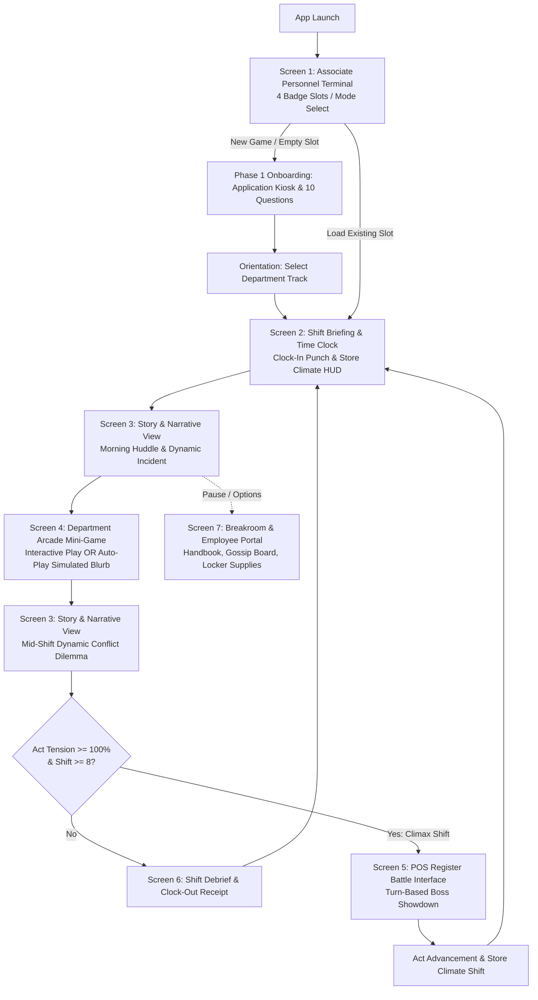

# Retail Inferno — UI/UX Layout & Wireframe Architecture

> **Topic:** Screen Flow, Jetpack Compose Hierarchy, Visual Language, and Wireframe Layouts  
> **Aesthetic Theme:** "Satirical MegaMart Beige & Corporate Fluorescent" — Utilitarian department store signage, retro CRT terminal scanlines, thermal paper receipts, plastic company name badges, and vibrant arcade overlays.

---

## 1. Visual Language & Design System

### A. Color Palette
| Token Name | Hex Code | Visual Meaning / Usage |
|---|---|---|
| `MegaMartBeige` | `#F5F2EB` | Background for standard story cards and employee handbooks |
| `CorporateNavy` | `#1A2B4C` | Primary executive text, header bars, and nametag borders |
| `VestBlue` | `#0055A5` | Front-end cashier vest blue, active interactive buttons |
| `SafetyYellow` | `#FFC220` | Sales floor safety vest, hazard alerts, caution cones |
| `WarehouseSteel` | `#33373D` | Backroom industrial frames, compactor metal, POS bezel |
| `FluorescentWhite`| `#FAFDFE` | Stark fluorescent light glow on sales floor linoleum |
| `TerminalGreen` | `#33FF33` | CRT monitor scanline text, clock-in approvals, high productivity |
| `OccurrenceRed` | `#D92B2B` | Attendance occurrence warnings, tardy flags, boss HP bar |
| `ThermalPaper` | `#FFFDF7` | Shift debrief receipts, printed write-ups, application forms |

### B. Typography & Font Hierarchy
* **Signage & Headers (Bold Sans-Serif):** *MegaMart Industrial Bold* — used for department banners, boss titles, and screen headers.
* **Dialogue & Narrative (Clean Readable Sans):** *System Sans (Roboto/Inter)* — high legibility for rapid TTS-synchronized story dialogue.
* **System & Data (Monospace Receipt Font):** *Thermal Dot-Matrix* — used for timecards, register receipts, occurrence logs, and POS keypad digits.

### C. Audio Feedback Design
* **Clock-In Swipe:** Sharp plastic badge friction + dual-tone electronic confirmation beep (`*CHIME-BEEP*`).
* **Barcode Scan:** High-pitch crisp optical register chirp (`*BEEP*`).
* **Cash Drawer Slam:** Spring-loaded heavy sheet-metal slide + deafening mechanical bell kick (`*KER-CHING-CLANG*`).
* **Hydraulic Compactor:** Low 40Hz industrial hydraulic hum with rhythmic metallic creaks.
* **Overhead Intercom:** Two-note ding-dong chime (`*DING-DONG*`) preceding managerial voice pages.

---

## 2. Complete Screen Navigation Flow



---

## 3. Detailed Screen Wireframes & UI Specifications

### Screen 1: The Associate Personnel Terminal (Title & Slot Selection)
*An authentic corporate employee login terminal with 4 physical employee badge slots.*

```
╔══════════════════════════════════════════════════════════════════════╗
║  MEGAMART STORE #1042                     ASSOCIATE FILING TERMINAL  ║
╠══════════════════════════════════════════════════════════════════════╣
║                                                                      ║
║  ┌──────────────────────────────┐  ┌──────────────────────────────┐  ║
║  │ [BADGE PHOTO]   SLOT 1       │  │ [BADGE PHOTO]   SLOT 2       │  ║
║  │ NAME: Taylor                 │  │ NAME: Jordan                 │  ║
║  │ DEPT: Front End Cashier      │  │ DEPT: Backroom Freight       │  ║
║  │ ACT:  Act II (Shift 16)      │  │ ACT:  Act I (Shift 4)        │  ║
║  │ MORALE: 65% | ENGAGE: 40%    │  │ MORALE: 95% | ENGAGE: 90%    │  ║
║  │ OCCURRENCES: [ 1.5 / 5.0 ]   │  │ OCCURRENCES: [ 0.0 / 5.0 ]   │  ║
║  │ [ > RESUME SHIFT ]           │  │ [ > RESUME SHIFT ]           │  ║
║  └──────────────────────────────┘  └──────────────────────────────┘  ║
║                                                                      ║
║  ┌──────────────────────────────┐  ┌──────────────────────────────┐  ║
║  │ [BADGE PHOTO]   SLOT 3       │  │ [EMPTY BADGE CLIP]  SLOT 4   │  ║
║  │ NAME: Morgan                 │  │                              │  ║
║  │ DEPT: Sales Floor Merchandiser│ │     NEW APPLICANT KIOSK      │  ║
║  │ ACT:  Act IV (Shift 41)      │  │                              │  ║
║  │ MORALE: 18% | ENGAGE: 10%    │  │  [ + SUBMIT APPLICATION ]    │  ║
║  │ OCCURRENCES: [ 4.5 / 5.0 ] ⚠️│  │                              │  ║
║  │ [ > RESUME SHIFT ]           │  │                              │  ║
║  └──────────────────────────────┘  └──────────────────────────────┘  ║
║                                                                      ║
║  [ ⚙️ GLOBAL SETTINGS ]     [ 🎧 AUDIO & VOICES ]     [ ❓ CREDITS ] ║
╚══════════════════════════════════════════════════════════════════════╝
```

#### Modal on Slot Tap:
* **`[ 🎮 MANUAL SHIFT (Interactive) ]`** — Complete hands-on experience: manual dialogue decisions, full arcade mini-games, and POS tactical combat.
* **`[ 📖 PURE STORY SHIFT (Auto-Play) ]`** — Simulated mini-games with narrative blurbs, archetype-driven narrative decisions, and hands-free character TTS narration.

---

### Screen 2: Shift Briefing & Time Clock (Pre-Shift Briefing)
*Presents the time clock swipe animation, shift details, and the Store #1042 Macro Climate.*

```
╔══════════════════════════════════════════════════════════════════════╗
║ [MEGAMART LOGO] TIME & ATTENDANCE TERMINAL            STORE #1042    ║
╠══════════════════════════════════════════════════════════════════════╣
║                                                                      ║
║   >>> [ >>> SWIPE PLASTIC BADGE ACROSS SENSOR >>> ] >>>              ║
║       PUNCH CONFIRMED: 06:58 AM (ON TIME) | BADGE #1042-882          ║
║                                                                      ║
║ ┌──────────────────────────────────────────────────────────────────┐ ║
║ │ SHIFT BRIEFING: SHIFT 18 OF 56 (ACT II: BREAKROOM POLITICS)       │ ║
║ │ ASSIGNED TRACK: SALES FLOOR (AISLE RECOVERY & ZONING)             │ ║
║ │ SCHEDULED: 07:00 AM - 03:30 PM | SUPERVISOR: SALES FLOOR MGR TODD │ ║
║ └──────────────────────────────────────────────────────────────────┘ ║
║                                                                      ║
║ ┌──────────────────────────────────────────────────────────────────┐ ║
║ │ STORE #1042 MACRO ENVIRONMENTAL CLIMATE                          │ ║
║ │ STORE MORALE:    [ ▓▓▓▓░░░░░░ 42% ] (Toxic / Whisper Mill)       │ ║
║ │ SHRINK & LOSS:   [ ▓▓▓▓▓▓▓░░░ 68% ] (Security Paranoia Critical) │ ║
║ │ LABOR SQUEEZE:   [ ▓▓▓▓▓▓▓▓░░ 78% ] (Severe Payroll Austerity)   │ ║
║ │ CUSTOMER CHAOS:  [ ▓▓▓▓▓░░░░░ 51% ] (Elevated Weekend Tension)   │ ║
║ └──────────────────────────────────────────────────────────────────┘ ║
║                                                                      ║
║   YOUR STANDING:  MORALE: 62%   ENGAGEMENT: 45%   POINTS: 2.0/5.0    ║
║                                                                      ║
║                 [ ▶ REPORT TO ACTION ALLEY HUDDLE ]                  ║
╚══════════════════════════════════════════════════════════════════════╝
```

---

### Screen 3: Story & Narrative Dialogue View (The Visual Novel Interface)
*The core storytelling viewport, featuring top persistent meters, animated character art, and choice cards.*

```
╔══════════════════════════════════════════════════════════════════════╗
║ [❤️ 62%] [⚡ 45%] [⚠️ 2.0/5.0]        [TENSION: ▓▓▓▓▓░░░░░ 55%] [⏸️] ║
╠══════════════════════════════════════════════════════════════════════╣
║                                                                      ║
║                      [BACKGROUND: BREAKROOM PATIO]                   ║
║                                                                      ║
║         (DONNA PORTRAIT)                     (BRENDA PORTRAIT)       ║
║        Weathered / Sarcastic                Smug / Crossed Arms      ║
║                                                                      ║
║ ┌──────────────────────────────────────────────────────────────────┐ ║
║ │ BRENDA — SENIOR CASHIER                                          │ ║
║ │ "I left two return carts in your cereal aisle, rookie. Don't look│ ║
║ │ at me like that; front end is understaffed. Front End thanks you!│ ║
║ └──────────────────────────────────────────────────────────────────┘ ║
║                                                                      ║
║ ┌──────────────────────────────────────────────────────────────────┐ ║
║ │ [A] [SYCOPHANT] "No problem, Brenda! Teamwork makes the dream... │ ║
║ │     (Ass-Kissing +15, Morale -15)                 🎙️ 'Teamwork'  │ ║
║ ├──────────────────────────────────────────────────────────────────┤ ║
║ │ [B] [SLACKER] "Leave them there. Overnight will deal with it."   │ ║
║ │     (Slacker +20, Todd Warning Risk)              🎙️ 'Leave it'  │ ║
║ ├──────────────────────────────────────────────────────────────────┤ ║
║ │ [C] [DEFIANT] "Push them back into your lane right now, Brenda." │ ║
║ │     (Solidarity -10, Brenda Vendetta +25)         🎙️ 'Push back' │ ║
║ └──────────────────────────────────────────────────────────────────┘ ║
║                                                                      ║
║ [ 🎙️ VOICE: LISTENING... ]              [ 👁️ SCREENLESS MODE: OFF ] ║
╚══════════════════════════════════════════════════════════════════════╝
```

---

### Screen 4: Mini-Game Gameplay & Auto-Play Skip View
*The arcade gameplay viewport for shift labor, with instant simulation fallback in Auto-Play.*

#### Mode A: Interactive Arcade Play (e.g. Pallet Haul Aisle Dodger)
```
╔══════════════════════════════════════════════════════════════════════╗
║ [TIME: 00:42]     QUOTA: 18 / 25 PALLETS     STAMINA: [▓▓▓▓▓▓▓▓░░]   ║
╠══════════════════════════════════════════════════════════════════════╣
║                                                                      ║
║                     AISLE 8 (GROCERY & SAUCE)                        ║
║                                                                      ║
║         [SPILL CONE]                [RUNAWAY TODDLER]                ║
║                 \                          /                         ║
║                  === [ OVERLOADED FLATBED ] ===                      ║
║                            (PLAYER)                                  ║
║                                                                      ║
║         [SLOW SHOPPER]               [BLOCKED CART]                  ║
║                                                                      ║
╠══════════════════════════════════════════════════════════════════════╣
║   (VIRTUAL ANALOG STICK)                 [ ⚡ SPRINT / HEAVY PUSH ]  ║
║       [ ◄   ▲   ► ]                      [ ⏭️ SKIP TO STORY ]        ║
║             ▼                                                        ║
╚══════════════════════════════════════════════════════════════════════╝
```

#### Mode B: Auto-Play Simulation Resolution Blurb (Instant Bypass)
```
╔══════════════════════════════════════════════════════════════════════╗
║                   AUTO-PLAY SHIFT WORK SIMULATION                    ║
╠══════════════════════════════════════════════════════════════════════╣
║                                                                      ║
║                     >>> SIMULATING SHIFT LABOR >>>                   ║
║                                                                      ║
║  ┌────────────────────────────────────────────────────────────────┐  ║
║  │ SIMULATED RESULT: SOLID ROUTINE SHIFT                          │  ║
║  │                                                                │  ║
║  │ "Standard, unglamorous floor labor. You met your freight quota │  ║
║  │ right as the 4:00 PM timer buzzer sounded."                    │  ║
║  │                                                                │  ║
║  │ STAT DELTAS: Productivity +10 | Morale +0 | Stamina -10        │  ║
║  └────────────────────────────────────────────────────────────────┘  ║
║                                                                      ║
║              [ ADVANCING TO MID-SHIFT INCIDENT... ]                  ║
╚══════════════════════════════════════════════════════════════════════╝
```

---

### Screen 5: POS Register Battle Interface (Boss Encounters)
*The turn-based boss battle layout, framed through an interactive Point-of-Sale terminal.*

```
╔══════════════════════════════════════════════════════════════════════╗
║  REGISTER 04 TERMINAL               COMPOSURE BATTLE (ACT II CLIMAX) ║
╠══════════════════════════════════════════════════════════════════════╣
║  ┌────────────────────────────────────────────────────────────────┐  ║
║  │ SENIOR CASHIER BRENDA (BOSS)             COMPOSURE: [▓▓▓░░░░]  │  ║
║  │ STANCE: [ 🛑 LANE CLOSED ] (80% Damage Reduction)              │  ║
║  │ STATUS LOG: "Brenda redirected customer line onto your register!"│  ║
║  └────────────────────────────────────────────────────────────────┘  ║
║                                                                      ║
║  CONVEYOR TURN BELT: [ 🛒 YOU ] ───► [ 🛒 BRENDA ] ───► [ 🛒 YOU ]  ║
║                                                                      ║
║  YOUR COMPOSURE: [▓▓▓▓▓▓░░░░ 60%]     FOCUS (MP): [▓▓▓▓▓▓▓▓░░ 80/100]║
║  ASS-KISSING OVERRIDE METER: [▓▓▓▓▓▓▓▓▓▓ READY! ]                    ║
╠══════════════════════════════════════════════════════════════════════╣
║  ┌──────────────────────────────┐  ┌──────────────────────────────┐  ║
║  │ [ ITEM SCAN ]                │  │ [ PRICE CHECK ] (HOLY / STUN)│  ║
║  │ Barcode Whip (80 Dmg)        │  │ Intercom Page (25 MP)        │  ║
║  │ TIER II CALIBRATION (1.8x)   │  │ TIER I CALIBRATION (1.0x)    │  ║
║  ├──────────────────────────────┤  ├──────────────────────────────┤  ║
║  │ [ VOID / PARRY ]             │  │ [ TOTAL / FINISHER ]         │  ║
║  │ Expired Coupon Shield (15 MP)│  │ Cash Drawer Slam (50 MP)     │  ║
║  │ Reflect 100% + Counter Stun  │  │ 800 Mega-Dmg Cash Crush      │  ║
║  └──────────────────────────────┘  └──────────────────────────────┘  ║
║                                                                      ║
║  [ 👔 SUMMON STORE MGR HENDERSON ]   [ ☕ 15-MIN UNION BREAK (HEAL) ] ║
╚══════════════════════════════════════════════════════════════════════╝
```

---

### Screen 6: Shift Debrief & Clock-Out Screen (Shift Debrief Receipt)
*Presented as an authentic thermal receipt sliding upward from a receipt printer.*

```
╔══════════════════════════════════════════════════════════════════════╗
║ [MEGAMART LOGO] TIME & ATTENDANCE TERMINAL            STORE #1042    ║
╠══════════════════════════════════════════════════════════════════════╣
║                                                                      ║
║         ┌──────────────────────────────────────────────────┐         ║
║         │                MEGAMART COMPLEX #1042            │         ║
║         │            ASSOCIATE SHIFT SUMMARY RECEIPT       │         ║
║         │                                                  │         ║
║         │ DATE: WEDNESDAY        SHIFT: 18 / 56 (ACT II)   │         ║
║         │ ASSOCIATE: TAYLOR      DEPT: SALES FLOOR         │         ║
║         │ BADGE: #1042-882       STATUS: ACTIVE            │         ║
║         │ ──────────────────────────────────────────────── │         ║
║         │ HOURS WORKED:         8.00 HRS                   │         ║
║         │ OVERTIME (UNAUTH):    0.00 HRS (SHAVED TO ZERO)  │         ║
║         │ BASE GROSS PAY:       $108.00                    │         ║
║         │ BREAKROOM DEDUCTIONS: -$2.50 (VENDING ENERGY)    │         ║
║         │ ──────────────────────────────────────────────── │         ║
║         │ PRODUCTIVITY SCORE:   78% [SOLID OUTPUT]         │         ║
║         │ ATTENDANCE PTS TODAY: +0.0 (TOTAL: 2.0 / 5.0)    │         ║
║         │ MORALE CHANGE:        -15% (NET MORALE: 47%)     │         ║
║         │ ENGAGEMENT CHANGE:    -10% (NET ENGAGEMENT: 35%) │         ║
║         │ ──────────────────────────────────────────────── │         ║
║         │ STORE REPUTATION FLAGS LOGGED:                   │         ║
║         │ + [FLAG: #ONE_OF_US (SOLIDARITY WITH PEERS)]     │         ║
║         │ + [FLAG: BRENDA_VENDETTA_ACTIVE]                 │         ║
║         │                                                  │         ║
║         │ ACT TENSION INDEX:    [ ▓▓▓▓▓▓░░░░ 60% ]         │         ║
║         │ ──────────────────────────────────────────────── │         ║
║         │        "HAVE A PRODUCTIVE MEGAMART DAY!"         │         ║
║         └──────────────────────────────────────────────────┘         ║
║                                                                      ║
║                   [ ▶ PROCEED TO NEXT SHIFT ]                        ║
╚══════════════════════════════════════════════════════════════════════╝
```

---

### Screen 7: Breakroom & Employee Portal (Pause Menu)
*Accessible at any time via the pause button or between shifts. Structured into 4 distinct tabs:*

```
╔══════════════════════════════════════════════════════════════════════╗
║  BREAKROOM EMPLOYEE PORTAL                         STORE #1042       ║
╠══════════════════════════════════════════════════════════════════════╣
║  [ 🪪 PERSONNEL FILE ] [ 📌 DONNA'S BOARD ] [ 🗄️ LOCKER ] [ ⚙️ OPTIONS ] ║
╠══════════════════════════════════════════════════════════════════════╣
║                                                                      ║
║  TAB 1: PERSONNEL DOSSIER                                            ║
║  - Associate ID: #1042-882 (Probationary Hire)                       ║
║  - Department Track: Front End Cashier                               ║
║  - Tenure: Shift 18 of 56 (Approx. 3 Months In-Game)                 ║
║  - Attendance Points: 2.0 / 5.0 [Next Drop-Off: Shift 23 (Act III)]  ║
║  - Hidden Productivity Rating: 82 / 100                              ║
║  - Hidden Ass-Kissing Score:   34 / 100                              ║
║                                                                      ║
║  TAB 2: DONNA'S GOSSIP BOARD (ACTIVE SOCIAL STANDINGS)               ║
║  - Donna Affinity:    [ ▓▓▓▓▓▓░░░░ 60% ] ("She nods when you enter") ║
║  - Todd Leverage:     [ ▓▓▓▓▓▓▓▓░░ 80% ] (Connex trailer secret held)║
║  - Brenda Vendetta:   [ ▓▓▓▓▓▓▓▓▓▓ ACTIVE ] (Lurking near registers) ║
║  - Loading Dock Crew: [ ▓▓▓▓▓▓▓░░░ ALLIED ] (#ONE_OF_US tag active)  ║
║                                                                      ║
║  TAB 3: LOCKER & SUPPLY INVENTORY                                    ║
║  - Sharp Utility Blades:    [ 2 ] (+20% Box Slicing Speed)           ║
║  - Charged Scanner Battery: [ 1 ] (Prevents mid-shift scanner dead)  ║
║  - Lukewarm Thermos Coffee: [ 1 ] (Restores 25 Focus in battle)      ║
║  - Graphite Latch Lube:     [ 1 ] (Donna's locker maintenance tool)  ║
║                                                                      ║
║  TAB 4: SYSTEM OPTIONS & AUDIO                                       ║
║  - Gameplay Mode:  (o) Manual Shift    ( ) Pure Story (Auto-Play)    ║
║  - TTS Voice Pitch: [ ────●─────── ] 1.05x                           ║
║  - Screenless Pocket Mode: [ ON / OFF ]                              ║
║                                                                      ║
║  [ 💾 SAVE & EXIT TO TITLE ]             [ ✖️ RETURN TO SHIFT ]      ║
╚══════════════════════════════════════════════════════════════════════╝
```

---

## 4. Jetpack Compose Component Architecture

To maintain **Engine Rule 1 (Content Neutrality)**, all UI layouts are implemented as reusable, data-agnostic Composable components that read their labels, icons, and themes from `GameContent` and JSON data:

```
app/src/main/java/com/voicerpg/engine/ui/
├── screens/
│   ├── PersonnelTerminalScreen.kt    # Screen 1: 4-Badge slot selection & mode modal
│   ├── ShiftBriefingScreen.kt        # Screen 2: Punch clock animation & macro climate HUD
│   ├── NarrativeScreen.kt            # Screen 3: Dialogue viewport, choice cards, top HUD
│   ├── MiniGameContainerScreen.kt    # Screen 4: 2D Canvas arcade runner & auto-play simulation
│   ├── PosCombatScreen.kt            # Screen 5: POS Register battle UI, keypad, and timeline
│   ├── ShiftDebriefScreen.kt         # Screen 6: Thermal receipt shift summary
│   └── BreakroomPortalScreen.kt      # Screen 7: 4-Tab pause menu & inventory manager
├── components/
│   ├── MetaMeterHud.kt               # Reusable Top HUD (Morale, Engagement, Occurrences)
│   ├── StoreClimateHud.kt            # Macro climate gauges (Morale, Shrink, Squeeze, Chaos)
│   ├── PosKeypadButton.kt            # POS register button with Tier I–III RNG indicators
│   ├── ThermalReceiptCard.kt         # Monospace dot-matrix receipt container
│   ├── ConveyorTimeline.kt           # Turn-order conveyor belt component
│   └── ArchetypeChoiceCard.kt        # Dialogue choice card with archetype flair badges
└── theme/
    ├── Color.kt                      # Retail Inferno color palette definitions
    ├── Type.kt                       # Monospace receipt, industrial bold, and body typography
    └── Theme.kt                      # RetailInfernoTheme composable wrapper
```

---

## 5. Accessibility & Hands-Free Interaction (Engine Rule 6)

* **Screenless Pocket Mode Integration:**
  - When enabled, the screen darkens to preserve battery, and `CombatNarrator` / `StoryNarrator` automatically reads the scene description, dialogue lines, and numbered choices aloud.
  - Spoken confirmation allows advancing: e.g., speaking *"One"*, *"Two"*, or the voice keyword (e.g. *"Report"*, *"Leave it"*) triggers the selection.
* **Large Touch Targets:**
  - All POS Keypad buttons and Story Choice cards adhere to a minimum touch target size of **64dp $\times$ 64dp** to ensure effortless thumb interaction while playing one-handed on mobile devices.
* **High-Contrast Warning Stems:**
  - When Attendance Occurrences reach `4.5 / 5.0` or Morale drops below `20%`, status gauges activate pulsing amber/red border animations with accompanying distinct tactile vibration cues.
